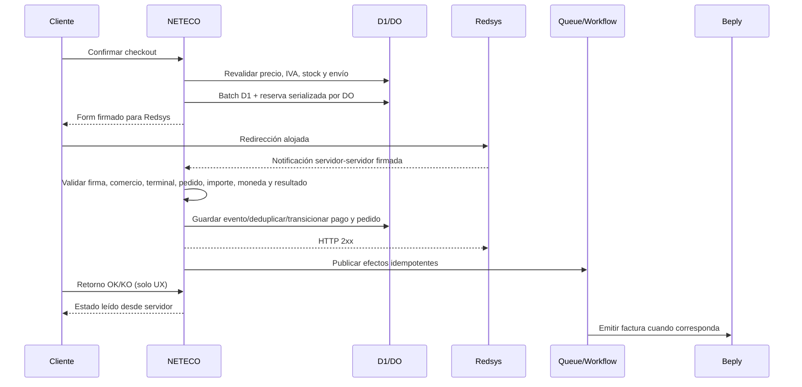
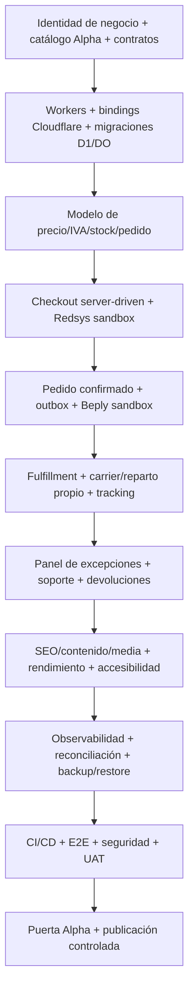

# Informe maestro de auditoría y hoja de ruta de producción — NETECO Shop

## Decisión de alcance vinculante — 2026-09-08

NETECO es una tienda de un único vendedor para particulares y empresas, con un único almacén. Quedan **descartados** multi-almacén y transferencias entre almacenes, marketplace de vendedores externos, comunidad social/profesional, multisede de clientes, jerarquías de compradores/aprobadores, administración empresarial delegada y presupuestos/aprobaciones por departamento. Se mantienen newsletter avanzada, soporte completo de alta calidad, condiciones comerciales por cliente/empresa, direcciones de entrega/facturación, recogida y picking del único almacén. La calidad UI/UX, seguridad y arquitectura 100 % Cloudflare no se rebajan.

Esta decisión prevalece sobre cualquier requisito, checklist o fase histórica posterior que contradiga este alcance. [Registro de descartadas y requisitos adaptados](docs/production/alcance-vigente.md). La matriz conserva 702 IDs históricos, pero excluye los 7 `DISCARDED` del denominador activo: 695 requisitos. Los 11 requisitos mixtos se adaptan, no se eliminan ni se marcan completados. No continuar el desarrollo de sedes o jerarquías empresariales; conservar los datos fiscales y contacto normales de una empresa.

## Flujo de desarrollo vinculante — 2026-10-04

**Mismo resultado, menos ciclos.** Los 695 requisitos activos se conservan como criterios de aceptación y trazabilidad; dejan de ser 695 unidades de ejecución. La unidad de trabajo es una **funcionalidad completa**, agrupada en módulos con dependencias explícitas. Esta decisión sustituye el orden de microtareas histórico, no las prioridades, fases, garantías ni puertas de lanzamiento.

La [ruta funcional](docs/production/ruta-desarrollo-funcional.md) es la entrada de trabajo. Su manifiesto ejecutable está en `shared/functional-delivery-plan.ts`: asigna cada ID activo a un único módulo, mantiene las descartadas aparte y detecta omisiones, duplicados y dependencias circulares. La matriz `requirements-traceability.csv` sigue siendo la fuente de evidencia por requisito; agrupar no promociona estados ni equivale a terminar funcionalidades.

El ciclo obligatorio de cada lote es:

1. **Preparar todas las pruebas del lote antes del código:** convertir su aceptación completa en casos positivos, negativos, autorización, concurrencia, recuperación, contrato y UX según riesgo. Escribir primero las nuevas pruebas ejecutables; reutilizar las existentes sin reescribirlas. Comprobar que el fallo inicial es por comportamiento ausente, no por un fixture roto. No crear tests vacíos, `skip`, ni un test por ID que sólo compruebe la existencia de un archivo.
2. **Desarrollar el lote completo:** tres frentes independientes como máximo y un principal para contratos, integración y revisión. Cada agente conserva la propiedad de sus archivos hasta entregar; los cambios en archivos comunes y las decisiones de dinero, stock, fiscalidad o permisos los integra el principal. Durante esta fase se ejecutan pruebas específicas, no el gate global por campo, archivo o requisito.
3. **Probar e integrar una vez el lote congelado:** ejecutar las suites afectadas y su integración real; después un único gate local conjunto de formato, lint, tipos, unitarias, componentes y bundle/auditoría Cloudflare. Si falla, corregir y repetir primero la suite fallida; un resultado conjunto sólo acredita el mismo código validado, nunca una revisión posterior sin comprobar.
4. **Entregar evidencia por funcionalidad:** comportamiento terminado, aceptación pendiente, riesgos, pruebas y dependencias externas. Actualizar la trazabilidad de todos sus IDs juntos y únicamente con evidencia suficiente. No hacer commits por requisito ni desplegar, llamar a proveedores o probar producción sin autorización expresa.

Se prepara desde el principio la matriz de pruebas de **todos** los módulos; las pruebas ejecutables nuevas se escriben antes de desarrollar el lote correspondiente. No se simula que pruebas de futuras integraciones, datos reales o proveedores ya existen o pasan. Una suite verde local no certifica Beply, Redsys, entregabilidad, transportistas, catálogo real ni aceptación humana.

**Modelo de los subagentes vigente:** por petición expresa del usuario, GPT-6.1 Sol con razonamiento `medium`, hasta tres frentes independientes. El principal conserva integración y revisión crítica; el cambio de modelo no relaja pruebas, permisos, contratos ni criterios de aceptación. La goal de desarrollo continúa por funcionalidades completas, sin requerir un «sigue» por cada requisito.

La selección prioriza dependencias y P0/P1 abiertos, no el incremento fácil del porcentaje. Newsletter avanzada, soporte/CRM, paneles, accesibilidad y calidad siguen dentro. No se recuperan funcionalidades descartadas. Los agentes implementan frentes independientes en paralelo; los builds, generadores Nuxt y suites comparten un turno CPU pesado serializado, con un worker en las validaciones dirigidas actuales. Cualquier aumento respeta el gate y la política de recursos del host, que prevalecen sobre límites históricos. No se relajan límites reales de D1 ni controles de seguridad para acelerar.

**Checkpoint de fuentes — 2026-10-09:** calendario operativo/ETA y escalados internos de soporte añaden las migraciones incrementales 0078/0079, sin inventar festivos, aprobación empresarial, runbooks ni garantías de transportista. El harness UI-013 ya tiene fixtures y mounts reales; pasa de hueco de repositorio a implementación parcial `NOT_VERIFIED`, no a terminado. [Evidencia y límites de esta tanda](docs/cloudflare/README.md#shipping-calendars-internal-escalations-and-ui-state-harness-source-integration-2026-10-09). Los 695 requisitos activos y todas las puertas de producción se conservan; no se infiere aceptación visual, CI, proveedor ni despliegue.

**Siguiente tanda de fuentes — 2026-10-09:** promociones contextuales reutilizan el CMS y su publicación/calendario/preview; el historial de comunicaciones añade recuperación segura de preparación, no reenvíos ciegos (`0080`); la medición promocional es aditiva y no financiera (`0081`). Las direcciones Cloudflare normalizan NFC y rechazan controles sin reescribir históricos ni cambiar Node. [Contrato y aceptación pendiente](docs/cloudflare/README.md#contextual-cms-promotions-communication-history-and-address-normalization-source-integration-2026-10-09). MKT-004/MKT-006/COM-011/CUS-006 mantienen aceptación parcial, no un aumento artificial del porcentaje terminado.

**Checkpoint compilado local — 2026-10-09, 21:13 UTC:** las tandas anteriores ya compilan juntas en Cloudflare tras reproducir y corregir un import relativo incompatible con Nitro. Se corrigen además el falso vacío por fallo de API en búsqueda y su canonical hacia una página noindex. Tipos y banda dirigida conjunta (266 Node / 34 componentes), UI/servidor, Worker dry-run y política de bundle pasan; 81 migraciones registradas, 8.574 entradas / 990 fuentes Nitro. [Hashes y alcance exacto de la prueba](docs/cloudflare/README.md#local-compiled-checkpoint-2026-10-09-2113-utc). No acredita navegador nuevo, CI Oracle, proveedores, despliegue ni cierre de los 695 requisitos.

**Bloque ADM-004 integrado y compilado local — 2026-10-09, 21:50 UTC:** invitaciones a cuentas existentes con MFA, panel de equipo, consumo/grant/revocación de sesiones atómicos y bootstrap local explícito del primer administrador, sin credenciales ni política predeterminadas. La banda conjunta pasa 440 Node / 153 componentes, tipos y checks afectados; D1/workerd desechable pasa 1/1 sobre 83 migraciones. UI/servidor, Worker dry-run y política del bundle pasan (8.672 entradas / 997 fuentes Nitro). Esto no equivale a navegador compilado, aprovisionamiento real, CI ni despliegue. [Hashes, contrato, recuperación y límites](docs/cloudflare/README.md#administrative-invitations-and-first-admin-bootstrap-2026-10-09). La aceptación de ADM-004 permanece `NOT_VERIFIED`; no aumenta el porcentaje de lanzamiento ni reduce el alcance.

**ADM-005 integrado y compilado local — 2026-10-09, aproximadamente 22:34 UTC:** auditoría central de 38 familias administrativas sobre sus ledgers inmutables, revisión append-only con CAS y exportación minimizada de hasta 1000 filas / 2.000.000 bytes, SHA-256 y acceso de descarga durante 24 horas (sin afirmar borrado físico). Se excluyen autoservicio de cliente, automatismos de proveedor, logs y cancelaciones históricas sin audiencia administrativa probada; IP/sesión históricas ausentes quedan desconocidas. Los nuevos contextos de cancelación registran audiencia/sesión reales y HMAC de IP, no IP cruda ni roles inferidos. Lectura, commit y recuperación exigen autoridad vigente, correo verificado, MFA y `administration.manage`. Evidencia focal: 15 núcleo (incluidas tres reproducciones de integridad corregidas), nueve HTTP, un caso D1/workerd nativo sobre 84 migraciones y 22 componentes. La banda conjunta pasa **396 Node / 17 archivos y 86 componentes / cinco archivos**, incluidos límites de exportación, siete upgrades completos hasta 0084 y regresiones de navegación/contexto/paleta; tipos Worker/auditor/Nuxt, formato/lint afectados, trazabilidad de sólo lectura y diff pasan. Cloudflare UI/Nitro, Worker dry-run y política del bundle pasan: **8.761 entradas / 1.004 fuentes Nitro**, Worker de 10.479.850 bytes `768024d5…` y metafile de 756.880 bytes `88588ed4…`. La prueba nativa acredita canary-source, no el artefacto compilado; no se atribuyen ejecución del Worker compilado, Chromium, CI Oracle, proveedores ni despliegue. Los hashes de ADM-004 conservan sólo su evidencia histórica. [Hashes completos, contrato y límites](docs/cloudflare/README.md#central-sensitive-administrative-audit--source-checkpoint-2026-10-09). `ADM-005` sigue `NOT_VERIFIED`, con 695 requisitos activos / siete descartados intactos.

**Fecha de corte de la auditoría base:** 11 de agosto de 2026<br>
**Revisión de arquitectura y backlog:** 20 de agosto de 2026<br>
**Activos revisados:** `https://neteco.es/` y `neteco-shop-main.zip`  
**Repositorio extraído:** aplicación Nuxt 4 con frontend, API Nitro, panel, SQLite, catálogo semilla y activos locales  
**Objetivo:** convertir la base actual en una plataforma ecommerce B2B/B2C de suministros profesionales para hostelería, comercio, industria y colectividades; rápida, segura, operable, medible y capaz de competir por servicio, reposición y fiabilidad, no solo por precio.

> **Veredicto:** el ZIP es una base de producto válida para evolucionar, pero hoy debe considerarse **demo técnica**. No está preparado para aceptar ventas reales. Alpha deberá cerrar todos los P0/P1 de pagos, stock, fiscalidad/Beply, logística, seguridad, legal, catálogo, SEO, rendimiento, operación y calidad antes de abrir al público.

> **Decisión incorporada:** la facturación fiscal se delegará en **Beply**. NETECO conservará la fuente de verdad de carrito, pedido, pago, fulfillment y experiencia de cliente; Beply será la fuente de verdad del documento fiscal emitido, su numeración, estado tributario, PDF y rectificativas, salvo que en el futuro se decida explícitamente ampliar su papel como ERP/stock.

> **Decisión de plataforma incorporada:** toda la infraestructura propia de NETECO se ejecutará en **Cloudflare**: Nuxt/Nitro sobre Workers, Static Assets/CDN, D1, Durable Objects, KV, R2, Queues, Workflows, Email Service, DNS, TLS, WAF, Turnstile, secretos y observabilidad. No se desplegarán servidores, contenedores, PostgreSQL, Redis, S3 ni colas de otro proveedor. Redsys, Beply, transportistas y los canales externos de marketing/SMS/WhatsApp siguen siendo integraciones empresariales; no forman parte de la infraestructura operada por NETECO.

---

**Vistas privadas y zoom gobernado — checkpoint local del 9 de octubre de 2026:** `0085` permite hasta 20 vistas activas privadas por administrador con filtros/orden y hasta siete columnas más ID obligatorio; aplicar realiza una consulta explícita de 25 pedidos actuales, no una operación masiva. CAS, archivo lógico y recibos inmutables actor-bound se confirman con detalle/lista frescos y recuperación GET explícita, sin rePOST automático ni resucitar una vista archivada. El zoom gobernado incorpora teclado/foco, movimiento reducido, alta resolución sólo abierto y cierre por cambio de variante/fuente, sin acreditar aprobación de medios reales. La banda conjunta pasa **357 Node / 12 archivos**, dos nativos canary-source/workerd D1 sobre **85 migraciones** y siete upgrades; las bandas de componentes pasan **245 / seis archivos** (124/121). Tipos Worker/auditor/Nuxt, formato/lint afectados, trazabilidad de sólo lectura y diff pasan. La compilación conjunta pasa a las **23:13 UTC**: **8.913 entradas / 1.009 fuentes Nitro**, shop `d49d4c18…`, metafile `f29dc838…`, sin acreditar ejecución del Worker compilado, Chromium, CI ni despliegue. `UI-005`, `PDP-004` y `MED-010` siguen `NOT_VERIFIED`, pendientes de aceptación completa de bulk/cursor, navegador/accesibilidad, medios aprobados y despliegue. Se preservan los históricos y 695 requisitos activos / siete descartados. [Hashes completos, contrato y límites](docs/cloudflare/README.md#private-order-views-and-governed-product-zoom--local-checkpoint-2026-10-09).

## Índice ejecutivo

**Cursor y lotes de pedidos — checkpoint local del 9 de octubre de 2026, 23:56 UTC:** `0086` integra cursores keyset cifrados ligados a la sesión y consulta, selección explícita de hasta 25 pedidos confirmados, preview de versiones/elegibilidad y grupos duraderos recuperables. La cola aplica un comando canónico por invocación; CAS, MFA dentro del commit, recibos inmutables y GET explícito preservan resultados honestos sin duplicar efectos de inventario o económicos. Las páginas vacías por cambios vivos conservan una vuelta. Pasan **357 Node únicos / 11 archivos**, incluido canary-source/workerd sobre **86 migraciones** con entregas simultáneas, siete upgrades y presupuesto de queries para 25 elegibles, más **77 componentes / dos archivos** y tipos/checks afectados. Compilación conjunta Cloudflare UI/Nitro, Worker dry-run y política del bundle pasan: **8.998 entradas / 1.015 fuentes Nitro**, shop `d9fb0ffe…`, metafile `50346607…`. No acredita ejecución del artefacto compilado, navegador, escala operativa, CI ni despliegue; `UI-005` sigue `NOT_VERIFIED` y el alcance conserva 695 activos / siete descartados. [Contrato, hashes completos y próxima aceptación integral](docs/cloudflare/README.md#cursor-order-queue-and-recoverable-bulk-preparation--local-checkpoint-2026-10-09).

1. Cómo leer el informe y alcance de la auditoría  
2. Resumen ejecutivo y bloqueadores  
3. Auditoría verificable del ZIP  
4. Auditoría de la landing pública  
5. Benchmark de competidores  
6. Capacidades de Shopify que conviene adoptar  
7. Posicionamiento, usuarios y journeys objetivo  
8. Arquitectura técnica y modelo operativo objetivo  
9. Especificación detallada por dominio  
10. Hoja de ruta: MVP, Alpha, Beta y fases de producción  
11. Puertas de calidad y checklist de salida Alpha  
12. Métricas, SLO y cuadro de mando  
13. Decisiones de negocio pendientes  
14. Registro de fuentes

# 1. Cómo leer este informe

## 1.1 Prioridades

| Prioridad | Definición | Regla |
| --- | --- | --- |
| P0 | Bloquea venta real o introduce riesgo crítico de seguridad, dinero, datos, stock, cumplimiento o continuidad. | No puede existir abierto al publicar Alpha. |
| P1 | Obligatorio para que Alpha sea profesional, operable y mantenible. | No puede quedar abierto al finalizar Alpha, salvo excepción formal firmada. |
| P2 | Mejora fuerte de conversión, retención, productividad o diferenciación. | Normalmente Beta/Fase 1–3. |
| P3 | Escala, automatización avanzada o expansión. | Solo cuando datos, capacidad y retorno lo justifiquen. |

## 1.2 Significado de las fases

| Fase | Naturaleza | Qué debe significar realmente |
| --- | --- | --- |
| MVP interno | Fundación no pública | Arquitectura, datos, entornos, integraciones sandbox y flujo completo demostrable. No procesa ventas reales. |
| Alpha | Candidato completo de producción | Incluye todo lo necesario y obvio para vender, cobrar, preparar, entregar, facturar con Beply, devolver, soportar, medir y recuperar fallos. |
| Beta | Producción controlada | Clientes/zonas seleccionados, feature flags, observación, endurecimiento y corrección de fricción; no se usa para esconder carencias esenciales. |
| Fase 1 | Conversión y retención | Promociones, automatización, recurrencia, reseñas y merchandising. |
| Fase 2 | SEO, contenido y comunidad | Motor editorial, autoridad técnica, newsletter de valor y comunidad profesional. |
| Fase 3 | B2B avanzado | Empresas, sedes, tarifas, presupuestos, aprobaciones, crédito y pedido rápido. |
| Fase 4 | Operaciones y logística avanzada | Compras, proveedores, multi-almacén, rutas, ERP/WMS y costes reales. |
| Fase 5 | Inteligencia y experimentación | Recomendación, búsqueda semántica, predicción y automatización con guardrails. |
| Fase 6 | Omnicanal/internacional | Marketplaces, comerciales/POS, idiomas, mercados y monedas. |

## 1.3 Tipos de afirmación

- **Verificado en código:** hallazgo reproducible dentro del ZIP y acompañado de ruta o evidencia.
- **Verificado en web:** observado en la landing, documentación oficial o competidores en la fecha de corte.
- **Recomendación:** diseño propuesto para cumplir el objetivo; debe validarse con negocio, proveedores y especialistas.
- **Por confirmar:** dependencia externa, condición comercial o alcance legal que requiere respuesta contractual o asesoría.

## 1.4 Limitaciones

1. No se han recibido credenciales de Redsys, Beply, correo, DNS/CDN, analítica, hosting, transportistas, ERP ni entorno productivo.
2. La carpeta `.data` está ignorada y la base SQLite real no viaja en el ZIP; no se ha podido certificar el catálogo operativo, clientes o pedidos fuera del seed.
3. El ZIP no incluye historial Git, decisiones arquitectónicas ni documentación funcional; el `README.md` no describe instalación, variables, tests o despliegue.
4. Se ha realizado auditoría estática. La aplicación no pudo certificarse mediante build limpio porque el lock resuelve una versión de Nuxt cuyo requisito de Node es superior al runtime disponible en el entorno de auditoría, y además la descarga de paquetes sufrió un fallo DNS. Esto no demuestra que el código no compile en un entorno correcto; sí demuestra que la toolchain no está fijada ni documentada.
5. La evaluación legal es una lista de requisitos técnicos, no asesoramiento jurídico. Debe revisarse con asesoría fiscal, consumo, privacidad, accesibilidad y seguridad química antes de lanzar.
6. Las tarifas, servicios y promesas de competidores/transportistas pueden cambiar; las decisiones de carrier deben tomarse con oferta comercial, cobertura, mercancía y SLA reales.

# 2. Resumen ejecutivo

## 2.1 Estado de madurez

| Área | Estado actual | Madurez | Consecuencia |
| --- | --- | --- | --- |
| Propuesta de valor | Más de 25 años, servicio humano, stock y logística propia local. | Buena base | Conservar y demostrar con datos, fotos y promesas operativas reales. |
| Storefront | Inicio, catálogo, categoría, producto, búsqueda, carrito, cuenta y checkout. | Prototipo funcional | Aprovechable, pero incompleto para operar. |
| Checkout/pago | Recoge tarjeta/Bizum y simula aprobación local. | Crítico | No publicar; sustituir por Redsys alojado. |
| Inventario | Existe campo `stock`, pero no reserva, descuenta ni reconcilia. | Crítico | Riesgo de sobreventa. |
| Precios/impuestos | IVA fijo al 21 % y portes codificados. | Crítico | Totales/facturas incorrectos en múltiples casos. |
| Facturación | No existe; se integrará Beply. | Ausente | Diseñar outbox, idempotencia, PDF, rectificativas y conciliación. |
| Logística | Métodos y coste fijo sin carrier, etiqueta ni tracking. | Muy incompleto | No se puede cumplir una promesa de entrega fiable. |
| Catálogo/PIM | Seed pequeño, scraper de proveedor y muchos activos sin gobierno. | Parcial | Riesgo de datos, derechos, duplicados y despliegue no reproducible. |
| Panel | CRUD de productos/categorías/pedidos y estadísticas básicas. | Inicial | No sirve aún para marketing, operación, soporte o publicación segura. |
| SEO | Metatítulos/descripciones; sin canonical, sitemap ni JSON-LD. | Muy incompleto | No hay base técnica competitiva. |
| Rendimiento | SSR Nuxt como base, sin medición, CDN, RUM ni imágenes modernas. | Sin certificar | La velocidad no está garantizada. |
| Seguridad | Admin predecible y controles de identidad mínimos. | Crítico | Bloquea producción. |
| Testing/CI/CD | Playwright instalado, sin configuración, tests ni pipeline. | Ausente | Cada cambio puede romper venta o despliegue. |
| Observabilidad/DR | Sin errores, métricas, trazas, alertas ni restore probado. | Ausente | Fallos silenciosos y recuperación incierta. |
| Marketing/comunidad | Sin blog, newsletter, reviews, automatización ni promociones. | Ausente | No retiene ni crea demanda propia. |

## 2.2 Bloqueadores de Alpha

1. Eliminar el administrador automático y cualquier contraseña por defecto.
2. Eliminar PAN, caducidad y CVC de NETECO; implementar Redsys Redirect con notificación firmada servidor-servidor.
3. Implementar ledger de intentos/eventos de pago, idempotencia, reembolso total/parcial y conciliación.
4. Sustituir SQLite embebido por Cloudflare D1, migraciones versionadas y coordinación crítica mediante Durable Objects.
5. Implementar disponibilidad vendible, reservas, decremento, liberación, ajustes e historial de stock.
6. Crear motor de precios, IVA, unidad, descuentos y portes con snapshots inmutables por pedido.
7. Integrar Beply de forma asíncrona y recuperable; una caída de Beply nunca debe deshacer un pedido ya cobrado.
8. Integrar logística real: reparto propio, recogida, paquetería y palé/ADR cuando proceda.
9. Completar identidad, RBAC, MFA, rate limiting, privacidad, cookies, legal y accesibilidad.
10. Completar catálogo Alpha, derechos de imagen/documentos, contenido y documentación química.
11. Implementar SEO técnico completo, Merchant Center cuando corresponda y estrategia de facetas.
12. Definir presupuestos de rendimiento, CDN/caché, imágenes responsivas y medición RUM.
13. Crear testing multinivel, cobertura, seguridad y CI/CD con despliegues protegidos.
14. Añadir observabilidad, alertas de negocio, backups externos, restauración y rollback.
15. Crear operación de soporte: correos transaccionales, timeline, incidencias, devoluciones y runbooks.

## 2.3 Posicionamiento recomendado

> **NETECO debe convertirse en el sistema de reposición profesional más fiable para negocios de la zona, con asesoramiento real, stock y entrega creíbles, y compra recurrente casi instantánea; ampliado a nivel nacional mediante logística controlada.**

La ventaja no es “tener más referencias que Amazon”. Es resolver mejor la compra profesional repetitiva:

- encontrar por nombre, SKU, EAN, marca, uso o problema;
- conocer unidad, caja, precio por unidad, IVA, MOQ, stock y ETA antes de pagar;
- repetir pedidos, guardar listas y cargar referencias rápidamente;
- obtener documentación técnica y de seguridad correcta;
- pedir presupuesto y convertirlo en pedido/enlace de pago;
- recibir por reparto propio en zona o carrier con tracking nacional;
- resolver una incidencia sin perder contexto;
- operar todo desde un panel con permisos, vista previa, auditoría y automatización.

## 2.4 Qué significa “vender como Amazon” en un proyecto realista

1. **Encontrabilidad:** cualquier referencia o alternativa aparece en segundos.
2. **Confianza:** precio, unidad, disponibilidad, documentación y fecha son creíbles.
3. **Fricción mínima:** el checkout no obliga a crear cuenta ni repite datos innecesarios.
4. **Estado inequívoco:** nunca hay duda sobre si se ha cobrado o confirmado el pedido.
5. **Seguimiento:** cliente y soporte ven el mismo timeline.
6. **Autoservicio:** factura, repetición, devolución y direcciones se resuelven sin llamadas.
7. **Recurrencia:** listas, pedido anterior, favoritos y reposición convierten hábitos en un clic.
8. **Resiliencia:** callbacks duplicados, caídas externas y despliegues fallidos no corrompen dinero, stock ni pedidos.

# 3. Auditoría verificable del ZIP

## 3.1 Inventario técnico

| Elemento | Resultado verificado |
| --- | --- |
| Stack | Nuxt 4, Vue, Nuxt UI 4, Pinia, `nuxt-auth-utils`, Zod y `better-sqlite3`. |
| Volumen | 78 ficheros bajo `app`, `server` y `scripts`; aproximadamente 7.026 líneas. |
| Interfaz | 19 páginas, 10 componentes principales y layouts público/admin. |
| API | 23 endpoints Nitro para catálogo, búsqueda, autenticación, pedidos y administración. |
| Scripts NPM | `dev`, `build`, `preview`, `postinstall`, `db:backup`. |
| Tests | 0 ficheros de test/spec; Playwright está instalado pero no configurado. |
| CI/CD | 0 workflows; no lint, format, typecheck, cobertura ni escáneres. |
| Entorno | Sin `.env.example`, Dockerfile, IaC, `.nvmrc`/Volta ni contrato de variables. |
| Persistencia | SQLite local en `.data/neteco.db`, WAL, seed al arrancar y `ALTER TABLE` aditivos. |
| Toolchain | El lock resuelve Nuxt 4.5.2; el paquete exige Node `^22.19.0 \|\| ^24.11.0 \|\| >=26`. |

## 3.2 Funcionalidad existente que conviene conservar

- SSR de Nuxt como base de indexabilidad y rapidez.
- Catálogo, categorías jerárquicas, producto, variantes, facetas y búsqueda predictiva inicial.
- Carrito y checkout con validación de payload mediante Zod.
- Reconsulta de precios en servidor en vez de confiar en el navegador.
- Representación monetaria en céntimos enteros.
- Snapshot básico de nombre, formato, SKU y precio en líneas de pedido.
- Estados activo/inactivo y conservación del histórico.
- Cuenta, login/registro y consulta de pedidos.
- Panel inicial con CRUD y dashboard.
- Base visual responsive clara sobre Nuxt UI.
- Colección de fotos y fichas técnicas que puede alimentar un PIM tras revisar derechos, correspondencia y vigencia.

## 3.3 Hallazgos críticos con evidencia

| ID | Evidencia | Riesgo | Corrección Alpha |
| --- | --- | --- | --- |
| SEC-P0-001 | `server/plugins/admin-user.ts:1-18`: crea/promociona `admin@neteco.es`; fallback `neteco-admin`. | Toma de control y escalada automática de rol. | Eliminar bootstrap normal; comando/invitación one-shot, secreto obligatorio, MFA y auditoría. |
| PAY-P0-001 | `server/api/checkout/pay.post.ts:3-9` recibe número, caducidad, CVC y teléfono Bizum. | Amplía alcance PCI y expone datos sensibles. | Eliminar campos y usar Redsys alojado. NETECO no recibe PAN/CVC. |
| PAY-P0-002 | `pay.post.ts:40-44` marca `pagado` tras validación local simulada. | Pedido pagado sin confirmación bancaria. | Solo callback firmado/validado cambia estado; retorno navegador es UX. |
| INV-P0-001 | `variants.stock` existe, pero no se encontró `UPDATE variants SET stock` ni reserva. | Sobreventa y divergencia. | Reservas transaccionales, ledger y reconciliación. |
| TAX-P0-001 | `orders/index.post.ts:43`: `total - round(total / 1.21)`. | IVA fijo y cálculo agregado incorrecto para múltiples clases/portes. | Motor por línea y snapshot fiscal inmutable. |
| SHIP-P0-001 | `orders/index.post.ts:41`: 5,90 € bajo 150 € para `envio`. | Regla rígida sin peso, zona, bulto, palé o carrier. | Motor de tarifas administrable y adaptadores de transporte. |
| DB-P0-001 | `server/utils/db.ts:7-15`: crea/migra/siembra SQLite al primer acceso. | Producción no reproducible y migraciones acopladas al arranque. | D1 por entorno y migraciones explícitas, verificadas y promovidas por pipeline. |
| DB-P1-002 | `server/utils/db.ts:108-125`: `ALTER TABLE` aditivos sin versión. | No hay orden, rollback ni trazabilidad de schema. | Herramienta de migraciones con tabla de versión y estrategia forward-fix. |
| CAT-P0-001 | `.data` está ignorada; el seed solo reconstruye un catálogo pequeño. | Un despliegue limpio no reproduce la tienda preparada. | Fuente maestra versionada/importable y release de datos. |
| MED-P0-001 | `public/img/products/CREDITS.md` exige sustituir fotos demo y señala marca de tercero. | Derechos/marca y producto incorrecto. | Quitar activos demo; media oficial o propia con licencia registrada. |
| BKP-P1-001 | `scripts/backup.mjs` crea una copia local bajo `.data/backups`. | Mismo fallo puede destruir original y copia. | D1 Time Travel, exportaciones periódicas a R2 con retención y restore probado. |
| ORD-P1-001 | Pedido con un `status` textual sin ledgers separados. | Transiciones ambiguas, difícil auditoría y reintento. | Máquinas de estado y timeline de eventos. |
| AUTH-P1-001 | No se encontraron reset, verificación, MFA, rate limit o sesiones gestionables. | Secuestro de cuenta, abuso y soporte manual. | Identidad completa y controles de abuso. |
| SEO-P1-001 | 19 `useSeoMeta`; 0 canonical; 0 JSON-LD; sin sitemap. | Duplicidad, baja elegibilidad rich results y rastreo incompleto. | Capa SEO centralizada y automatizada. |
| QA-P0-001 | 0 tests/config/pipeline. | Regresiones silenciosas en dinero, stock y deploy. | Arquitectura de testing y CI/CD obligatoria. |

## 3.4 Modelo de datos actual: huecos principales

El esquema actual solo cubre una fracción del dominio. Faltan, como mínimo:

- direcciones reutilizables, empresa/sede y contactos;
- precio base, tarifa, reglas de cantidad, histórico de precio y descuentos;
- clases de IVA y snapshots de impuestos/descuentos por línea;
- dimensiones, peso, embalaje, unidades por caja/palé y perfil de envío;
- códigos EAN/GTIN/MPN, fabricante, atributos tipados y relaciones entre productos;
- lotes/caducidad cuando aplique;
- ubicaciones, movimientos, reservas, disponibilidad y compras;
- intentos/eventos/reembolsos/conciliaciones de pago;
- shipments, paquetes, etiquetas, tracking y eventos de carrier;
- devoluciones, RMA, inspección y disposición;
- facturas Beply, rectificativas, PDF, estado fiscal e incidencias;
- promociones, cupones, usos y redenciones;
- contenido/CMS, versiones, publicación y redirects;
- consentimientos, preferencias, segmentos, campañas y eventos analíticos;
- roles, permisos, auditoría, sesiones y tokens de integración;
- outbox/inbox, jobs, reintentos y dead-letter queue.

## 3.5 Catálogo y activos encontrados

| Activo/dato | Cantidad/hallazgo | Acción |
| --- | --- | --- |
| Categorías en seed | Aproximadamente 46. | Revisar jerarquía, intención, atributos y slugs. |
| Productos en seed | Aproximadamente 20. | No representa un catálogo productivo completo. |
| Informe de sync | 175 aplicados; 34 sin match; 0 errores; 708 candidatos extra. | Revisión humana y fuente de verdad antes de publicar. |
| JPG | 217; los revisados son 800×800 RGB. | Originales de mayor calidad y derivados responsive. |
| PNG | 3. | Optimizar logo/favicon y eliminar duplicados. |
| PDF | 173. | Clasificar, versionar, escanear y vincular al SKU correcto. |
| WebP/AVIF | 0. | Generar automáticamente en CDN/pipeline. |
| Duplicados | Logo/favicon y al menos una foto repetida por hash. | Deduplicación y asset ID estable. |

## 3.6 Riesgos del sincronizador de proveedor

`scripts/eurosanex-sync.mjs` rastrea HTML, descarga imágenes/PDF y escribe datos. No debe convertirse en una dependencia silenciosa de producción.

- Obtener autorización contractual para textos, fotos, marcas y documentos.
- Preferir API, feed o CSV oficial y versionado.
- Registrar procedencia, fecha, versión, licencia y hash por campo/asset.
- Ejecutar en staging con cuarentena, diff y aprobación humana.
- No publicar coincidencias por nombre sin umbral/confianza y revisión.
- Evitar contenido duplicado: reescribir categorías y descripciones con valor propio.
- Validar que ficha técnica/SDS corresponde exactamente a variante, fórmula y versión.
- Detectar altas, cambios, descatalogados, renombres y documentos retirados.
- Mantener un log de importación, métricas y rollback de lote.
- Prohibir que un fallo parcial deje el catálogo inconsistente.

## 3.7 Reproducibilidad y documentación ausente

- Versiones de Node y package manager fijadas.
- Build Nuxt/Worker reproducible con preset Cloudflare y Wrangler fijado.
- `.env.example` y validación fail-fast de variables.
- Migraciones numeradas y seed/demo deterministas.
- ADR de arquitectura e integraciones.
- Manual de instalación, desarrollo, pruebas, despliegue y rollback.
- Matriz de permisos y catálogo de secretos.
- Inventario de dependencias/licencias y SBOM.
- Runbooks de incidentes, restore y conciliación.

# 4. Auditoría de la landing pública `neteco.es`

## 4.1 Fortalezas a conservar

La landing comunica atención a empresas/profesionales, ubicación en Ontinyent, más de 25 años, logística propia, trato humano, stock y especialización por sectores. Es una propuesta más defendible que “somos baratos”.

## 4.2 Carencias

- Es una landing de captación, no una tienda: no hay catálogo, búsqueda, cuenta, checkout, pedido ni seguimiento.
- Las imágenes principales provienen de Unsplash y no prueban equipo, almacén, flota o trabajo real.
- Las afirmaciones de stock/logística no están conectadas a cobertura, hora de corte o ETA verificables.
- No hay arquitectura SEO de productos, categorías, sectores, problemas y ubicaciones.
- No hay social proof verificable, marcas/certificaciones estructuradas, casos o métricas.
- El consentimiento de cookies debe sustituirse por una CMP verificable con aceptar/rechazar/configurar al mismo nivel.
- Faltan condiciones de contratación, privacidad ecommerce, devolución, accesibilidad y preferencias de cookies integradas en la experiencia.

## 4.3 Inventario fotográfico obligatorio

| Grupo | Tomas necesarias | Uso |
| --- | --- | --- |
| Marca | Logo vectorial, paleta, tipografía, iconografía, manual de marca. | Consistencia y assets sociales. |
| Equipo | Retrato de equipo, administración, almacén y reparto; fotos horizontales/verticales. | Home, “nosotros”, confianza y local SEO. |
| Instalaciones | Exterior identificable, almacén, racks, preparación y control de calidad. | Prueba de operación real. |
| Flota/logística | Vehículos rotulados, carga segura, reparto y entrega. | Explicar área y servicio propio. |
| Sectores | Cocina, barra, baño, comercio, industria, colegio/residencia con permisos. | Landings sectoriales. |
| Producto | Frontal, trasera/etiqueta, escala, detalle, variante y uso. | PDP, feeds y soporte. |
| Clientes/casos | Negocios reales, testimonio y resultado con consentimiento. | Casos y social proof. |
| Vídeo | Tour corto, demostraciones, dosificación, montaje/uso y reparto. | PDP, blog, redes y soporte. |

## 4.4 Home Alpha recomendada

1. Barra de servicio con teléfono/soporte, cobertura y mensaje operativo real.
2. Buscador dominante por referencia, EAN, marca, uso o necesidad.
3. Propuesta de valor y CTA: “Ver catálogo”, “Repetir pedido”, “Solicitar presupuesto”.
4. Categorías/sectores prioritarios definidos por demanda y margen.
5. Reparto local/envío nacional con condiciones y ETA transparentes.
6. Disponibles hoy, habituales y más vendidos; no carruseles aleatorios.
7. Bloque “Compra de nuevo” para usuarios autenticados.
8. Equipo/almacén/flota reales y marcas/certificaciones verificables.
9. Guías o herramientas útiles: dosificación, consumo, equivalencias, checklist.
10. Footer completo de ayuda, contacto, legal, accesibilidad y preferencias.

# 5. Benchmark de competidores

## 5.1 Referentes directos y patrones observados

El benchmark se contrastó sobre los escaparates públicos de los referentes enumerados; precios, surtido, condiciones y capacidades pueden variar por fecha, zona o tipo de cuenta. [S64–S70]

| Competidor | Patrones útiles observados | Oportunidad para NETECO |
| --- | --- | --- |
| CLIM Profesional | Envío por umbral, entrega 24/48 h, múltiples métodos de pago, descuentos y orientación profesional. | Superar con ETA calculada, documentación y recompra B2B. |
| CompraLimpieza | Envío gratis desde umbral, devolución anunciada, descuentos por cantidad, ecológicos, newsletter y contenido largo de categoría. | Mejorar calidad editorial, filtros técnicos y reglas de margen. |
| Monouso | Precio unitario, descuentos por volumen, disponibilidad/ETA, reviews, preguntas, relacionados, outlet y newsletter. | Aplicar unidad/caja/MOQ impecables y bundles por caso de uso. |
| García de Pou | Taxonomía profunda, miles de referencias, pedido mínimo/múltiplos, personalización y sostenibilidad. | Competir en selección, servicio y compra recurrente; añadir presupuestos de personalización. |
| Makro | Cuenta profesional, amplitud, listas/pedidos, descuentos por volumen y marketplace. | Evitar guerra de amplitud; ganar en especialización y atención contextual. |
| Eurosanex | Variantes, mínimos, usos, fichas técnicas y datos regulatorios. | Ofrecer una ficha aún más clara, comparable y orientada a solución. |
| Hostelería10 | Catálogo amplio, confianza, variedad de pago y financiación en compras de equipamiento. | Mantener arquitectura de proveedor de pago extensible y presupuesto asistido. |

## 5.2 Matriz objetivo competitiva

| Capacidad | Nivel de mercado | Objetivo NETECO |
| --- | --- | --- |
| Catálogo | Gran amplitud en generalistas. | Catálogo seleccionado y profundo; “bajo pedido” separado de stock real. |
| Stock/ETA | Mensajes genéricos o fechas estimadas. | Disponibilidad por ubicación, cutoff, ruta y carrier con confianza. |
| Precio B2B | Alta profesional y volumen. | Tarifa/contrato/volumen por empresa sin destruir margen. |
| Unidad/MOQ | Visible en los mejores referentes. | Precio neto/bruto, unidad, caja, múltiplo y palé en todo el funnel. |
| Reposición | Generalmente básica. | Listas, repetir pedido, CSV/SKU y recordatorio por consumo. |
| Presupuesto | Presente de forma desigual. | Presupuesto digital, aprobación, conversión a pedido y PayGold. |
| Logística local | Poco defendida nacionalmente. | Rutas propias, franja/cutoff y prueba de entrega en zona. |
| Documentación | Calidad variable. | SDS/ficha/UFI/pictogramas/versiones como estándar de publicación. |
| Soporte | Teléfono/chat genérico. | Soporte con contexto de cliente, carrito, pedido y producto. |
| Contenido | Blogs y categorías SEO de calidad irregular. | Centro profesional basado en experiencia, no texto de relleno. |

## 5.3 Estrategia para no copiar los defectos del mercado

- No prometer “24/48 h” para todo; calcular por producto, stock, hora, código postal y carrier.
- No usar descuentos perpetuos ni urgencia falsa.
- No llenar categorías con texto repetitivo generado para buscadores.
- No publicar miles de referencias sin datos, imagen o disponibilidad fiables.
- No ocultar IVA, unidad, MOQ o portes hasta el último paso.
- No obligar a contactar para operaciones que el cliente puede resolver solo.
- No usar popups agresivos, fake social proof o contadores reiniciables.

# 6. Capacidades de Shopify que conviene adoptar

Shopify destaca por convertir operaciones complejas en flujos administrables. NETECO debe copiar los **principios de producto**, no sus límites ni su aspecto. La matriz se apoya en documentación oficial sobre B2B, catálogos, reglas de cantidad, editor, búsqueda, descuentos, segmentos, formularios, automatizaciones, pedidos borrador e inventario. [S12–S22]

| Patrón Shopify | Aplicación NETECO | Fase |
| --- | --- | --- |
| Productos, variantes, colecciones y metafields/metaobjects | Modelo PIM tipado y extensible para atributos, documentos, sectores y compatibilidades. | MVP/Alpha |
| Theme editor con secciones/bloques | Page builder seguro para home, landings, banners y bloques sin despliegue. | Alpha |
| Draft themes y preview | Borrador, preview firmado, aprobación, programación, versión y rollback. | Alpha |
| Search & Discovery | Filtros, sinónimos, boosts, redirects, zero-results y merchandising administrable. | Alpha/Beta |
| Descuentos de código/automáticos y combinaciones | Motor de promociones con exclusiones, calendario, límites, stack y simulador. | Fase 1 |
| Customer segments | Segmentos dinámicos por sector, valor, frecuencia, conducta y consentimiento. | Fase 1 |
| Forms/popups y automatizaciones | Form builder, modales con targeting/frequency cap y flujos de email. | Fase 1 |
| Abandoned browse/cart/checkout | Estados recuperables, timeline y automatizaciones con consentimiento. | Fase 1 |
| Companies/locations B2B | Empresa, sedes, compradores, catálogos, métodos y direcciones por ubicación. | Fase 3 |
| Quantity rules/volume pricing | Mínimo, máximo, incremento, caja, palé y escalas de precio. | Alpha/Fase 3 |
| Draft orders | Presupuesto/pedido manual con precio bloqueado, términos y enlace de pago. | Fase 3 |
| Quick order list | Pedido rápido por SKU/EAN, pegado masivo, CSV y escáner. | Fase 3 |
| Inventory locations/transfers/purchase orders | Stock por almacén, recepciones, transferencias y compras. | Fase 4 |
| Extensibilidad/webhooks | Adaptadores y eventos versionados para Redsys, Beply, carriers, email y búsqueda. | MVP/Alpha |

## 6.1 Lo que no conviene copiar literalmente

- Un ecosistema de plugins sin gobierno: cada extensión añade riesgo, coste y JavaScript.
- Un page builder capaz de romper accesibilidad o rendimiento.
- Dependencia total de una sola plataforma externa para datos críticos.
- Promociones sin simulación de margen y combinaciones.
- Apps de terceros con acceso excesivo a clientes/pedidos.
- Features B2C que ignoren la compra profesional por caja, palé, sede y orden de compra.

## 6.2 Principios Shopify traducidos a criterios de producto

1. Casi toda regla comercial debe ser configurable y auditable desde panel.
2. Todo contenido debe tener borrador, preview y publicación controlada.
3. Toda operación externa debe ser idempotente, reintentable y visible.
4. El cliente debe poder resolver la mayoría de tareas sin soporte.
5. El panel debe mostrar contexto, timeline y próxima acción, no solo tablas CRUD.
6. Las extensiones deben usar contratos/adaptadores, no tocar directamente el núcleo.

# 7. Posicionamiento, usuarios y journeys objetivo

## 7.1 Usuarios principales

| Usuario | Necesidad | Diseño prioritario |
| --- | --- | --- |
| Propietario de bar/restaurante | Reponer rápido sin equivocarse ni quedarse sin stock. | Pedido anterior, listas, ETA, unidad/caja y soporte rápido. |
| Responsable de limpieza/colectividad | Documentación, presupuesto, control por centro y recurrencia. | SDS, sedes, aprobación, listas y exportación. |
| Compras de industria/comercio | SKU, tarifa, PO, palés y trazabilidad. | Pedido rápido, precios B2B, condiciones y tracking. |
| Cliente ocasional | Encontrar y comprar sin aprender el catálogo. | Búsqueda por necesidad, comparadores y checkout invitado. |
| Comercial NETECO | Preparar presupuesto/pedido y ayudar con contexto. | Vista cliente 360, draft order y enlace de pago. |
| Almacén/reparto | Preparar/entregar sin ambigüedad. | Pick list, bultos, incidencias, escaneo y prueba de entrega. |
| Marketing/contenido | Publicar campañas sin desarrollo. | CMS, preview, promociones, segmentos y medición. |
| Soporte/administración | Resolver pagos, facturas, devoluciones y fallos. | Timeline unificado, acciones seguras y auditoría. |

## 7.2 Journeys que Alpha debe completar de extremo a extremo

1. **Compra invitada con Redsys:** buscar → filtrar → producto → carrito → envío → Redsys → confirmación → Beply → preparación → tracking → entrega.
2. **Compra con cuenta:** direcciones guardadas, consentimiento, historial y repetición.
3. **Transferencia bancaria:** pedido reservado con caducidad, instrucciones/referencia, conciliación y liberación segura.
4. **Reparto propio:** elegibilidad por código postal/ruta, fecha/franja, preparación, salida y entrega.
5. **Recogida:** stock/horario, “listo para recoger”, código de entrega y cierre.
6. **Pago rechazado/abandono:** no perder carrito, liberar reserva cuando toque y permitir reintento.
7. **Falta de stock concurrente:** un solo comprador obtiene la última unidad; el otro recibe alternativa clara.
8. **Cancelación/reembolso:** autorización, devolución Redsys, stock/disposición y rectificativa Beply.
9. **Incidencia de transporte:** timeline, comunicación, reexpedición/abono y coste registrado.
10. **Caída de Beply:** pedido pagado sigue operativo; la factura queda en cola y se reconcilia sin duplicar.

## 7.3 Principios UI/UX de venta

- Búsqueda visible y rápida en móvil/escritorio.
- Información comercial esencial antes de CTA: disponibilidad, unidad, precio, IVA, MOQ, ETA y portes.
- Botones y estados inequívocos; no usar color como única señal.
- Formularios cortos, autocompletado, validación inline y conservación de datos tras error.
- Checkout con pasos y resumen persistente; sin distracciones de marketing.
- Confianza basada en evidencia, no sellos genéricos.
- Ayuda contextual que no tape contenido ni interrumpa compra.
- Modales solo con consentimiento/valor/segmentación y límites de frecuencia.
- No usar dark patterns, casillas premarcadas, escasez falsa o costes ocultos.
- Accesibilidad y rendimiento como requisitos del diseño, no revisión final.

## 7.4 Arquitectura de navegación recomendada

- **Comprar por producto:** limpieza, papel/celulosa, higiene, desechables/packaging, menaje/equipamiento, EPIs, etc., según surtido real.
- **Comprar por sector:** hostelería, comercio, industria, colectividades.
- **Comprar por necesidad:** cocina, baños, lavandería, residuos, superficies, food delivery, seguridad.
- **Compra rápida:** SKU/EAN, listas, pedido anterior y CSV.
- **Recursos:** fichas, SDS, guías, comparadores, casos y blog.
- **Ayuda:** envío, pago, devolución, contacto, preguntas frecuentes y estado de pedido.

# 8. Arquitectura técnica y modelo operativo objetivo

## 8.1 Decisión: monolito modular sobre Cloudflare

No se recomienda empezar con microservicios. Se adopta un **monolito modular Nuxt/Nitro desplegado en Cloudflare Workers**, con capacidades auxiliares de Cloudflare separadas por responsabilidad. Wrangler detecta Nuxt, genera el preset `cloudflare`, publica el servidor y los Static Assets y expone los bindings de plataforma al runtime. No habrá servidor Node persistente ni contenedor productivo; cualquier dependencia debe ser compatible con Workers y, solo cuando sea imprescindible, con `nodejs_compat`. [S71–S72]

### Alcance de “100 % Cloudflare”

- Compute, frontend, API, datos, coordinación, cache, objetos, colas, workflows, cron, DNS, TLS, CDN, WAF, mitigación de bots, secretos, telemetría e infraestructura declarativa pertenecen a Cloudflare.
- No forman parte del diseño PostgreSQL, Redis, Docker/Kubernetes productivo, S3 externo, una VM, un worker Node o una cola de otro proveedor.
- Redsys, Beply, carriers y los canales de marketing/SMS/WhatsApp son **proveedores funcionales externos**. Solo se accede a ellos desde Workers/Workflows y nunca alojan el runtime o la persistencia maestra de NETECO. El correo transaccional usa Cloudflare Email Service si su beta, límites, entregabilidad y SLA superan UAT; una excepción requiere decisión formal y adaptador sustituible.
- Si una función no cabe en límites o garantías actuales de Cloudflare, se rediseña o se registra como bloqueo explícito; no se introduce infraestructura paralela de forma silenciosa.

### Módulos de dominio

- identidad y permisos;
- catálogo/PIM y media;
- búsqueda/merchandising;
- pricing/impuestos/promociones;
- carrito/checkout;
- pagos;
- pedidos/returns;
- inventario/compras;
- fulfillment/logística;
- facturación Beply;
- clientes/B2B;
- CMS/SEO;
- marketing/consentimiento;
- analítica/experimentos;
- integraciones/jobs/auditoría.

## 8.2 Componentes de infraestructura

| Componente | Recomendación | Motivo |
| --- | --- | --- |
| Aplicación | Nuxt/Nitro en Cloudflare Workers con preset `cloudflare`. | SSR/híbrido, API y despliegue reproducible sin servidor persistente. |
| Frontend estático | Workers Static Assets + CDN/Cache Rules. | JS/CSS/fuentes/assets versionados se publican con el Worker y se sirven desde el edge. |
| Base relacional | D1 independiente por entorno. | Fuente de verdad de catálogo, clientes, pedidos, ledgers y configuración transaccional. |
| Coordinación consistente | Durable Objects con SQLite, particionados por agregado/SKU. | Serializar reservas, idempotencia y contención por clave sin fingir locks de PostgreSQL. |
| Cache/config derivada | Workers KV y Cache API. | Lecturas globales rápidas; nunca dinero, stock, permisos o consentimientos como única verdad porque KV es eventualmente consistente. [S76] |
| Objetos y media | R2 con claves inmutables, metadatos, cuarentena y lifecycle; Cloudflare Images para derivados. | Imágenes, PDFs, exportaciones, artefactos y copias D1 dentro de Cloudflare. |
| Asíncrono | Cloudflare Queues con consumidores Worker, reintentos, DLQ e idempotencia. | Desacoplar Beply, email, carriers, feeds e imágenes con entrega al menos una vez. [S77–S78] |
| Procesos duraderos | Cloudflare Workflows. | Orquestaciones de varios pasos, esperas y compensaciones que sobreviven a reintentos/fallos. [S79] |
| Programación | Cron Triggers para disparos periódicos y Durable Object Alarms para agenda por entidad. | Evitar cron manual y repartir trabajo pesado mediante Queues/Workflows. |
| Correo transaccional | Cloudflare Email Service binding + Queues/Workflows; Email Routing/Email Workers para entrada. | Mantener envío/recepción operativa en Cloudflare, condicionado a validar la beta y sus límites antes de Alpha. [S88] |
| Borde y abuso | Cloudflare DNS/TLS/CDN, WAF, Rate Limiting y Turnstile con validación servidor. | Rendimiento, reglas gestionadas y protección de formularios/endpoints. [S84–S85] |
| Búsqueda | D1 FTS5 e índices explícitos; Vectorize solo si una fase futura demuestra necesidad semántica. | Búsqueda Cloudflare-native sin infraestructura dedicada prematura. [S86] |
| Observabilidad | Workers Logs, traces, métricas, Analytics Engine, Web Analytics/RUM y Logpush a R2 cuando aplique. | Diagnóstico técnico/negocio correlacionado y retención controlada dentro de Cloudflare. [S83] |
| Secretos | Workers Secrets/Secrets Store bindings por entorno. | Valores cifrados fuera de Git/config y contratos de secretos requeridos. [S81] |
| IaC y deploy | Wrangler para aplicación/bindings y Terraform/OpenTofu con provider Cloudflare para cuenta/zona. | Repetición, revisión y ausencia de drift por cambios manuales. [S87] |

### Regla de consistencia y transacciones

1. D1 es la base relacional maestra. Operaciones SQL que deban confirmar o revertir juntas usan prepared statements y `D1Database.batch()`, que ejecuta la secuencia como transacción. [S73]
2. La concurrencia crítica no se implementa con locks inexistentes ni con KV. Un Durable Object por SKU/agregado serializa la reserva y mantiene su ledger consistente; D1 conserva pedido, eventos y proyecciones consultables.
3. Una compra con varios SKU es una saga idempotente: reservar por SKU, crear/confirmar pedido, y compensar todas las reservas ya obtenidas si una falla. Cada paso tiene clave idempotente y estado reconciliable; no se promete una transacción distribuida inexistente.
4. Queues entrega al menos una vez y no garantiza orden global. Consumidores, webhooks y Workflows deben tolerar duplicados, desorden y reanudación. [S77]
5. KV solo contiene proyecciones regenerables. Una lectura que decide cobro, stock, autorización, factura o devolución consulta D1/Durable Objects.

## 8.3 Patrón de integración obligatorio

Toda integración externa debe implementarse detrás de una interfaz de proveedor:

- `PaymentProvider` — Redsys; Stripe solo como futuro adaptador si existe caso.
- `InvoiceProvider` — Beply.
- `CarrierProvider` — reparto propio, paquetería, palé/ADR.
- `EmailProvider` — transaccional/marketing separados.
- `SearchProvider` — D1 FTS5 y, si se aprueba después, Vectorize.
- `ObjectStorageProvider` — R2/Cloudflare Images.

Reglas comunes:

1. timeouts explícitos y circuit breaker cuando proceda;
2. idempotency key propia y deduplicación;
3. outbox en D1 y publicación en Queues/Workflows para efectos posteriores a transacción;
4. inbox de webhooks con payload firmado, hash y estado de procesado;
5. reintentos exponenciales con jitter solo en errores recuperables;
6. DLQ, replay manual y auditoría;
7. normalización de estados/códigos externos;
8. credenciales distintas por entorno y mínimo privilegio;
9. pruebas de contrato contra sandbox/mock;
10. dashboard de salud, latencia, errores y conciliación.

## 8.4 Fuentes de verdad recomendadas

| Dato | Fuente de verdad | Réplicas/uso |
| --- | --- | --- |
| Carrito | D1; Durable Object cuando necesita coordinación inmediata | El cliente conserva solo una proyección. |
| Pedido y líneas snapshot | D1 | Beply/carrier reciben copia contractual. |
| Pago e historial de eventos | D1 + evidencia Redsys | Beply recibe estado de cobro cuando corresponda. |
| Factura fiscal | Beply | NETECO guarda ID, código, estado, PDF/checksum y enlace seguro. |
| Stock ecommerce | Ledger por SKU en Durable Objects + proyección/reconciliación en D1; nunca doble maestro | Beply solo si se amplía alcance mediante decisión explícita. |
| Media original | R2 con clave inmutable/checksum | Cloudflare Images/CDN sirve derivados. |
| Consentimientos | D1/CMP/ESP sincronizados con trazabilidad | Marketing respeta suppression global; KV solo puede cachear una proyección no decisoria. |
| Tracking | Carrier normalizado en D1 | Cliente y soporte consumen el mismo timeline. |

## 8.5 Estados separados e inmutables

No usar un único campo `status` para todo. Mantener, como mínimo:

- **pedido:** draft, awaiting_payment, confirmed, on_hold, cancelled, completed;
- **pago:** initiated, pending, authorized, captured, failed, cancelled, partially_refunded, refunded, chargeback;
- **inventario:** unreserved, reserved, allocated, picked, shipped, released, returned, damaged;
- **fulfillment:** pending, picking, packed, ready_for_pickup, in_transit, delivered, exception, returned;
- **facturación:** not_requested, queued, issuing, issued, fiscal_pending, failed, rectified;
- **devolución:** requested, approved, rejected, in_transit, received, inspected, resolved.

Cada transición debe registrar actor, instante, origen, motivo, versión y correlación. Nunca borrar eventos financieros/fiscales.

## 8.6 Entornos

| Entorno | Datos | Integraciones | Acceso/objetivo |
| --- | --- | --- | --- |
| Local | Seed sintético por desarrollador. | Mocks/sandboxes. | Desarrollo rápido y offline razonable. |
| CI efímero | D1 local aislada por job con Miniflare/Wrangler. | Mocks y emuladores/bindings locales. | Tests reproducibles sin servicios personales. |
| Preview por PR | Worker version/URL de preview y D1/R2/KV sintéticos aislados. | Sin credenciales productivas. | Revisión visual/funcional de cambio. |
| Demo | Dataset rico y reiniciable. | Sandbox/mocks. | Ventas, formación y prueba desde panel. |
| Staging | Datos anonimizados o sintéticos realistas. | Redsys test, Beply test, carrier test. | Ensayo de release/migración/E2E. |
| Producción | PII real. | Credenciales y endpoints reales. | Ventas reales; acceso mínimo, auditoría y alertas. |

### Reglas de aislamiento

- Recursos y bindings distintos por entorno: D1, namespaces DO/KV, buckets R2, colas, workflows, secretos, hostnames y analítica.
- Nunca copiar PII productiva a demo/preview.
- Banners visuales y hostname inequívocos en entornos no productivos.
- Correos/SMS de pruebas interceptados o allowlist.
- Redsys/Beply/carriers productivos inaccesibles desde preview/demo.
- Reset de demo automatizado y auditable.
- Feature flags con defaults seguros por entorno.
- Configuración validada al arrancar; producción falla cerrada si falta un secreto.

## 8.7 Recuperación y despliegue Cloudflare

- D1 Time Travel está siempre activo y permite recuperación por minuto durante 30 días en plan Paid (7 días en Free). La restauración es destructiva e in-place, por lo que exige aprobación, bookmark previo y runbook. [S74]
- Un Workflow programado exporta D1 a R2 con claves inmutables, checksum, manifiesto y lifecycle para la retención superior a 30 días; un restore drill importa el dump en una D1 aislada y valida integridad/journeys antes de considerar recuperable la copia. [S74–S75]
- R2 no se tratará como si tuviera versionado S3 implícito: nuevas revisiones usan nuevas claves, el puntero activo vive en D1, lifecycle gestiona caducidad y Bucket Locks protege prefijos críticos contra overwrite/borrado durante su retención. [S80, S89]
- Cada cambio crea una versión de Worker; staging y producción usan upload/promoción, despliegue gradual y rollback de Workers. Las versiones no versionan D1/R2/KV/DO, por lo que schema y código aplican expand/contract y forward-fix. [S82]
- Las migraciones D1 jamás se ejecutan de forma destructiva al arrancar una request. Pipeline hace preflight, aplica migración numerada, ejecuta smoke y registra versión/bookmark.

# 9. Especificación detallada por dominio

Este backlog no es una lista de ideas sueltas. Cada fila define una capacidad, la fase mínima recomendada, su prioridad y un criterio verificable de terminación. **Alpha acumula MVP + Alpha**; ninguna tarea P0/P1 de esas fases puede trasladarse a Beta para “salir antes” sin una aceptación formal de riesgo.
**Total de requisitos funcionales/técnicos:** 702 en 26 dominios.

| Fase mínima | Requisitos de la fase | Acumulados al terminar |
| --- | --- | --- |
| MVP | 68 | 68 |
| Alpha | 402 | 470 |
| Beta | 57 | 527 |
| Fase 1 | 49 | 576 |
| Fase 2 | 24 | 600 |
| Fase 3 | 42 | 642 |
| Fase 4 | 31 | 673 |
| Fase 5 | 22 | 695 |
| Fase 6 | 7 | 702 |

| Prioridad | Cantidad |
| --- | --- |
| P0 | 300 |
| P1 | 185 |
| P2 | 180 |
| P3 | 37 |

## 9.1 Catálogo y PIM

La ficha comercial, técnica, regulatoria y logística debe tener fuente, tipo, estado y versión; publicar catálogo incompleto solo multiplica incidencias.

| ID | Fase | Prio. | Funcionalidad / trabajo | Criterio de aceptación |
| --- | --- | --- | --- | --- |
| CAT-001 | MVP | P0 | Definir fuente maestra del catálogo y propiedad por campo. | Matriz aprobada: NETECO/proveedor/Beply/ERP; no existen dos maestros para el mismo dato. |
| CAT-002 | MVP | P0 | Migrar catálogo desde SQLite/seed a D1 mediante import reproducible. | Una D1 vacía queda idéntica tras migraciones Wrangler + release de datos validado. |
| CAT-003 | MVP | P0 | Crear modelo producto-variante estable con identificadores internos inmutables. | Cambios de slug/SKU no rompen pedidos, URLs ni integraciones. |
| CAT-004 | Alpha | P0 | Exigir SKU único y política de EAN/GTIN/MPN/fabricante. | Validador bloquea duplicados o formatos inválidos y genera informe de excepciones. |
| CAT-005 | Alpha | P0 | Implementar estado editorial: borrador, revisión, publicado, oculto, descatalogado. | Solo publicado aparece; cada transición queda auditada. |
| CAT-006 | Alpha | P0 | Definir completitud mínima por tipo de producto. | No se publica sin nombre, categoría, precio, IVA, unidad, imagen, stock/lead time y datos obligatorios. |
| CAT-007 | Alpha | P1 | Atributos tipados por categoría. | Admin define texto, número, unidad, booleano, lista y referencia; filtros se derivan sin texto libre caótico. |
| CAT-008 | Alpha | P1 | Taxonomía jerárquica con redirect al cambiar slug. | Mover/renombrar categoría conserva SEO y enlaces mediante 301. |
| CAT-009 | Alpha | P1 | Unidades comerciales completas. | Cada variante muestra unidad base, contenido, caja, múltiplo, MOQ y precio por unidad comparable. |
| CAT-010 | Alpha | P1 | Relaciones de sustitución, compatibilidad, accesorio y equivalente. | Relaciones administrables y validadas en PDP/carrito/soporte. |
| CAT-011 | Alpha | P1 | Marca/fabricante como entidad, no texto libre. | Landing de marca, logo autorizado, descripción y filtros coherentes. |
| CAT-012 | Alpha | P1 | Campos químicos/regulatorios por variante. | Pictogramas, palabra de advertencia, frases, UFI, registro y SDS versionada cuando aplique. |
| CAT-013 | Alpha | P1 | Perfil logístico por variante. | Peso, dimensiones, unidades/caja/palé, apilable, restricciones y ADR disponibles para rate engine. |
| CAT-014 | Alpha | P1 | Importación masiva con preview, validación y rollback de lote. | No escribe si hay errores críticos; el usuario ve diff y puede revertir lote. |
| CAT-015 | Alpha | P1 | Exportación CSV/XLSX completa y filtrada. | Export conserva IDs, variantes, atributos y estado para operación/auditoría. |
| CAT-016 | Alpha | P1 | Registro de procedencia/licencia/versión de datos y assets. | Cada campo importado y documento crítico identifica fuente y fecha. |
| CAT-017 | Beta | P2 | Score de calidad de catálogo y cola de tareas. | Dashboard ordena productos por campos/documentos/imágenes faltantes y fecha de revisión. |
| CAT-018 | Beta | P2 | Comparación automática de feed de proveedor. | Altas/cambios/bajas quedan en revisión; nunca se publican silenciosamente. |
| CAT-019 | Fase 2 | P2 | Contenido editorial propio por producto/categoría. | Texto responde intención profesional y supera contenido de proveedor sin duplicarlo. |
| CAT-020 | Fase 4 | P2 | Lotes, caducidad y recall cuando el surtido lo exija. | Se puede localizar stock/clientes afectados y bloquear expedición. |
| CAT-021 | Fase 4 | P3 | Multi-proveedor y coste/lead time por proveedor. | Selección de fuente de suministro trazable y margen calculable. |
| CAT-022 | Fase 6 | P3 | Catálogo por mercado/idioma. | Disponibilidad, contenido y cumplimiento se configuran por mercado sin clonar producto. |

## 9.2 Precios, impuestos y promociones

Un único motor debe producir exactamente los mismos importes en PDP, carrito, pedido, Redsys, Beply, devolución y analítica.

| ID | Fase | Prio. | Funcionalidad / trabajo | Criterio de aceptación |
| --- | --- | --- | --- | --- |
| PRI-001 | MVP | P0 | Crear servicio único de cálculo monetario. | Carrito, checkout, pedido, admin y tests usan la misma librería versionada. |
| PRI-002 | MVP | P0 | Usar enteros de unidad mínima y reglas explícitas de redondeo. | No se usan floats para dinero; tests cubren bordes y conciliación. |
| PRI-003 | Alpha | P0 | Clase de IVA por producto/porte/descuento. | Cada línea y cargo conserva base, tipo, cuota y total snapshot. |
| PRI-004 | Alpha | P0 | Precios netos/brutos coherentes para B2B/B2C. | Configuración determina visualización; checkout muestra desglose total inequívoco. |
| PRI-005 | Alpha | P0 | Recalcular precio, promoción, impuesto y stock justo antes de pago. | Cambios provocan aviso y consentimiento; nunca se cobra un total obsoleto. |
| PRI-006 | Alpha | P1 | Histórico de precios y precio anterior de promociones. | Se conserva evidencia para mostrar/revisar descuentos conforme a normativa aplicable. |
| PRI-007 | Alpha | P1 | Reglas de cantidad: mínimo, máximo e incremento. | PDP/carrito/backend impiden cantidades inválidas y explican corrección. |
| PRI-008 | Alpha | P1 | Escalas simples por volumen para referencias seleccionadas. | Tabla visible y cálculo server-side con test de límites. |
| PRI-009 | Alpha | P1 | Tarifa de portes como cargo fiscalmente modelado. | IVA y descuentos de transporte se calculan de forma consistente. |
| PRI-010 | Alpha | P1 | Preservar snapshots de precio y reglas aplicadas. | Pedido histórico no cambia al editar catálogo/promoción. |
| PRI-011 | Alpha | P1 | Administrar precios con fecha de vigencia. | Cambios futuros se programan y previsualizan; no dependen de despliegue. |
| PRI-012 | Beta | P2 | Simulador de margen y cesta antes de activar promociones. | Panel muestra coste, margen, portes, combinaciones y riesgo de pérdida. |
| PRI-013 | Fase 1 | P2 | Motor de cupones. | Código, calendario, canal, segmento, límite total/cliente y auditoría. |
| PRI-014 | Fase 1 | P2 | Descuentos automáticos. | Por producto/categoría/cesta/volumen con prioridad y explicación al cliente. |
| PRI-015 | Fase 1 | P2 | Compra X y obtén Y/regalo. | Elegibilidad, stock, devolución y fiscalidad cubiertos por tests. |
| PRI-016 | Fase 1 | P2 | Combinaciones y exclusiones. | Matriz explícita; se aplica mejor resultado permitido sin doble descuento accidental. |
| PRI-017 | Fase 1 | P2 | Envío gratis condicionado por zona, margen y perfil. | No subvenciona palé/ADR/remoto salvo regla consciente. |
| PRI-018 | Fase 1 | P2 | Crédito de tienda/cupón de compensación. | Saldo, caducidad, emisión, uso y fraude quedan auditados. |
| PRI-019 | Fase 3 | P2 | Catálogos/tarifas por empresa o sede. | Precio contractual prevalece con vigencia, versión y aprobación. |
| PRI-020 | Fase 3 | P2 | Condiciones de pago y límite de crédito. | Solo clientes aprobados pueden usar pago aplazado; bloqueo y revisión visibles. |
| PRI-021 | Fase 3 | P2 | Depósitos y pagos parciales para presupuestos/equipamiento. | Ledger concilia importe debido, capturado, restante y factura/rectificativa. |
| PRI-022 | Fase 5 | P3 | Optimización promocional por margen incremental. | Experimentos con holdout; nunca optimiza solo ingresos brutos. |

## 9.3 Búsqueda, navegación y merchandising

La compra profesional se gana encontrando SKU, marca, uso o necesidad con rapidez y filtros técnicamente correctos.

| ID | Fase | Prio. | Funcionalidad / trabajo | Criterio de aceptación |
| --- | --- | --- | --- | --- |
| SEA-001 | MVP | P1 | Indexar nombre, SKU, EAN, marca, categoría, uso y atributos. | Consulta exacta por referencia devuelve resultado en primer lugar. |
| SEA-002 | Alpha | P0 | Búsqueda disponible y rápida en todas las páginas. | Responsive, teclado, lector de pantalla y objetivo de latencia medido. |
| SEA-003 | Alpha | P1 | Autocompletado predictivo con productos/categorías/consultas. | No filtra datos privados; soporta teclado y estados de carga/error. |
| SEA-004 | Alpha | P1 | Tolerancia a errores y normalización de acentos/plurales. | Casos reales definidos en suite de relevancia pasan umbral. |
| SEA-005 | Alpha | P1 | Sinónimos administrables. | Ej.: lejía/hipoclorito según negocio; cambios previsualizables y auditados. |
| SEA-006 | Alpha | P1 | Facetas derivadas de atributos tipados. | Solo aparecen valores con resultados; conteos y selección son correctos. |
| SEA-007 | Alpha | P1 | Ordenaciones útiles. | Relevancia, disponibilidad, precio, novedad y más vendidos con reglas claras. |
| SEA-008 | Alpha | P1 | Paginación rastreable además de carga incremental. | Cada página tiene URL/enlaces; JS no es requisito para descubrir productos. |
| SEA-009 | Alpha | P1 | Breadcrumbs y navegación contextual. | Jerarquía visible, accesible y con marcado estructurado. |
| SEA-010 | Alpha | P1 | Páginas de cero resultados orientadas a resolución. | Sugieren corrección, categoría, contacto/presupuesto y registran consulta. |
| SEA-011 | Alpha | P1 | Control SEO de facetas y parámetros. | Allowlist de landings; resto canonical/noindex/crawl policy sin explosión de URLs. |
| SEA-012 | Beta | P2 | Dashboard de consultas, CTR, add-to-cart y cero resultados. | Datos filtrables por segmento/dispositivo/periodo y sin PII innecesaria. |
| SEA-013 | Beta | P2 | Boost/bury y redirects administrables. | Reglas caducan, tienen motivo y no pueden ocultar indisponibilidad engañosamente. |
| SEA-014 | Beta | P2 | Suite offline de relevancia. | Conjunto versionado de consultas y resultados esperados bloquea regresiones. |
| SEA-015 | Fase 1 | P2 | Merchandising de categoría por regla. | Stock, margen, popularidad, contrato y campaña combinables con guardrails. |
| SEA-016 | Fase 2 | P2 | Landings por problema/sector conectadas al catálogo. | Contenido útil, filtros preaplicados y canonicals correctos. |
| SEA-017 | Fase 3 | P2 | Pedido rápido por SKU/EAN y pegado de líneas. | Valida referencias/cantidades y muestra errores por fila antes de añadir. |
| SEA-018 | Fase 3 | P3 | Carga CSV y escaneo de código. | Preview, mapeo, errores y autorización por empresa. |
| SEA-019 | Fase 5 | P3 | Búsqueda semántica con resultados anclados al catálogo. | No inventa producto/precio/stock; fallback léxico y evaluación humana. |
| SEA-020 | Fase 5 | P3 | Reordenación personalizada controlada. | Mantiene filtros/orden explícitos y mide uplift incremental. |

## 9.4 Ficha de producto y confianza

La PDP debe eliminar dudas sobre unidad, rendimiento, disponibilidad, entrega, documentación, seguridad y compatibilidad.

| ID | Fase | Prio. | Funcionalidad / trabajo | Criterio de aceptación |
| --- | --- | --- | --- | --- |
| PDP-001 | Alpha | P0 | Mostrar nombre, SKU/EAN, marca, variante y estado de disponibilidad. | Datos coinciden con backend y feed; selección de variante actualiza todo. |
| PDP-002 | Alpha | P0 | Mostrar precio, IVA, unidad/caja, contenido, MOQ e incremento. | El usuario conoce coste real por unidad antes de añadir. |
| PDP-003 | Alpha | P0 | Mostrar ETA/condición de entrega calculada. | No se usa promesa genérica si faltan stock, zona o carrier. |
| PDP-004 | Alpha | P1 | Galería accesible y responsive. | Zoom razonable, alt útil, variantes, teclado y sin CLS. |
| PDP-005 | Alpha | P1 | Descripción orientada a beneficio y uso profesional. | No copia al proveedor; incluye aplicaciones, superficies y límites. |
| PDP-006 | Alpha | P1 | Ficha técnica estructurada. | Atributos comparables en HTML además de PDF. |
| PDP-007 | Alpha | P1 | SDS/ficha/registro descargables con versión/fecha/idioma. | Documento correcto para la variante y descarga segura. |
| PDP-008 | Alpha | P1 | Información química/regulatoria visible cuando aplique. | Pictogramas, advertencias y restricciones se renderizan desde datos estructurados. |
| PDP-009 | Alpha | P1 | Dosificación, rendimiento y coste por uso cuando sea posible. | Fórmula/cálculo explicado y revisado por experto. |
| PDP-010 | Alpha | P1 | Variantes comparables y no duplicadas como productos sin necesidad. | URL/canonical/selección respetan estrategia de variantes. |
| PDP-011 | Alpha | P1 | CTA con estados completos. | Disponible, pocas unidades, bajo pedido, agotado, sustituido, restringido y contacta. |
| PDP-012 | Alpha | P1 | Contacto/presupuesto contextual. | Mensaje incluye producto/variante y consentimiento; soporte recibe contexto. |
| PDP-013 | Alpha | P1 | Datos estructurados Product/Offer válidos. | Rich Results Test/validator sin errores críticos y precio/stock coinciden. |
| PDP-014 | Beta | P2 | Alternativas por compatibilidad/precio/disponibilidad. | No sustituye químico sin regla técnica y revisión. |
| PDP-015 | Fase 1 | P2 | Complementos y “se compra con”. | Basado en compatibilidad/datos, medido y sin forzar productos irrelevantes. |
| PDP-016 | Fase 1 | P2 | Reviews verificadas y Q&A moderado. | Solo compradores marcados; fraude, respuesta y consentimiento gestionados. |
| PDP-017 | Fase 1 | P2 | Aviso de reposición y bajada de precio. | Doble opt-in/preferencias y cancelación sencilla. |
| PDP-018 | Fase 2 | P2 | Vídeo/demo y contenido experto. | Subtítulos/transcripción, carga diferida y medición de uso. |
| PDP-019 | Fase 3 | P2 | Precio/condiciones B2B por empresa. | No se filtran tarifas en HTML/cache a otro cliente. |
| PDP-020 | Fase 4 | P3 | Disponibilidad multi-almacén/recogida. | Solo información útil y autorizada; reserva por ubicación consistente. |

## 9.5 Carrito y checkout

El checkout debe ser corto, server-driven y resistente a cambios de stock, precio, sesión, proveedor o red.

| ID | Fase | Prio. | Funcionalidad / trabajo | Criterio de aceptación |
| --- | --- | --- | --- | --- |
| CHK-001 | MVP | P0 | Crear carrito server-side identificado y versionado. | Persiste entre dispositivos/cuenta según consentimiento; operaciones idempotentes. |
| CHK-002 | Alpha | P0 | Revalidar stock, precio, IVA, promoción y envío antes de crear intento de pago. | Diferencias se muestran y requieren aceptación; no hay total silenciosamente distinto. |
| CHK-003 | Alpha | P0 | Checkout invitado y autenticado. | Crear cuenta no es obligatorio para B2C; B2B usa identidad cuando corresponda. |
| CHK-004 | Alpha | P0 | Separar dirección de envío y facturación. | Validación postal/fiscal y opción de copiar sin perder edición. |
| CHK-005 | Alpha | P0 | Capturar NIF/CIF/empresa solo con reglas claras. | Campos y validaciones dependen del tipo de cliente/documento. |
| CHK-006 | Alpha | P0 | Métodos de envío elegibles por carrito/destino. | No se ofrece método incompatible con peso, ADR, zona o stock. |
| CHK-007 | Alpha | P0 | Reserva de stock con TTL al iniciar pago. | Expira/libera de forma determinista; callback tardío entra en flujo de excepción seguro. |
| CHK-008 | Alpha | P0 | Idempotencia de creación de pedido. | Doble clic/reintento de red no crea pedidos duplicados. |
| CHK-009 | Alpha | P0 | Resumen final contractual. | Productos, cantidades, IVA, descuentos, portes, total, entrega y políticas visibles antes de pagar. |
| CHK-010 | Alpha | P0 | Botón con obligación de pago inequívoca. | Texto, foco, estado disabled/loading y prevención de doble envío correctos. |
| CHK-011 | Alpha | P1 | Autocompletado y validación de dirección. | Permite corrección manual; no bloquea direcciones válidas no reconocidas sin salida. |
| CHK-012 | Alpha | P1 | Conservar progreso tras error/rechazo. | El cliente vuelve al checkout con carrito y datos no sensibles intactos. |
| CHK-013 | Alpha | P1 | Consentimientos separados. | Términos necesarios, privacidad informativa y marketing opcional no premarcado. |
| CHK-014 | Alpha | P1 | Checkout mobile-first y accesible. | Completable con teclado/lector; campos semánticos/autocomplete y errores anunciados. |
| CHK-015 | Alpha | P1 | Cuenta atrás solo para reserva real, no urgencia comercial falsa. | TTL proviene del backend y no se reinicia engañosamente. |
| CHK-016 | Alpha | P1 | Notas, referencia interna/PO opcional y contacto de entrega. | Datos llegan a pedido/operación sin mezclar con campos fiscales. |
| CHK-017 | Alpha | P1 | Página de confirmación basada en estado servidor. | Nunca afirma pago por query string; consulta pedido y maneja pending/failed. |
| CHK-018 | Beta | P2 | Guardar carrito y compartir enlace seguro. | Tokens revocables, sin precio privado filtrado y con expiración. |
| CHK-019 | Fase 1 | P2 | Código de descuento y feedback de elegibilidad. | Explica por qué no aplica sin revelar reglas sensibles. |
| CHK-020 | Fase 1 | P2 | Recuperación de carrito/checkout. | Consentimiento, frecuencia, enlace seguro, atribución y exclusión tras compra. |
| CHK-021 | Fase 3 | P2 | Checkout B2B por sede, PO, aprobador y términos. | Precios/métodos/direcciones obedecen la ubicación de empresa. |
| CHK-022 | Fase 3 | P2 | Pedido como borrador sujeto a aprobación. | No reserva/cobra de forma indefinida; timeline y expiración definidos. |
| CHK-023 | Fase 6 | P3 | Checkout por mercado/moneda. | Impuesto, transporte, términos y medios cambian de forma consistente. |

## 9.6 Pagos y Redsys

Redsys alojado reduce exposición de tarjeta; la notificación validada, no el navegador, es la fuente de verdad.

| ID | Fase | Prio. | Funcionalidad / trabajo | Criterio de aceptación |
| --- | --- | --- | --- | --- |
| PAY-001 | MVP | P0 | Definir interfaz `PaymentProvider` y modelo de intentos/eventos. | Dominio no depende de campos específicos de Redsys; historial inmutable. |
| PAY-002 | MVP | P0 | Eliminar captura local de PAN, caducidad y CVC. | No existen campos ni logs; escaneo de código verifica ausencia. |
| PAY-003 | Alpha | P0 | Integrar Redsys Redirect alojado. | NETECO genera parámetros firmados server-side y redirige a endpoint correcto por entorno. |
| PAY-004 | Alpha | P0 | Validar notificación servidor-servidor. | Firma, comercio, terminal, moneda, importe, pedido y respuesta se validan antes de transición. |
| PAY-005 | Alpha | P0 | Tratar callback como fuente de verdad y retorno como UX. | Cerrar navegador o manipular URL no cambia estado de pago. |
| PAY-006 | Alpha | P0 | Procesamiento idempotente de notificaciones. | Duplicadas/desordenadas no duplican captura, stock, factura, email o pedido. |
| PAY-007 | Alpha | P0 | Estado `pending` y reconciliación. | Timeout no se presenta como fallo definitivo; job consulta/reconcilia según capacidades acordadas. |
| PAY-008 | Alpha | P0 | Reembolso total y parcial desde panel. | Permiso fuerte, motivo, doble confirmación, estado, evento y respuesta bancaria auditados. |
| PAY-009 | Alpha | P0 | Conciliación diaria de pedidos/pagos/devoluciones. | Alertas por importe/estado faltante o duplicado; cola de resolución operativa. |
| PAY-010 | Alpha | P0 | Separar credenciales test/prod y rotarlas. | Secret manager, mínimo acceso, no logs y procedimiento de rotación probado. |
| PAY-011 | Alpha | P1 | Diseñar identificador compatible con Redsys y mapeo interno. | Único, no reutilizado, trazable y probado contra restricciones vigentes. |
| PAY-012 | Alpha | P1 | Manejar rechazo, cancelación, abandono y error técnico por separado. | Mensajes accionables sin exponer códigos internos; carrito recuperable. |
| PAY-013 | Alpha | P1 | Registrar payment events sin datos sensibles. | Payload saneado/hash, correlation ID y retención definida. |
| PAY-014 | Alpha | P1 | Activar Bizum solo tras confirmación bancaria. | Flujo sandbox/prod y mensajes específicos probados; no simulado. |
| PAY-015 | Alpha | P1 | Transferencia con referencia única y caducidad. | Reserva/confirmación/liberación y conciliación manual segura desde panel. |
| PAY-016 | Alpha | P1 | Emails de pago según estado real. | Confirmado, pendiente transferencia, rechazado y reembolsado con plantillas/test. |
| PAY-017 | Alpha | P1 | Runbook de incidente Redsys. | Modo degradado, comunicación, replay, conciliación y responsables definidos. |
| PAY-018 | Beta | P2 | Panel de funnel de pago y causas de rechazo. | No almacena datos prohibidos; segmenta por dispositivo/método/banco cuando esté disponible. |
| PAY-019 | Fase 1 | P2 | Apple Pay/Google Pay vía capacidades del TPV si se aprueban. | Dominio/verificación/terminal completados; fallback a Redirect. |
| PAY-020 | Fase 3 | P2 | Redsys PayGold para presupuestos/venta asistida. | Enlace expirable ligado a draft order e importe; webhook y conciliación iguales al checkout. |
| PAY-021 | Fase 3 | P2 | Preautorización solo para casos justificados. | Captura/cancelación/expiración y stock coordinados; no se usa por defecto. |
| PAY-022 | Fase 3 | P3 | Tokenización/one-click con consentimiento. | Solo si banco lo soporta, alcance PCI revisado y eliminación autoservicio disponible. |
| PAY-023 | Fase 6 | P3 | Proveedor alternativo por mercado/contingencia. | Adaptador aislado; no se duplican reglas de pedido ni se fragmenta conciliación. |

## 9.7 Facturación e integración Beply

Beply emite y conserva el documento fiscal; NETECO orquesta de forma asíncrona, idempotente y conciliable.

| ID | Fase | Prio. | Funcionalidad / trabajo | Criterio de aceptación |
| --- | --- | --- | --- | --- |
| BEP-001 | MVP | P0 | Confirmar contrato, instancia de prueba, API key, permisos y soporte Beply. | Checklist contractual resuelto; claves separadas por entorno y contacto de escalado. |
| BEP-002 | MVP | P0 | Definir momento fiscal de emisión con asesoría. | Regla documentada por tipo de pedido/pago/entrega; no se improvisa en código. |
| BEP-003 | MVP | P0 | Crear interfaz `InvoiceProvider` y cliente Beply versionado. | Timeouts, auth, formatos y errores normalizados; sin API key en frontend. |
| BEP-004 | MVP | P0 | Implementar outbox D1 para facturación. | Pedido/pago y evento outbox se confirman en el mismo batch D1; publicador Queue/Workflow reanudable y reconciliación evitan perder o duplicar factura. |
| BEP-005 | Alpha | P0 | Upsert/mapeo de cliente fiscal. | NIF, razón social, dirección y email se validan; ID Beply se conserva y no duplica por reintento. |
| BEP-006 | Alpha | P0 | Crear factura mediante función de alto nivel. | Payload sale de snapshot inmutable y respuesta guarda `idfactura`, código y líneas. |
| BEP-007 | Alpha | P0 | Idempotencia propia ante reintentos. | Un pedido/versión fiscal solo puede generar una factura; 409 entra en reconciliación, no reemisión ciega. |
| BEP-008 | Alpha | P0 | Descargar/servir PDF de factura. | Se guarda ID, checksum, versión/estado y acceso autenticado o enlace firmado corto. |
| BEP-009 | Alpha | P0 | Crear rectificativa para devolución/abono. | Referencia factura original, motivo, líneas/importes y estado de reembolso conciliados. |
| BEP-010 | Alpha | P0 | No editar una factura emitida. | Correcciones generan rectificativa/nuevo documento según regla fiscal; UI lo impide. |
| BEP-011 | Alpha | P0 | Reintentos selectivos y DLQ. | Red/500 se reintenta con backoff; 400/422 requieren corrección; 401/403 alertan configuración. |
| BEP-012 | Alpha | P0 | Estado de facturación visible en pedido y panel. | Queued/issuing/issued/failed/rectified con error accionable y botón retry autorizado. |
| BEP-013 | Alpha | P0 | Reconciliación periódica NETECO–Beply. | Detecta pedidos facturables sin factura, duplicados, importes y estados divergentes. |
| BEP-014 | Alpha | P1 | Marcar factura pagada cuando proceda. | `pagarFacturaCliente/<id>` se ejecuta idempotentemente según método/estado acordado. |
| BEP-015 | Alpha | P1 | Series separadas y configuradas por entorno/caso. | Demo/staging/prod no comparten numeración; permisos y series validados. |
| BEP-016 | Alpha | P1 | Mapeo de impuestos/productos/formas de pago. | Códigos Beply se configuran, validan al arrancar y tienen test de contrato. |
| BEP-017 | Alpha | P1 | No bloquear fulfillment por latencia temporal de Beply. | Pedido pagado sigue preparación; incidencia fiscal alerta y se resuelve antes del plazo aplicable. |
| BEP-018 | Alpha | P1 | Proteger PII y secretos en logs. | Logs solo IDs/códigos/correlación; payload sensible en almacenamiento restringido si es imprescindible. |
| BEP-019 | Beta | P2 | Dashboard de latencia/error/cola Beply. | SLO y alertas por backlog, edad de job, 401/403/422/500 y discrepancias. |
| BEP-020 | Beta | P2 | Confirmar webhooks o estrategia de polling con Beply. | Capacidad documentada; si no hay webhooks, polling/reconciliación con límites acordados. |
| BEP-021 | Fase 3 | P2 | Presupuesto/pedido/albarán Beply solo si aporta valor. | Se evita doble edición y se define maestro por documento antes de ampliar alcance. |
| BEP-022 | Fase 4 | P3 | Evaluar stock/ERP Beply como maestro futuro. | Decisión basada en procesos e integraciones; migración evita doble stock. |

## 9.8 Pedidos, devoluciones y reembolsos

Pedido, pago, fulfillment, factura y devolución son estados distintos enlazados por eventos, no un único campo editable.

| ID | Fase | Prio. | Funcionalidad / trabajo | Criterio de aceptación |
| --- | --- | --- | --- | --- |
| ORD-001 | MVP | P0 | Modelar pedido, pago, fulfillment, factura y devolución por separado. | Máquinas de estado independientes y eventos inmutables. |
| ORD-002 | Alpha | P0 | Snapshot contractual completo de línea. | SKU, nombre, variante, unidad, precio, descuento, IVA, documentos/flags y logística quedan congelados. |
| ORD-003 | Alpha | P0 | Timeline unificado de eventos. | Cliente/panel ven versiones adecuadas; actor/origen/correlación auditados. |
| ORD-004 | Alpha | P0 | Transiciones autorizadas e idempotentes. | No se puede saltar estados inválidos; tests cubren concurrencia y replay. |
| ORD-005 | Alpha | P0 | Cancelación antes/después de pago con reglas. | Libera stock, cancela/reembolsa y coordina Beply/carrier según estado. |
| ORD-006 | Alpha | P0 | Reembolso total/parcial ligado a líneas/cargos. | Importe no supera capturado; estado, stock, factura y comunicación concilian. |
| ORD-007 | Alpha | P0 | Devolución/RMA básica desde panel. | Motivo, elegibilidad, autorización, recepción, inspección y resolución trazables. |
| ORD-008 | Alpha | P1 | Pedidos invitados accesibles de forma segura. | Token de URL se intercambia por sesión/cookie corta; revocable y no enviado a terceros. |
| ORD-009 | Alpha | P1 | Número público y ID interno separados. | No enumerables; búsquedas y soporte usan referencia estable. |
| ORD-010 | Alpha | P1 | Notas internas y etiquetas operativas. | No se exponen al cliente; autor/fecha y permisos. |
| ORD-011 | Alpha | P1 | Edición controlada antes de pago/preparación. | Recalcula snapshots; conserva versiones y requiere motivo. |
| ORD-012 | Alpha | P1 | Correos transaccionales versionados. | Creado, pagado, preparando, enviado, entregado, listo, cancelado, devolución y factura. |
| ORD-013 | Alpha | P1 | Documentos descargables. | Confirmación, albarán/factura según alcance; acceso seguro y trazado. |
| ORD-014 | Alpha | P1 | Incidencias vinculadas a pedido/expedición/línea. | Tipo, SLA, responsable, comunicación, coste y resolución. |
| ORD-015 | Alpha | P1 | Búsqueda/filtros/export del panel. | Por ID, cliente, email, NIF, estado, fecha, pago, carrier y excepción. |
| ORD-016 | Beta | P2 | Portal autoservicio de devolución. | Elegibilidad server-side, instrucciones/etiqueta y tracking del caso. |
| ORD-017 | Beta | P2 | Encuesta postentrega y motivo de contacto. | Mide experiencia sin bloquear; opt-out y segmentación. |
| ORD-018 | Fase 1 | P2 | Repetir pedido con revalidación. | No copia ciegamente; ofrece sustitutos y explica cambios de precio/stock. |
| ORD-019 | Fase 3 | P2 | Draft order/presupuesto creado por comercial. | Precio bloqueado/vigencia/aprobación y enlace de pago trazables. |
| ORD-020 | Fase 3 | P2 | Pedidos con PO/centro de coste/aprobación. | Datos exportables y visibles en factura si corresponde. |
| ORD-021 | Fase 4 | P2 | Split/backorder por disponibilidad. | Cliente acepta envíos parciales/costes; stock y facturación coherentes. |
| ORD-022 | Fase 4 | P3 | Gestión de recall. | Identifica líneas/clientes, bloquea stock y registra comunicación/resolución. |

## 9.9 Inventario, almacén y compras

Sin reservas, ledger y reconciliación no existe stock ecommerce fiable, aunque la UI muestre un número.

| ID | Fase | Prio. | Funcionalidad / trabajo | Criterio de aceptación |
| --- | --- | --- | --- | --- |
| INV-001 | MVP | P0 | Definir maestro de stock y frecuencia de sincronización. | Documento aprobado; no hay edición concurrente en dos sistemas sin reconciliación. |
| INV-002 | MVP | P0 | Crear ledger de movimientos de inventario. | Todo cambio tiene tipo, cantidad, ubicación, referencia, actor y saldo calculable. |
| INV-003 | Alpha | P0 | Disponibilidad vendible = físico − reservado − bloqueado + política. | Consulta consistente y probada con concurrencia. |
| INV-004 | Alpha | P0 | Reserva transaccional por checkout/pedido. | Bloqueo/versión evita vender la última unidad dos veces. |
| INV-005 | Alpha | P0 | Liberación por rechazo, cancelación y TTL. | Jobs idempotentes; no liberan stock ya capturado/asignado. |
| INV-006 | Alpha | P0 | Decremento/asignación al confirmar/preparar según política. | Estado y movimiento concilian con pedido y fulfillment. |
| INV-007 | Alpha | P0 | Ajustes manuales con motivo y permiso. | Nunca se edita saldo directo; auditoría y doble control sobre ajustes altos. |
| INV-008 | Alpha | P1 | Una ubicación/almacén inicial explícito. | Stock ya no es columna aislada; preparado para multiubicación. |
| INV-009 | Alpha | P1 | Stock de seguridad y backorder configurable. | Disponibilidad pública respeta buffer; “bajo pedido” tiene lead time real. |
| INV-010 | Alpha | P1 | Conteo e importación de inventario con preview. | Diferencias, motivo y aprobación; no sobrescritura silenciosa. |
| INV-011 | Alpha | P1 | Alertas de stock bajo/agotado/anómalo. | Umbral por variante; cola accionable y sin spam. |
| INV-012 | Alpha | P1 | Reconciliación diaria pedido–reserva–movimiento. | Dashboard detecta reservas huérfanas y saldos imposibles. |
| INV-013 | Beta | P2 | Back-in-stock basado en disponibilidad real. | Notifica una vez por suscripción y respeta consentimiento. |
| INV-014 | Fase 3 | P2 | Stock comprometido por cliente/contrato si procede. | Reserva contractual visible y con caducidad/reglas. |
| INV-015 | Fase 4 | P2 | Multi-almacén y ubicaciones de picking. | Recepción, transferencia, reserva y disponibilidad por ubicación. |
| INV-016 | Fase 4 | P2 | Órdenes de compra y recepciones. | Coste, proveedor, esperado/recibido, discrepancia y documentos. |
| INV-017 | Fase 4 | P2 | Puntos de pedido y sugerencias de compra. | Basadas en lead time/demanda/stock de seguridad; aprobación humana. |
| INV-018 | Fase 4 | P2 | Código de barras en recepción/picking/packing. | Escaneo valida SKU/cantidad y reduce errores; modo excepción disponible. |
| INV-019 | Fase 4 | P2 | Lotes/caducidades cuando aplique. | FEFO y trazabilidad a pedido/cliente. |
| INV-020 | Fase 4 | P2 | Inventarios cíclicos y discrepancias. | Plan, conteo ciego, aprobación y causa raíz. |
| INV-021 | Fase 4 | P3 | Coste medio/FIFO según sistema contable definido. | Margen analítico concilia con fuente financiera. |
| INV-022 | Fase 5 | P3 | Forecast de demanda y anomalías. | Modelo medido contra baseline; sugerencia, no acción irreversible automática. |

## 9.10 Envíos, transportistas y reparto propio

La promesa de entrega sale del producto, stock, destino, cutoff, ruta/carrier y calendario; no de un texto fijo.

| ID | Fase | Prio. | Funcionalidad / trabajo | Criterio de aceptación |
| --- | --- | --- | --- | --- |
| SHP-001 | MVP | P0 | Segmentar mercancía: paquete, multibulto, palé, reparto propio y ADR. | Cada variante/carrito obtiene un perfil y métodos elegibles. |
| SHP-002 | MVP | P0 | Crear interfaz `CarrierProvider` y modelo normalizado. | Rates, label, pickup, tracking, cancel y return no dependen de un carrier. |
| SHP-003 | Alpha | P0 | Definir cobertura de reparto propio por CP/ruta/día. | Panel configura zonas/cutoffs; backend valida y cliente ve fecha real. |
| SHP-004 | Alpha | P0 | Seleccionar carrier paquetería primario y fallback tras tender. | Contrato, API, cobertura, SLA, incidencias, recargos y prueba sandbox aprobados. |
| SHP-005 | Alpha | P0 | Seleccionar operador de palé/industrial/ADR cuando aplique. | Mercancía aceptada contractualmente; documentación y formación verificadas. |
| SHP-006 | Alpha | P0 | Motor de tarifas server-side. | Zona, peso volumétrico, bultos, palé, remoto, combustible, ADR y servicios extra contemplados. |
| SHP-007 | Alpha | P0 | Generar etiqueta/expedición desde panel. | Idempotente; guarda tracking, etiqueta, coste cotizado y respuesta carrier. |
| SHP-008 | Alpha | P0 | Tracking normalizado y webhooks/polling. | Eventos externos deduplicados; timeline y email usan estado normalizado. |
| SHP-009 | Alpha | P0 | ETA calculada. | Combina stock, cutoff, preparación, calendario, ruta/carrier y destino. |
| SHP-010 | Alpha | P0 | No aceptar dirección/método incompatible. | Restricciones de islas/remoto/ADR/peso se validan antes de pago. |
| SHP-011 | Alpha | P0 | Flujo de incidencia y entrega fallida. | Reintento, recogida, devolución, coste y comunicación trazables. |
| SHP-012 | Alpha | P1 | Recogida en almacén. | Horario, disponibilidad, aviso listo, código/identificación y cierre. |
| SHP-013 | Alpha | P1 | Packing y bultos. | Operador registra contenido/peso/dimensiones; etiqueta correcta por bulto. |
| SHP-014 | Alpha | P1 | Prueba de entrega para reparto propio. | Firma/foto/geo solo con base legal y minimización; hora/receptor/incidencia. |
| SHP-015 | Alpha | P1 | Comunicación preentrega y tracking. | Enlace seguro, preferencias y fallback si carrier no aporta eventos. |
| SHP-016 | Alpha | P1 | Cancelación de expedición/etiqueta. | Estado carrier y pedido concilian; no se duplica expedición al reintentar. |
| SHP-017 | Alpha | P1 | Devolución logística básica. | Etiqueta/instrucciones, elegibilidad por mercancía y estado inbound. |
| SHP-018 | Alpha | P1 | Método manual de contingencia. | Operación puede registrar tracking/etiqueta externa con motivo sin romper timeline. |
| SHP-019 | Alpha | P1 | Calendarios y festivos. | Nacional/local/carrier configurables; ETA no cuenta días no operativos. |
| SHP-020 | Alpha | P1 | Coste estimado y real por expedición. | Se almacenan ambos para analizar margen y desviación. |
| SHP-021 | Beta | P2 | Scorecard de carrier. | On-time, daños, incidencias, primera entrega, coste y tiempo de resolución. |
| SHP-022 | Beta | P2 | Reglas de fallback y circuit breaker. | Si API falla, usa tarifa cache/manual segura o método alternativo sin doble etiqueta. |
| SHP-023 | Beta | P2 | Puntos de conveniencia si aportan conversión. | Selector accesible y API contractualmente disponible. |
| SHP-024 | Fase 1 | P2 | Umbral de envío gratis por margen/segmento. | Simulado y excluye perfiles caros; mensaje de progreso honesto. |
| SHP-025 | Fase 3 | P2 | Condiciones de envío por empresa/sede. | Métodos/cuenta de portes/recogida se aplican tras autenticación sin fuga de datos. |
| SHP-026 | Fase 4 | P2 | Planificación y secuenciación de rutas propias. | Capacidad, ventana, vehículo y conductor; reoptimización controlada. |
| SHP-027 | Fase 4 | P2 | App/PWA de reparto. | Manifiesto, navegación, incidencias, POD y funcionamiento offline seguro. |
| SHP-028 | Fase 4 | P2 | Manifiestos, cierres y recogidas de carrier. | Expediciones incluidas/excluidas conciliadas; documentos archivados. |
| SHP-029 | Fase 4 | P2 | Gestión de ADR y cantidades limitadas. | Datos UN/clase/grupo/embalaje, documentación, etiquetado y carrier validados por especialista. |
| SHP-030 | Fase 4 | P3 | Optimización de embalaje. | Algoritmo respeta incompatibilidades, peso/dimensiones y se valida en almacén. |
| SHP-031 | Fase 6 | P3 | Envío internacional/restricciones por país. | Duties, documentación, químicos y devoluciones definidos por mercado. |

## 9.11 Clientes, cuentas y comercio B2B

Invitado y cuenta simple deben convivir con empresa, sede, comprador, aprobador, tarifa y condiciones futuras.

| ID | Fase | Prio. | Funcionalidad / trabajo | Criterio de aceptación |
| --- | --- | --- | --- | --- |
| CUS-001 | MVP | P0 | Modelo de cliente separado de identidad de acceso. | Una persona puede comprar como invitada o pertenecer a una empresa; no se duplican datos por email sin reglas explícitas. |
| CUS-002 | MVP | P0 | Modelo de empresa y sede preparado desde la base. | Empresa, NIF, razón social, nombre comercial, sedes y contactos tienen IDs propios y restricciones de unicidad razonables. |
| CUS-003 | Alpha | P0 | Registro, login, logout y recuperación seguros. | Sesiones rotan, tokens expiran/son de un solo uso, respuestas no enumeran cuentas y existe rate limit. |
| CUS-004 | Alpha | P0 | Checkout invitado completo. | Crear cuenta es opcional; el pedido puede consultarse mediante acceso seguro y no enumerable. |
| CUS-005 | Alpha | P0 | Validación de email y cambios sensibles. | Verificación/reautenticación para email, contraseña y datos fiscales; avisos de seguridad enviados. |
| CUS-006 | Alpha | P0 | Direcciones normalizadas y validadas server-side. | Facturación/envío separadas; país, CP, provincia, teléfono e instrucciones conservan snapshot en pedido. |
| CUS-007 | Alpha | P0 | NIF/CIF/VAT ID y razón social con validación por país/uso. | No se promete validación tributaria universal; formato, requeridos y errores son claros y auditables. |
| CUS-008 | Alpha | P0 | Consentimientos separados por finalidad y canal. | Contrato, privacidad, newsletter, perfilado y cookies no se agrupan; fuente/texto/versión/fecha quedan registrados. |
| CUS-009 | Alpha | P0 | Portal de cliente con pedidos, facturas y direcciones. | Autorización por propietario/empresa; PDFs con URL corta firmada y sin fuga entre cuentas. |
| CUS-010 | Alpha | P1 | Preferencias de comunicación y suppression global. | Email/SMS/WhatsApp por finalidad; baja efectiva en todos los proveedores y visible en panel. |
| CUS-011 | Alpha | P1 | Fusión/deduplicación controlada de clientes. | Preview, reglas, referencias preservadas, registro de auditoría y reversión operativa. |
| CUS-012 | Alpha | P1 | Exportar y eliminar/anonimizar datos según política. | Solicitud autenticada, workflow con excepciones legales/fiscales, SLA y evidencia de ejecución. |
| CUS-013 | Alpha | P1 | Favoritos y listas simples. | Persisten por cuenta; cantidad/unidad y disponibilidad se revalidan al añadir al carrito. |
| CUS-014 | Alpha | P1 | Agenda de direcciones y destinatarios. | Etiquetas, predeterminadas y permisos; no se modifica el snapshot de pedidos históricos. |
| CUS-015 | Beta | P2 | Centro de preferencias completo. | Frecuencia, temas, sectores y canales; cambio sincronizado con ESP/CMP sin dark patterns. |
| CUS-016 | Beta | P2 | Cuenta profesional solicitada y aprobada. | Estado pending/approved/rejected/suspended, documentos opcionales, motivo y responsable auditados. |
| CUS-017 | Beta | P2 | Vista cliente 360 para soporte/comercial. | Pedidos, incidencias, facturas, valor, consentimiento y próxima acción con ocultación por rol. |
| CUS-018 | Fase 1 | P2 | Listas compartidas y recurrentes. | Propietario, colaboradores, frecuencia sugerida y revalidación de surtido/precio. |
| CUS-019 | Fase 1 | P2 | Recordatorios de reposición configurables. | Basados en historial/consumo declarado; consentimiento y frequency cap. |
| CUS-020 | Fase 3 | P1 | Empresas con múltiples sedes y compradores. | Roles por sede, direcciones/métodos/catalogo propios y aislamiento entre organizaciones. |
| CUS-021 | Fase 3 | P1 | Roles B2B: admin, comprador, aprobador, consulta. | Permisos server-side y tests de matriz; invitaciones revocables. |
| CUS-022 | Fase 3 | P1 | Catálogo/tarifa por empresa o sede. | Asignación versionada con vigencia; no se filtran precios contractuales a otros clientes. |
| CUS-023 | Fase 3 | P1 | Términos de pago y límite de crédito. | Solo clientes aprobados; exposición, vencimiento, bloqueo y excepciones reconciliados con administración/Beply. |
| CUS-024 | Fase 3 | P2 | Orden de compra, centro de coste y referencia interna. | Campos/configuración por empresa; aparecen en pedido/documentos según mapeo acordado. |
| CUS-025 | Fase 3 | P2 | Workflow de aprobación de compra. | Umbrales, aprobadores, caducidad, comentarios y notificaciones; ningún pago/captura antes de autorización cuando aplique. |
| CUS-026 | Fase 3 | P2 | Pedido rápido B2B por SKU/EAN/CSV. | Preview de coincidencias/errores, cantidades por múltiplo y cotización completa antes de crear carrito. |
| CUS-027 | Fase 3 | P2 | Presupuestos y pedidos borrador para comerciales. | Vigencia, versión, precio/margen, aprobación y conversión idempotente a pedido. |
| CUS-028 | Fase 3 | P2 | Impersonación de soporte controlada. | Solo roles autorizados, motivo/ticket, banner visible, duración corta y registro de cada acción; nunca permite credenciales/pagos sensibles. |
| CUS-029 | Fase 3 | P2 | Delegación de administración de empresa. | Cliente invita/desactiva usuarios dentro de límites; cambios críticos notifican y quedan auditados. |
| CUS-030 | Fase 4 | P3 | EDI/API para clientes clave. | Contrato versionado, claves/firmas, límites, sandbox, idempotencia y monitorización por cliente. |
| CUS-031 | Fase 5 | P3 | Scoring de riesgo/valor asistido. | Explicable, revisable, sin decisiones discriminatorias automáticas y con calidad monitorizada. |

## 9.12 Panel de administración, CMS y publicación

El panel debe operar excepciones y publicar con borrador, preview, aprobación, versión y rollback; no limitarse a CRUD.

| ID | Fase | Prio. | Funcionalidad / trabajo | Criterio de aceptación |
| --- | --- | --- | --- | --- |
| ADM-001 | MVP | P0 | Definir mapa de roles y permisos por acción/recurso. | Matriz aprobada; backend niega por defecto y UI solo refleja, nunca sustituye, autorización. |
| ADM-002 | MVP | P0 | Separar panel del storefront en rutas/políticas claras. | Headers, robots, CSP, sesión y caché correctos; panel no indexable ni servido desde caché pública. |
| ADM-003 | Alpha | P0 | MFA obligatorio para administradores. | TOTP/WebAuthn o proveedor de identidad; códigos recuperación, revocación y eventos de seguridad. |
| ADM-004 | Alpha | P0 | Invitación y aprovisionamiento administrativo seguro. | No existe cuenta/contraseña predeterminada; invitación expira y exige MFA antes de operar. |
| ADM-005 | Alpha | P0 | Auditoría inmutable de acciones sensibles. | Actor, recurso, before/after redacted, IP/sesión, motivo y correlación; export/revisión disponible. |
| ADM-006 | Alpha | P0 | Protección de acciones destructivas/financieras. | Confirmación contextual, reautenticación o doble control según riesgo; idempotencia y rollback cuando sea posible. |
| ADM-007 | Alpha | P0 | Dashboard operativo de excepciones. | Pagos pendientes, pedidos bloqueados, stock negativo, Beply/transportista fallido, devoluciones y tareas con SLA. |
| ADM-008 | Alpha | P0 | CRUD de catálogo con validación completa y estados. | Draft/ready/published/archived; no se publica si faltan campos obligatorios o derechos/documentos. |
| ADM-009 | Alpha | P0 | CMS por secciones y bloques con esquema tipado. | Componentes permitidos, límites y validación impiden HTML/JS arbitrario y regresiones básicas de accesibilidad. |
| ADM-010 | Alpha | P0 | Borrador, vista previa firmada y publicación atómica. | Preview no indexable, expira, reproduce segmento/dispositivo; publicación no deja página a medias. |
| ADM-011 | Alpha | P0 | Versionado y rollback de contenido/configuración. | Historial muestra autor/diff/fecha; restaurar crea nueva versión y mantiene auditoría. |
| ADM-012 | Alpha | P0 | Separar configuración por entorno. | Cambios demo/staging no afectan producción; promoción de config pasa revisión y no copia secretos. |
| ADM-013 | Alpha | P1 | Programación de publicación/despublicación. | Timezone Europe/Madrid explícita, jobs idempotentes, vista calendario y alerta de fallo. |
| ADM-014 | Alpha | P1 | Biblioteca multimedia central. | Búsqueda, metadatos, derechos, uso, variantes y referencias; no se borra asset en uso sin flujo seguro. |
| ADM-015 | Alpha | P1 | Gestión de menús, redirects y navegación. | Preview, validación de enlaces, orden drag/drop accesible y redirect automático al cambiar slug. |
| ADM-016 | Alpha | P1 | Gestión de SEO por plantilla/entidad. | Título, descripción, canonical, indexación, OG y schema con preview/validación y defaults seguros. |
| ADM-017 | Alpha | P1 | Feature flags con propietario y caducidad. | Targeting limitado, defaults seguros, audit log, kill switch y limpieza obligatoria tras rollout. |
| ADM-018 | Alpha | P1 | Importaciones con upload, mapeo y preview. | Dry run, errores por fila, límites, antivirus, aprobación y job reanudable; nunca actualiza silenciosamente. |
| ADM-019 | Alpha | P1 | Exportaciones asíncronas y seguras. | Permisos/filtros respetados, archivo cifrado/expirable, auditoría y protección contra CSV injection. |
| ADM-020 | Alpha | P1 | Bulk actions con resumen de impacto. | Selección explícita, validación, confirmación, job, progreso, errores parciales y reversión razonable. |
| ADM-021 | Alpha | P1 | Búsqueda global administrativa. | Pedido, cliente, SKU, factura, tracking e incidencia; resultados limitados por permiso. |
| ADM-022 | Alpha | P1 | Centro de tareas y asignación. | Responsable, prioridad, SLA, estado, notas y enlaces al contexto; sin usar email como única cola. |
| ADM-023 | Beta | P2 | Workflow editorial de aprobación. | Autor/editor/publicador, comentarios, checklist y separación de funciones para cambios críticos. |
| ADM-024 | Beta | P2 | Comparación visual de preview. | Breakpoints, estados y diff de contenido; regresión visual automatizada para plantillas críticas. |
| ADM-025 | Beta | P2 | Panel configurable por rol. | Widgets/columnas/vistas guardadas sin ocultar alertas obligatorias. |
| ADM-026 | Fase 1 | P2 | Gestor de campañas y calendario comercial. | Banners, promociones, modales, emails y landings vinculados; conflictos/fechas visibles. |
| ADM-027 | Fase 1 | P2 | Segmentos y audiencias con estimación. | Reglas versionadas, tamaño/consentimiento previsto y preview de usuarios sin exportar PII innecesaria. |
| ADM-028 | Fase 1 | P2 | Simulador de promoción/margen. | Carritos de prueba revelan descuento, combinación, IVA, portes y margen antes de activar. |
| ADM-029 | Fase 2 | P2 | Calendario editorial y briefing SEO. | Tema, intención, autor experto, fuentes, assets, revisión, publicación/actualización y KPI. |
| ADM-030 | Fase 3 | P2 | Panel comercial de presupuestos y cuentas. | Pipeline, actividad, próxima acción, margen y permisos; no sustituye ERP/CRM sin decisión. |
| ADM-031 | Fase 4 | P2 | Panel de almacén orientado a escaneo. | Colas de recepción/picking/packing, modo excepción, impresoras y métricas operativas. |
| ADM-032 | Fase 5 | P3 | Asistente de administración con IA bajo aprobación. | Solo propone/copilota; cita datos, respeta permisos, registra prompts/acciones y nunca publica/reembolsa automáticamente. |
| ADM-033 | Fase 5 | P3 | Generación asistida de descripciones/atributos. | Fuentes y claims verificables, revisión humana, detector de duplicado y marcado de contenido generado. |

## 9.13 Contenido, imágenes, vídeo y documentación de producto

Todo asset necesita correspondencia, derechos, vigencia, accesibilidad y derivados rápidos.

| ID | Fase | Prio. | Funcionalidad / trabajo | Criterio de aceptación |
| --- | --- | --- | --- | --- |
| MED-001 | MVP | P0 | Inventario de derechos y procedencia de todos los assets. | Cada imagen/PDF tiene propietario, licencia/autorización, fuente, fecha y usos permitidos; activos dudosos bloqueados. |
| MED-002 | MVP | P0 | Mapeo unívoco asset–producto–variante–versión. | No se publica una foto/ficha por similitud de nombre; revisión humana y checksum/versionado. |
| MED-003 | Alpha | P0 | Sustituir imágenes demo/terceros no autorizadas. | No queda ningún asset marcado como demo ni atribución/licencia incompatible; revisión jurídica/comercial cerrada. |
| MED-004 | Alpha | P0 | Fotografía principal real por producto Alpha. | Fondo/encuadre consistentes, resolución fuente suficiente, color razonable y correspondencia exacta con variante. |
| MED-005 | Alpha | P0 | Imágenes de etiqueta, reverso y escala cuando aportan información. | Texto/regulación legibles; no contradicen ficha vigente; datos sensibles/terceros revisados. |
| MED-006 | Alpha | P0 | PDFs técnicos y SDS vigentes con control de versión. | Idioma, fecha/revisión, producto/UFI correctos; histórico y retirada controlada. |
| MED-007 | Alpha | P0 | Pipeline de subida seguro a R2. | Presigned/direct upload limitado entra en bucket/prefix de cuarentena; MIME/magic bytes, tamaño/dimensiones, metadata y análisis compatible con Workers se validan antes de promover una clave inmutable. |
| MED-008 | Alpha | P0 | Derivados responsivos con Cloudflare Images. | AVIF/WebP/JPEG fallback, srcset/sizes, miniaturas, calidad y recorte focal medidos; original R2 no se sirve salvo descarga autorizada. |
| MED-009 | Alpha | P0 | Alt text contextual administrable. | Describe función/producto sin keyword stuffing; decorativas con alt vacío; validación en publicación. |
| MED-010 | Alpha | P1 | Galería accesible y zoom eficiente. | Teclado/táctil, captions cuando proceda, tamaño reservado y carga diferida fuera de la imagen principal. |
| MED-011 | Alpha | P1 | Política de nombres/URLs estables de media. | Slug legible no es dependencia de identidad; cambios no rompen referencias/caché. |
| MED-012 | Alpha | P1 | Metadatos de documento. | Título, tipo, idioma, versión, fecha, ámbito, producto y visibilidad; descarga segura y medible. |
| MED-013 | Alpha | P1 | Fotos corporativas reales. | Equipo, almacén, preparación, flota y sede sustituyen Unsplash en páginas de confianza. |
| MED-014 | Alpha | P1 | Guía fotográfica y checklist por categoría. | Define tomas mínimas, fondos, escala, claims, seguridad y QA para nuevas altas. |
| MED-015 | Alpha | P1 | Fallback visual no engañoso. | Placeholder de categoría/marca claro; nunca reutiliza la foto de otro SKU como si fuera el producto. |
| MED-016 | Beta | P2 | Vídeo corto de uso/dosificación/montaje. | Subtítulos/transcripción, poster optimizado, consentimiento y carga sin degradar LCP. |
| MED-017 | Beta | P2 | Comparador visual/técnico. | Atributos normalizados y diferencias resaltadas; no se compara información ausente como equivalente. |
| MED-018 | Fase 1 | P2 | UGC/reseñas con fotos moderadas. | Consentimiento/licencia, moderación, antivirus, PII y retirada; no incentivos ocultos. |
| MED-019 | Fase 2 | P2 | Biblioteca de plantillas descargables. | Checklists, planes y guías versionados con página HTML indexable; PDF accesible cuando aplique. |
| MED-020 | Fase 2 | P2 | Casos de cliente con evidencia. | Permiso firmado, contexto, solución, resultado verificable y revisión periódica. |
| MED-021 | Fase 2 | P2 | Centro de marca/certificaciones. | Logos autorizados, certificados vigentes, alcance y enlaces verificables; sin sellos vagos. |
| MED-022 | Fase 4 | P2 | Assets operativos de almacén/ADR. | Etiquetas, pictogramas, instrucciones y documentos salen de fuentes versionadas y correctas por variante/lote. |
| MED-023 | Fase 5 | P3 | Enriquecimiento visual asistido. | IA solo elimina fondo/propone recortes o metadatos; no inventa envases, claims o usos; aprobación humana obligatoria. |

## 9.14 SEO técnico, contenido orgánico y feeds

La indexación se diseña antes de generar catálogo/facetas; schema y feeds deben coincidir con precio, stock y políticas reales.

| ID | Fase | Prio. | Funcionalidad / trabajo | Criterio de aceptación |
| --- | --- | --- | --- | --- |
| SEO-001 | MVP | P0 | Definir arquitectura de URLs canónica y estable. | Productos, categorías, marcas, sectores, necesidades, recursos y ayuda tienen patrones documentados; IDs internos no dependen del slug. |
| SEO-002 | MVP | P0 | Definir política de indexación por tipo de página/faceta. | Matriz index/noindex/canonical/crawl aprobada antes de generar URLs masivas. |
| SEO-003 | Alpha | P0 | `robots.txt` por entorno. | Producción permite solo lo previsto; staging/demo/preview se bloquean con autenticación y `noindex`, no solo robots. |
| SEO-004 | Alpha | P0 | Sitemap index dinámico. | Productos/categorías/marcas/contenido publicados, `lastmod` real, límites/particionado y exclusión de noindex/redirect/404. |
| SEO-005 | Alpha | P0 | Canonical absoluto y autoconsistente. | Query tracking, ordenación y variantes no crean duplicados; canonical no apunta a redirect/error/noindex. |
| SEO-006 | Alpha | P0 | Metadatos únicos con plantillas y overrides. | Título/descripción/OG/Twitter validados por entidad; no hay placeholders ni duplicados masivos en catálogo Alpha. |
| SEO-007 | Alpha | P0 | Schema `Product`/`Offer` server-side. | Precio, moneda, disponibilidad, condición, marca, SKU/GTIN/MPN y URL coinciden con contenido visible y pedido. |
| SEO-008 | Alpha | P0 | Schema `BreadcrumbList`, `Organization` y `LocalBusiness` aplicable. | Datos reales, consistentes y sin claims no verificables; validación automatizada y manual. |
| SEO-009 | Alpha | P0 | Modelar variantes según la estrategia de Google. | Cada variante elegible tiene URL/estado/canonical coherente; precio/disponibilidad/identificadores no se mezclan. |
| SEO-010 | Alpha | P0 | Facetas sin explosión de crawl. | Solo combinaciones con demanda/contenido se indexan; parámetros restantes canonical/noindex y enlaces controlados. |
| SEO-011 | Alpha | P0 | Paginación rastreable. | URLs únicas, enlaces `<a href>`, contenido server-rendered y sin depender de scroll infinito para descubrimiento. |
| SEO-012 | Alpha | P0 | Redirect manager y preservación de equity. | Cambio de slug/baja/migración genera 301 al destino equivalente; cadenas/bucles se detectan en CI/monitorización. |
| SEO-013 | Alpha | P0 | 404/410 y descatalogados con estrategia. | Producto temporalmente agotado permanece útil; retirado ofrece sustitutos/categoría o 410 cuando no hay equivalente. |
| SEO-014 | Alpha | P0 | Enlazado interno contextual. | Breadcrumbs, categorías, marcas, usos, relacionados y recursos usan enlaces rastreables; no hay huérfanas publicadas. |
| SEO-015 | Alpha | P0 | Feed de Merchant Center desde fuente contractual. | ID estable, URL, imagen, GTIN/MPN, precio, disponibilidad, envío y devoluciones coinciden; diagnóstico monitorizado. |
| SEO-016 | Alpha | P1 | Datos estructurados de envío/devolución cuando sean aplicables. | Políticas visibles y markup coinciden; no se declaran plazos o países no soportados. |
| SEO-017 | Alpha | P1 | Imagen SEO. | Nombre/alt/contexto/dimensiones/srcset y sitemap/metadata cuando aporte; originales no bloquean render. |
| SEO-018 | Alpha | P1 | Google Search Console y Bing Webmaster Tools. | Propiedades verificadas, sitemaps enviados, alertas y responsables definidos; sin compartir cuentas personales. |
| SEO-019 | Alpha | P1 | Google Business Profile y NAP local coherentes. | Nombre/dirección/teléfonos/horario/categoría/enlace/UTM consistentes con web y operación real. |
| SEO-020 | Alpha | P1 | Plantillas de categoría útiles. | H1, intro, selección, filtros, FAQs reales y enlaces; texto específico, revisado por experto y no bloquea catálogo en móvil. |
| SEO-021 | Alpha | P1 | Control de contenido duplicado de proveedor. | Descripciones propias para catálogo prioritario; fuente/copyright revisados y canonical no intenta arreglar duplicación editorial interna. |
| SEO-022 | Alpha | P1 | Preproducción con plan de migración SEO. | Inventario de URLs, mapeo 301, baseline, crawl y rollback; no se cambia dominio/paths sin validación. |
| SEO-023 | Beta | P2 | Monitorización SEO técnica continua. | Crawl programado detecta 4xx/5xx, canonicals, noindex, schema, huérfanas, profundidad y cambios accidentales. |
| SEO-024 | Beta | P2 | Análisis de logs de bots. | Privacidad y retención definidas; identifica desperdicio de crawl/errores sin confundir bots falsos. |
| SEO-025 | Beta | P2 | Programa de optimización de búsquedas sin resultado. | Queries internas se traducen en sinónimos, contenido, surtido o redirects medidos. |
| SEO-026 | Fase 1 | P2 | Reviews y AggregateRating conformes. | Solo reseñas propias/elegibles, política visible y markup coincide con lo mostrado; no auto-reseñas ni agregados engañosos. |
| SEO-027 | Fase 2 | P1 | Centro editorial con clusters de intención profesional. | Pilares y artículos enlazados a categorías/productos; autor, experiencia, fecha y revisión identificables. |
| SEO-028 | Fase 2 | P2 | Landings por sector/necesidad/localidad con valor real. | Oferta/cobertura/consejo/casos específicos; no páginas puerta ni combinaciones automáticas sin contenido. |
| SEO-029 | Fase 2 | P2 | Calendario de actualización de contenido. | Contenido sensible a normativa/producto tiene propietario y próxima revisión; retiradas/redirects planificados. |
| SEO-030 | Fase 2 | P2 | Activos enlazables y datos originales. | Calculadoras, comparativas, guías, checklists y estudios útiles; metodología y fecha transparentes. |
| SEO-031 | Fase 2 | P2 | Autoría y revisión experta. | Bio, experiencia relevante, revisor técnico y fuentes; claims químicos/sanitarios/comerciales requieren evidencia. |
| SEO-032 | Fase 5 | P3 | Búsqueda semántica/IA sin sacrificar SEO base. | Respuestas citan catálogo/contenido vigente; no se crean páginas indexables automáticas de baja calidad. |
| SEO-033 | Fase 6 | P2 | Internacionalización SEO. | Hreflang recíproco, canonicals por mercado, traducción humana y disponibilidad/precio/regulación real por país. |
| SEO-034 | Fase 6 | P3 | Feeds/catálogos multicanal. | Transformaciones por canal versionadas; stock/precio/estado se reconcilian y no sobre-venden. |

## 9.15 Rendimiento, Core Web Vitals y eficiencia

La velocidad se gobierna con presupuestos, datos de campo y gates; no con una optimización puntual antes de lanzar.

| ID | Fase | Prio. | Funcionalidad / trabajo | Criterio de aceptación |
| --- | --- | --- | --- | --- |
| PER-001 | MVP | P0 | Fijar presupuestos de rendimiento por plantilla. | LCP, INP, CLS, TTFB, JS, imágenes y requests tienen umbrales móvil/escritorio y propietario. |
| PER-002 | MVP | P0 | Establecer baseline reproducible. | Lighthouse/WebPageTest o equivalente desde condiciones fijas; resultados versionados por home/categoría/PDP/búsqueda/carrito/checkout. |
| PER-003 | Alpha | P0 | Objetivo de campo Core Web Vitals “bueno”. | En p75 por URL type: LCP ≤2,5 s, INP ≤200 ms y CLS ≤0,1; RUM segmenta dispositivo/red/plantilla. |
| PER-004 | Alpha | P0 | Rendering híbrido explícito por ruta. | Contenido público usa SSR/prerender/SWR/ISR según frescura; cuenta/checkout/panel son privados y no cacheables públicamente. |
| PER-005 | Alpha | P0 | Cloudflare CDN/Cache Rules/API con claves e invalidación correctas. | Cookies, moneda/segmento y auth no contaminan caché; purge por publicación y stale-while-revalidate controlado; rutas privadas siempre bypass/no-store. |
| PER-006 | Alpha | P0 | Imágenes responsivas modernas. | `NuxtImg`/`NuxtPicture` o pipeline equivalente, tamaños reales, preload solo hero, lazy loading bajo fold y dimensiones reservadas. |
| PER-007 | Alpha | P0 | Evitar layout shift. | Media, banners, widgets, fuentes y placeholders reservan espacio; modales/barras no empujan contenido inesperadamente. |
| PER-008 | Alpha | P0 | Presupuesto de JavaScript inicial. | Code splitting, componentes lazy, tree-shaking y terceros retrasados; cada script tiene dueño, finalidad y coste medido. |
| PER-009 | Alpha | P0 | Fuentes optimizadas. | Self-host/subset cuando licencia permite, formatos modernos, preload mínimo, `font-display` y fallbacks métricamente compatibles. |
| PER-010 | Alpha | P0 | Consultas e índices medidos. | Planes/latencia de catálogo, búsqueda, carrito, pedido y panel; no N+1 ni scans crecientes sin límite. |
| PER-011 | Alpha | P0 | Paginación y límites server-side. | APIs no devuelven catálogos completos; topes, cursores y orden estable. |
| PER-012 | Alpha | P0 | Compresión y protocolo moderno en Cloudflare. | Brotli/gzip, HTTP/2/3, cache headers y ETags se validan en la zona/Worker; no se añade un proxy/origin alternativo. |
| PER-013 | Alpha | P0 | RUM con muestreo y privacidad. | Vitals, TTFB, errores JS y navegación correlacionados sin capturar PII; alertas por regresión real. |
| PER-014 | Alpha | P0 | Pruebas de carga de rutas críticas. | Búsqueda, PDP, carrito, checkout callback, panel y jobs cumplen capacidad objetivo con margen y sin corrupción. |
| PER-015 | Alpha | P1 | Prefetch/preconnect con disciplina. | Solo destinos/probabilidades útiles; no descarga rutas/productos masivos ni abre terceros antes de consentimiento. |
| PER-016 | Alpha | P1 | Skeletons y estados de carga accesibles. | No ocultan errores ni causan CLS; aria-live solo donde ayuda. |
| PER-017 | Alpha | P1 | Control de caché privada. | Cuenta, pedido, PDFs y panel llevan `private/no-store` apropiado y no aparecen en history/cache compartida. |
| PER-018 | Alpha | P1 | Optimizar Worker, CPU y cold starts. | Bundle y dependencias son compatibles con Workers; CPU time, wall time, subrequests, memoria y arranque se miden contra límites del plan. |
| PER-019 | Alpha | P1 | Jobs pesados fuera del request. | Importación, imágenes, PDFs, emails, Beply, feeds y exports se fragmentan con R2 + Queues/Workflows; UI muestra estado y no exceden límites Worker. |
| PER-020 | Beta | P2 | Performance gate en CI. | PR/release falla ante regresión presupuestada y adjunta diff; excepciones temporales caducan. |
| PER-021 | Beta | P2 | Test sintético de compra desde ubicaciones clave. | Navegación y API monitorizadas con datos demo; no realiza cargos/ventas reales. |
| PER-022 | Fase 1 | P2 | Optimización de terceros por valor. | A/B de impacto/coste; eliminación de píxeles/widgets sin retorno. |
| PER-023 | Fase 3 | P2 | Cache/consulta por catálogo B2B sin fuga. | Claves incluyen empresa/tarifa de forma segura; tests prueban aislamiento y hit rate. |
| PER-024 | Fase 4 | P2 | Procesamiento masivo incremental. | Feeds, stock y precios usan deltas, batching, backpressure y checkpoints. |
| PER-025 | Fase 5 | P3 | Edge personalization limitada. | Solo cuando datos demuestren valor; mantiene caché, privacidad y fallback determinista. |
| PER-026 | Fase 5 | P3 | Optimización continua basada en RUM. | Backlog prioriza p75/colas reales por plantilla y cohortes, no una sola puntuación de laboratorio. |

## 9.16 Analítica, datos, atribución y experimentación

Los eventos deben reconciliarse con pedidos y respetar consentimiento; sin definiciones compartidas no hay decisiones fiables.

| ID | Fase | Prio. | Funcionalidad / trabajo | Criterio de aceptación |
| --- | --- | --- | --- | --- |
| DAT-001 | MVP | P0 | Plan de medición y taxonomía de eventos versionada. | Nombre, trigger, propiedades, PII prohibida, owner y tests definidos para funnel/operación. |
| DAT-002 | MVP | P0 | Identificadores y deduplicación consistentes. | session/user/cart/order/payment/event IDs sobreviven redirects; retries no duplican ingresos. |
| DAT-003 | Alpha | P0 | Consentimiento aplicado antes de tags no esenciales. | CMP controla carga/actualización; rechazo funciona; estado auditable y por región/finalidad. |
| DAT-004 | Alpha | P0 | Eventos ecommerce completos. | View/search/list/select/PDP/add/remove/cart/checkout/payment/purchase/refund con cantidades, unidad, impuestos, portes y descuentos coherentes. |
| DAT-005 | Alpha | P0 | Compra confirmada desde servidor. | Ingreso se emite solo tras estado válido de pago/pedido; browser event no es fuente contable. |
| DAT-006 | Alpha | P0 | Reconciliación diaria analítica–pedidos–Redsys–Beply. | Diferencias por duplicado, moneda, reembolso o tracking se cuantifican y generan tarea. |
| DAT-007 | Alpha | P0 | Exclusión de tráfico interno/demo/bots. | Filtros documentados, hostname/entorno y user agent/IP cuando proceda; raw data preserva capacidad de auditoría. |
| DAT-008 | Alpha | P0 | Dashboards operativos y comerciales básicos. | Ventas netas, pedidos, AOV, conversión, pagos fallidos, stock, fulfillment, devoluciones, búsqueda y soporte con definición compartida. |
| DAT-009 | Alpha | P1 | UTM y atribución normalizadas. | Persistencia/expiración documentada; no se sobrescribe origen indiscriminadamente; canales internos no crean sesiones falsas. |
| DAT-010 | Alpha | P1 | Medición de búsqueda. | Query normalizada, resultados, clicks, add-to-cart, conversión, zero-result y latencia sin almacenar PII libre. |
| DAT-011 | Alpha | P1 | Medición de promociones. | Impresión/elegibilidad/aplicación/rechazo/margen; no atribuye venta a modal no visto. |
| DAT-012 | Alpha | P1 | Data layer validado automáticamente. | Esquema/required/types y eventos duplicados se testean en CI/E2E. |
| DAT-013 | Alpha | P1 | Retención y acceso por dataset. | Plazos y roles; exports y consultas sensibles auditados; anonimización/pseudonimización según uso. |
| DAT-014 | Beta | P2 | Cohortes de repetición y lifecycle. | Primera/segunda compra, tiempo a recompra, churn y categoría/sector con definiciones estables. |
| DAT-015 | Beta | P2 | Embudo por dispositivo, fuente y segmento. | Muestra tamaño/confianza; evita conclusiones con cohortes pequeñas. |
| DAT-016 | Fase 1 | P2 | Medición de automatizaciones CRM. | Entrega, click, conversión incremental, bajas, quejas y margen por flujo; holdout cuando sea viable. |
| DAT-017 | Fase 1 | P2 | A/B testing con asignación server-side o estable. | Hipótesis, métrica primaria/guardrails, tamaño/duración, SRM, decisión y archivo de resultados. |
| DAT-018 | Fase 1 | P2 | Registro de experimentos. | Evita tests solapados no controlados; owner, segmento, cambios y resultado consultables. |
| DAT-019 | Fase 2 | P2 | SEO/content dashboard. | Impresiones, clicks, consultas, landing, revenue asistido, actualización y coste; no solo sesiones. |
| DAT-020 | Fase 3 | P2 | Métricas B2B. | Activación empresa, sedes, aprobación, PO, presupuesto→pedido, crédito, repetición y share of wallet aproximado. |
| DAT-021 | Fase 4 | P2 | Cost-to-serve y margen de contribución. | COGS, descuentos, pago, picking, porte real, devoluciones y soporte vinculados al pedido. |
| DAT-022 | Fase 4 | P2 | Warehouse/ELT gobernado si volumen lo justifica. | Modelos versionados, tests, lineage, catálogo, acceso y coste; no reemplaza fuentes operativas. |
| DAT-023 | Fase 5 | P3 | Modelos de propensión/recomendación evaluados. | Offline+online, sesgo/deriva, explainability y fallback; optimizan margen/retención, no solo clicks. |
| DAT-024 | Fase 5 | P3 | Detección de anomalías con revisión. | Alertas por caída de conversión, pago, stock, tracking o datos; umbrales y runbooks evitan ruido. |

## 9.17 Conversión, marketing, retención y comunidad

La retención debe aportar utilidad y recurrencia, con promociones honestas, segmentación, límites de frecuencia y margen.

| ID | Fase | Prio. | Funcionalidad / trabajo | Criterio de aceptación |
| --- | --- | --- | --- | --- |
| MKT-001 | MVP | P0 | Definir política de promociones y comunicación responsable. | Prohíbe urgencia/escasez/testimonios falsos, costes ocultos, opt-ins premarcados y descuentos sin precio de referencia válido. |
| MKT-002 | Alpha | P0 | Captación de newsletter con consentimiento trazable. | Finalidad/texto/versión/fuente, double opt-in cuando se adopte, baja simple y suppression sincronizada. |
| MKT-003 | Alpha | P0 | Preferencias y baja visibles en cada email comercial. | Un click o flujo mínimo; no exige login; efecto inmediato salvo colas ya enviadas y queda auditado. |
| MKT-004 | Alpha | P1 | Bloques promocionales administrables sin código. | Banners, barras y tarjetas con targeting, calendario, prioridad, preview, accesibilidad y métricas. |
| MKT-005 | Alpha | P1 | Consentimiento específico para reseñas/contacto postventa cuando proceda. | Solicitud transaccional legítima se separa de marketing y respeta oposición/preferencias. |
| MKT-006 | Alpha | P1 | CTAs y mensajes de confianza basados en operación real. | Entrega, stock, devolución, soporte y pago enlazan a condiciones; no se muestran sellos genéricos. |
| MKT-007 | Alpha | P1 | Cross-sell/upsell manual y seguro. | Compatibilidad y stock verificados; no añade productos automáticamente ni oculta impacto en total. |
| MKT-008 | Alpha | P1 | Captura de lead/presupuesto contextual. | Producto/carrito/origen se adjuntan; consentimiento y SLA claros; no pierde contexto al pasar a soporte. |
| MKT-009 | Beta | P2 | Motor de modales administrable. | Trigger, audiencia, páginas, exclusiones, frecuencia, prioridad, objetivo y variante; cierre accesible y persistente. |
| MKT-010 | Beta | P2 | Reglas anti-molestia para modales. | No en checkout/pago, no cubre contenido al llegar, mobile-safe, máximo simultáneo, cooldown y exclusión tras conversión/cierre. |
| MKT-011 | Beta | P2 | Experimentación de mensajes/ofertas. | Hipótesis, holdout, margen, bajas/quejas y Core Web Vitals como guardrails. |
| MKT-012 | Fase 1 | P1 | Automatización de checkout abandonado. | Dispara solo sobre estado real recuperable, espera configurable, enlaces seguros, dedup y parada tras compra/baja. |
| MKT-013 | Fase 1 | P1 | Automatización de carrito abandonado. | Consentimiento/base legal revisada, contenido/stock/precio revalidados y frequency cap multicanal. |
| MKT-014 | Fase 1 | P2 | Automatización de navegación/producto abandonado. | Solo usuarios elegibles; no revela comportamiento sensible y mide incrementalidad. |
| MKT-015 | Fase 1 | P2 | Serie de bienvenida. | Valor profesional, categorías, servicio local y preferencia; descuento opcional con coste/margen/abuso controlados. |
| MKT-016 | Fase 1 | P2 | Cupón de bienvenida administrable. | Un uso por identidad/reglas antifraude, caducidad, exclusiones y precio anterior; no descuento perpetuo. |
| MKT-017 | Fase 1 | P2 | Back-in-stock y bajada de precio. | Suscripción por variante, confirmación, dedup, disponibilidad real y baja; no reserva stock implícita. |
| MKT-018 | Fase 1 | P2 | Win-back por inactividad. | Segmento y ventana basados en ciclo de compra; exclusión de incidencias/deuda/bajas y control de margen. |
| MKT-019 | Fase 1 | P2 | Postcompra útil. | Uso/seguridad/reposición/soporte y relacionados pertinentes; transaccional y comercial separados. |
| MKT-020 | Fase 1 | P2 | Motor de recomendaciones inicialmente basado en reglas. | Compatibilidad, sector, co-compra y margen; fallback manual, diversidad y medición. |
| MKT-021 | Fase 1 | P2 | Bundles/kits por tarea o sector. | Componentes/stock/IVA/precio visibles; cantidad editable y ahorro calculado frente a compra equivalente real. |
| MKT-022 | Fase 1 | P2 | Umbral de portes y progreso contextual. | Calculado con elegibilidad/margen/perfil logístico; nunca promete gratis si ADR/palé/zona lo excluye. |
| MKT-023 | Fase 1 | P2 | Promociones por volumen y escalas claras. | Tabla antes de compra, cantidad/múltiplo y descuento efectivo; motor/pedido/factura coinciden. |
| MKT-024 | Fase 1 | P2 | Programa de reseñas verificadas. | Solo compradores o etiqueta de origen, moderación transparente, derecho de réplica y tratamiento de fraude/incentivos. |
| MKT-025 | Fase 1 | P2 | Preguntas y respuestas de producto. | Moderación, respuesta experta, privacidad, SLA y reutilización en contenido/PDP tras revisión. |
| MKT-026 | Fase 1 | P2 | Programa de referidos limitado. | Términos, fraude, atribución, consentimiento y recompensa después de ventana de devolución. |
| MKT-027 | Fase 2 | P1 | Blog/centro de recursos integrado con catálogo. | Categorías, autores, revisión, búsqueda, related products/resources, newsletter y medición. |
| MKT-028 | Fase 2 | P2 | Newsletter editorial segmentada. | Consejos, novedades, normativa/producto y ofertas relevantes; frecuencia elegible y ratio editorial/comercial definido. |
| MKT-029 | Fase 2 | P2 | Lead magnets profesionales. | Checklist/calculadora/guía aporta valor real; formulario mínimo y consentimiento no condicionado innecesariamente. |
| MKT-030 | Fase 2 | P2 | Webinars/demos y eventos locales. | Registro, recordatorios, grabación/subtítulos, preguntas y seguimiento; consentimiento por canal. |
| MKT-031 | Fase 2 | P2 | Casos de éxito y comunidad de expertos. | Participantes autorizan publicación; claims/resultados verificables; actualización y comentarios moderados. |
| MKT-032 | Fase 2 | P2 | Calendario de campañas estacionales por sector. | Necesidad, ventana, inventario, logística, contenido y margen coordinados; postmortem por campaña. |
| MKT-033 | Fase 2 | P2 | Centro de aprendizaje/certificados internos ligeros. | Lecciones útiles, progreso y quizzes sin prometer acreditación oficial; enlaza producto/soporte. |
| MKT-034 | Fase 2 | P3 | Comunidad/Q&A profesional propia o moderada. | Código de conducta, moderación, anti-spam, privacidad, reputación y plan de cold start; no se lanza vacía. |
| MKT-035 | Fase 3 | P2 | Campañas por empresa/sede/sector. | Tarifas/consentimientos correctos, exclusión de compradores no autorizados y reporting por cuenta. |
| MKT-036 | Fase 3 | P2 | Incentivos por recurrencia B2B. | Beneficio basado en volumen/margen/SLA, no puntos opacos; contrato y fiscalidad revisados. |
| MKT-037 | Fase 5 | P3 | Personalización predictiva. | No usa categorías sensibles, ofrece control, mide incrementalidad y mantiene experiencia base rápida. |
| MKT-038 | Fase 5 | P3 | Optimización automática de campañas con guardrails. | Topes de descuento/frecuencia/presupuesto, aprobación y kill switch; auditoría de decisiones. |

## 9.18 Correo, SMS, WhatsApp y notificaciones

Los canales transaccionales deben ser fiables y los comerciales consentidos, deduplicados y medibles.

| ID | Fase | Prio. | Funcionalidad / trabajo | Criterio de aceptación |
| --- | --- | --- | --- | --- |
| COM-001 | MVP | P0 | Adoptar Cloudflare Email Service para transaccional y separar marketing. | Binding/envíos/routing Cloudflare usan dominio/reputación propios; marketing queda aislado y la beta tiene UAT, límites, owner y excepción formal si no cumple Alpha. |
| COM-002 | MVP | P0 | Catálogo de plantillas y eventos. | Cada trigger, destinatario, idioma, datos, owner y condición está documentado y versionado. |
| COM-003 | Alpha | P0 | Configurar Cloudflare Email Service/DNS, SPF, DKIM y DMARC. | Dominio/subdominio, alineación y reporting monitorizados; política endurecida sin romper fuentes legítimas ni mezclar marketing. |
| COM-004 | Alpha | P0 | Envío asíncrono idempotente por Email Service. | Outbox D1, Queue/Workflow, message ID, retries, DLQ y dedup; una respuesta lenta/repetida no duplica correos. |
| COM-005 | Alpha | P0 | Webhooks de entrega/rebote/queja firmados. | Eventos deduplicados actualizan estado/suppression y alertan anomalías; payload sensible minimizado. |
| COM-006 | Alpha | P0 | Plantillas transaccionales esenciales. | Verificación, reset, pedido recibido, pago, preparación, envío/recogida, entrega, cancelación, reembolso, incidencia y factura disponibles. |
| COM-007 | Alpha | P0 | Enlaces seguros y con caducidad. | Pedido/factura/reset/acción no contienen PII ni tokens eternos; revocación y single-use cuando corresponda. |
| COM-008 | Alpha | P0 | Protección contra inyección en plantillas/cabeceras. | Escapado contextual, URLs allowlisted, asunto/remitente controlados y tests de payload hostil. |
| COM-009 | Alpha | P1 | Preview y envío de prueba desde panel. | Usa datos sintéticos, muestra desktop/mobile/texto y no activa acciones reales. |
| COM-010 | Alpha | P1 | Versión texto plano y accesibilidad. | Jerarquía, contraste, alt, enlaces descriptivos y lectura sin imágenes; cliente/email matrix probada. |
| COM-011 | Alpha | P1 | Centro de historial de comunicaciones. | Soporte ve tipo/estado/fecha sin contenido secreto; reenvío autorizado y auditado. |
| COM-012 | Alpha | P1 | Preferencias de idioma/horario/frecuencia preparadas. | Transaccional inmediato; marketing respeta quiet hours y configuración cuando se active. |
| COM-013 | Beta | P2 | SMS solo para eventos de alto valor. | Consentimiento/base legal, opt-out, coste, fallback y mensajes sin datos sensibles/enlaces inseguros. |
| COM-014 | Beta | P2 | WhatsApp Business mediante proveedor oficial si se adopta. | Plantillas aprobadas, ventana de conversación, opt-in, costes y handoff humano; no automatización invasiva. |
| COM-015 | Fase 1 | P2 | Orquestación multicanal con prioridades. | Evita duplicados email/SMS/WhatsApp, respeta preferencias y registra causa/resultado. |
| COM-016 | Fase 1 | P2 | Centro de notificaciones en cuenta. | Eventos de pedido, factura, stock y soporte con leído/no leído; no sustituye comunicaciones obligatorias. |
| COM-017 | Fase 2 | P2 | Digest editorial configurable. | Temas/frecuencia, contenido personalizado de forma transparente y baja simple. |
| COM-018 | Fase 3 | P2 | Notificaciones B2B por rol. | Aprobador/comprador/admin reciben solo eventos de su sede/función; escalado de aprobación y crédito. |
| COM-019 | Fase 4 | P2 | Alertas operativas a almacén/reparto. | Canal redundante para excepciones críticas; acuse y escalado, sin usar grupos personales no auditables. |
| COM-020 | Fase 5 | P3 | Optimización de send-time. | Solo marketing consentido, holdout y límites; no retrasa comunicaciones operativas. |

## 9.19 Atención al cliente, CRM y conocimiento

Soporte necesita el mismo contexto que operaciones y cliente, con identificación, SLA y siguiente acción.

| ID | Fase | Prio. | Funcionalidad / trabajo | Criterio de aceptación |
| --- | --- | --- | --- | --- |
| SUP-001 | MVP | P0 | Definir canales, horario, SLA y ownership. | Teléfono/email/formulario y emergencias operativas tienen promesa real, colas y responsables. |
| SUP-002 | Alpha | P0 | Formulario de contacto contextual y anti-spam. | Motivo, pedido/producto opcional, adjuntos seguros, consentimiento, rate limit/CAPTCHA adaptativo y ticket creado. |
| SUP-003 | Alpha | P0 | Ticket/incidencia con timeline único. | Cliente, pedido, líneas, pago, envío, factura y mensajes enlazados; estado/prioridad/responsable/SLA. |
| SUP-004 | Alpha | P0 | Identificación segura antes de revelar/modificar datos. | No basta con número de pedido; flujo de verificación proporcional y auditado. |
| SUP-005 | Alpha | P0 | Macros y plantillas revisadas. | Variables seguras, tono coherente, legal/operación actualizados y personalización obligatoria donde proceda. |
| SUP-006 | Alpha | P0 | Escalado de pago, stock, transporte y Beply. | Colas/responsables/runbooks y severidad; handoff conserva contexto y siguiente acción. |
| SUP-007 | Alpha | P1 | Base de conocimiento pública. | Envío, pago, factura, devolución, cuenta, productos y seguridad; búsqueda, feedback y revisión periódica. |
| SUP-008 | Alpha | P1 | Vista 360 con redacción por rol. | Historial y acciones disponibles sin exponer secretos, PAN, notas restringidas ni otras empresas. |
| SUP-009 | Alpha | P1 | Registro de llamada/nota y próxima acción. | Autor/fecha/categoría; información sensible minimizada y retención definida. |
| SUP-010 | Alpha | P1 | Satisfacción tras resolución/entrega. | Muestra opcional, no condiciona soporte; segmentación y comentario con privacidad. |
| SUP-011 | Beta | P2 | Chat humano con contexto. | Horario/cola, expectativa, transcript/consentimiento, handoff y rendimiento; no bot fingiendo ser persona. |
| SUP-012 | Beta | P2 | Asistente FAQ limitado. | Responde desde conocimiento aprobado, cita fuente, reconoce incertidumbre y deriva; no da instrucciones químicas inventadas. |
| SUP-013 | Beta | P2 | Portal de estado de incidencia/devolución. | Cliente ve hitos, documentos y mensajes sin llamar; acciones autorizadas server-side. |
| SUP-014 | Fase 1 | P2 | Análisis de motivos/contact rate. | Taxonomía, volumen por pedido/producto/carrier, coste y causa raíz alimentan backlog. |
| SUP-015 | Fase 2 | P2 | Contenido de soporte convertido en educación. | Preguntas repetidas generan guías/PDP/FAQ tras revisión experta y medición de deflexión real. |
| SUP-016 | Fase 3 | P2 | Gestor de cuenta/comercial por cliente. | Asignación, SLA, notas, oportunidades y calendario con permiso; contacto visible cuando corresponda. |
| SUP-017 | Fase 3 | P2 | Portal de solicitudes B2B. | Presupuesto, alta producto, documentación, crédito y reclamación con estado/SLA. |
| SUP-018 | Fase 4 | P2 | RCA sistemático de incidencias operativas. | Daño, error picking, atraso, stock y documentación se vinculan a acciones preventivas y verificación. |
| SUP-019 | Fase 5 | P3 | Copiloto de soporte. | Resume y propone respuesta citando datos; redacción/permiso, aprobación humana y evaluación de exactitud. |

## 9.20 Seguridad de aplicación, infraestructura y fraude

La seguridad se implementa como controles comprobables en identidad, autorización, datos, integraciones, supply chain y respuesta, tomando ASVS, OWASP Top 10 y WSTG como referencias verificables. [S48–S50]

| ID | Fase | Prio. | Funcionalidad / trabajo | Criterio de aceptación |
| --- | --- | --- | --- | --- |
| SEC-001 | MVP | P0 | Modelo de amenazas y clasificación de datos. | Activos, actores, trust boundaries, abuso, PII/secretos/dinero y mitigaciones se revisan por arquitectura y antes de cambios críticos. |
| SEC-002 | MVP | P0 | Baseline OWASP ASVS para requisitos verificables. | Nivel objetivo acordado, controles trazados a tests/evidencias y excepciones con riesgo/fecha/owner. |
| SEC-003 | MVP | P0 | Secretos en Workers Secrets/Secrets Store. | Bindings por entorno, rotación, mínimo privilegio, acceso auditado y detección en commits; ningún secreto usa `vars`, KV o bundle cliente. |
| SEC-004 | Alpha | P0 | Eliminar credenciales/usuarios predeterminados. | Instalación no crea admin conocido; bootstrap one-shot expira y queda inutilizable tras completar. |
| SEC-005 | Alpha | P0 | Sesiones seguras. | Cookies Secure/HttpOnly/SameSite apropiado, rotación login/privilegio, expiración idle/absolute, revocación y dispositivos visibles cuando proceda. |
| SEC-006 | Alpha | P0 | Contraseñas robustas y hash moderno. | Argon2id o equivalente calibrado; bloqueo inteligente, password managers permitidos y listas de contraseñas comprometidas cuando viable. |
| SEC-007 | Alpha | P0 | MFA en administración y acciones de alto riesgo. | Enroll/recovery/revocation seguros; no fallback débil por preguntas personales. |
| SEC-008 | Alpha | P0 | RBAC/ABAC server-side y aislamiento multiempresa. | Tests de IDOR y matriz; acceso directo por ID nunca evita organización/propiedad/rol. |
| SEC-009 | Alpha | P0 | Protección CSRF. | Métodos mutantes usan token/origin/SameSite según arquitectura; webhooks y APIs machine-to-machine tienen esquema distinto. |
| SEC-010 | Alpha | P0 | Prevención XSS e inyección HTML. | Escapado por defecto, sanitización allowlist para rich text, CSP y tests; no `v-html` arbitrario. |
| SEC-011 | Alpha | P0 | Validación y normalización server-side. | Esquemas con límites/tipos/enums; rechazo de campos desconocidos en endpoints sensibles y mensajes no filtran internals. |
| SEC-012 | Alpha | P0 | Consultas parametrizadas y acceso a datos seguro. | ORM/query builder/SQL parametrizado; revisión de búsquedas/filtros/imports contra SQL/NoSQL injection. |
| SEC-013 | Alpha | P0 | Headers de seguridad. | HSTS, CSP, frame-ancestors, nosniff, Referrer-Policy, Permissions-Policy y cache headers validados por ruta. |
| SEC-014 | Alpha | P0 | CORS cerrado y explícito. | Sin wildcard con credenciales; orígenes/métodos/headers por entorno y tests de preflight. |
| SEC-015 | Alpha | P0 | Cloudflare Rate Limiting, Turnstile y límites de aplicación. | Login/reset/registro/búsqueda/cart/checkout/contacto/webhooks/admin combinan WAF/rate rules y DO por identidad cuando haga falta; Siteverify se valida servidor y callbacks legítimos quedan probados. |
| SEC-016 | Alpha | P0 | Redsys alojado y alcance PCI minimizado. | NETECO no almacena/procesa/transmite PAN/CVC; inventario de páginas/scripts y cuestionario PCI aplicable revisado. |
| SEC-017 | Alpha | P0 | Validación criptográfica de webhooks/callbacks. | Firma, timestamp/nonce cuando exista, orden/importe/moneda/merchant y replay se verifican antes de mutar estado. |
| SEC-018 | Alpha | P0 | Upload seguro a R2 en cuarentena. | URL limitada, tamaño, MIME/magic bytes, nombre generado, objeto no ejecutable y descarga autorizada; análisis de malware compatible con Workers o bloqueo del tipo hasta decisión explícita. |
| SEC-019 | Alpha | P0 | Prevención SSRF y fetch remoto controlado. | No se descargan URLs arbitrarias; allowlist, DNS/IP checks, límites y salida de red restringida. |
| SEC-020 | Alpha | P0 | Protección de logs y errores. | Redacción de tokens, cookies, PII, claves y payloads; errores públicos genéricos con correlation ID. |
| SEC-021 | Alpha | P0 | Cifrado en tránsito, reposo y secretos Cloudflare. | SSL/TLS y certificados monitorizados; D1/DO/R2 protegidos por plataforma; credenciales solo en Workers Secrets/Secrets Store, nunca KV, código o cliente. |
| SEC-022 | Alpha | P0 | Gestión de dependencias y supply chain. | Lock congelado, fuentes registradas, actualizaciones automatizadas/revisadas, SBOM, firmas/checksums y escaneo del bundle/artefactos Worker. |
| SEC-023 | Alpha | P0 | SAST, secret scan y dependency scan en CI. | Hallazgos bloquean por severidad/alcance; SLA y proceso de excepción/remediación definidos. |
| SEC-024 | Alpha | P0 | DAST y pruebas de autorización en staging. | Cobertura de auth, IDOR, XSS, CSRF, headers, uploads y endpoints críticos; no ataca producción sin plan. |
| SEC-025 | Alpha | P0 | Plan de respuesta a incidentes y brechas. | Roles, contacto, contención, evidencia, comunicación, legal/notificación, rotación y ejercicios tabletop. |
| SEC-026 | Alpha | P1 | WAF/Bot protection adaptativa. | Cloudflare Managed/Custom Rules y Turnstile desafían solo ante riesgo; plan/capacidades elegidos, accesibilidad/falsos positivos medidos y fallback soporte. |
| SEC-027 | Alpha | P1 | Inventario de endpoints y esquema de API. | Versionado, auth, permisos, rate limits, owners y deprecación; endpoints internos no quedan públicos accidentalmente. |
| SEC-028 | Alpha | P1 | Separación de funciones en producción. | Deploy, secretos, reembolsos, roles y datos masivos requieren permisos distintos/aprobación según riesgo. |
| SEC-029 | Alpha | P1 | Acceso administrativo restringido con Cloudflare Access. | Access protege backoffice/preview como defensa adicional; MFA/sesión/RBAC internos siguen obligatorios, con alertas y revisión periódica. |
| SEC-030 | Alpha | P1 | Política de retención de auditoría de seguridad. | Integridad, acceso limitado, búsqueda, export legal y borrado al vencer plazo. |
| SEC-031 | Alpha | P1 | Antifraude básico de pedidos/pagos. | Velocidad, identidad/dirección, intentos y listas operativas; revisión manual y no decisiones opacas irreversibles. |
| SEC-032 | Alpha | P1 | Vulnerabilidad disclosure/security contact. | Canal monitorizado, alcance, safe harbor razonable y proceso de triage/remediación. |
| SEC-033 | Beta | P1 | Pentest independiente antes de ampliar tráfico. | Alcance storefront/API/panel/integraciones, retest de críticos/altos y riesgos aceptados formalmente. |
| SEC-034 | Beta | P2 | CSP en modo estricto con nonces/hashes. | Sin `unsafe-inline/eval` salvo excepción temporal medida; report-only antes de enforcement. |
| SEC-035 | Beta | P2 | Detección de anomalías de sesión/admin. | Nuevos dispositivos, MFA reset, export masivo, cambios de rol y reembolsos generan señal/alerta accionable. |
| SEC-036 | Fase 1 | P2 | Fraude promocional/referrals. | Límites por identidad/dirección/dispositivo/pago, revisión y apelación; no bloquea por una única señal. |
| SEC-037 | Fase 3 | P1 | SSO/SAML/OIDC para clientes B2B que lo requieran. | Tenant discovery, JIT/SCIM opcional, domain verification, logout y break-glass seguros. |
| SEC-038 | Fase 3 | P2 | API keys B2B con scopes. | Hash, prefijo, rotación, expiración, IP opcional, cuotas, audit log y revocación inmediata. |
| SEC-039 | Fase 4 | P2 | Seguridad de dispositivos de almacén/reparto. | MDM/lock, cuentas individuales, offline cifrado, remote wipe y mínimos datos locales. |
| SEC-040 | Fase 5 | P3 | Detección avanzada de abuso. | Modelos/heurísticas explicables, drift, revisión humana, privacidad y métricas de falso positivo. |

## 9.21 Legal, privacidad, accesibilidad y cumplimiento de producto

La tienda debe adaptar información y operación a cliente/producto/territorio, con revisión profesional y evidencia versionada. El backlog se apoya en fuentes normativas y organismos oficiales vigentes a la fecha de investigación, que deben revalidarse antes de cada release. [S51–S63]

| ID | Fase | Prio. | Funcionalidad / trabajo | Criterio de aceptación |
| --- | --- | --- | --- | --- |
| LEG-001 | MVP | P0 | Inventario de obligaciones por canal, cliente, producto y territorio. | B2B/B2C, España/otros, químicos/biocidas/EPIs/contacto alimentario/equipos se mapean con asesor responsable. |
| LEG-002 | MVP | P0 | Registro de tratamientos y mapa de proveedores/datos. | Finalidad, base, categorías, destinatarios, transferencias, retención, medidas y DPA por sistema. |
| LEG-003 | Alpha | P0 | Aviso legal e identidad del prestador completos. | Titular, NIF, domicilio, contacto, registro cuando aplique y condiciones de uso coherentes en toda la web. |
| LEG-004 | Alpha | P0 | Política de privacidad ecommerce específica. | Cuenta, compra, facturación Beply, transporte, soporte, marketing, analítica, derechos, transferencias y retención descritos. |
| LEG-005 | Alpha | P0 | Condiciones generales de contratación. | Formación de contrato, precios/impuestos, pago, entrega, disponibilidad, sustitución, cancelación, garantías, devolución, reclamaciones y ley/foro revisados. |
| LEG-006 | Alpha | P0 | Diferenciar condiciones B2B y consumidor cuando aplique. | Identidad del cliente y reglas no se infieren solo por checkbox; checkout muestra términos correctos y guarda versión aceptada. |
| LEG-007 | Alpha | P0 | Botón final con obligación de pago inequívoca. | Texto y resumen dejan claro que crea pedido de pago; no “continuar” ambiguo. |
| LEG-008 | Alpha | P0 | Información precontractual antes del pago. | Producto/unidad/cantidad/precio/impuestos/portes/entrega/pago/identidad/condiciones y devolución visibles y persistibles. |
| LEG-009 | Alpha | P0 | Confirmación contractual en soporte duradero. | Email/PDF o formato descargable con pedido, condiciones/versiones y contactos; no depende de página mutable. |
| LEG-010 | Alpha | P0 | Política de desistimiento/devolución y excepciones. | Plazos, coste, proceso, estado, exclusiones B2B/higiene/personalizado cuando legalmente aplicables, formulario y prueba de comunicación. |
| LEG-011 | Alpha | P0 | Precios y descuentos conformes. | IVA incluido/explicado según audiencia, precio por unidad cuando aplique, gastos antes de pagar y precio anterior/promoción con historial auditable. |
| LEG-012 | Alpha | P0 | CMP/cookies conforme. | Aceptar/rechazar/configurar en primera capa con prominencia equivalente, bloqueo previo, categorías/proveedores/duración y cambio posterior. |
| LEG-013 | Alpha | P0 | Consent log y retirada. | Texto/versión/timestamp/finalidad/canal/origen y prueba; retirar es tan sencillo como otorgar y se propaga. |
| LEG-014 | Alpha | P0 | Contratos de encargado y transferencias internacionales. | Beply, hosting, email, analítica, soporte, carriers y otros revisados; SCC/TIA u otra base cuando proceda. |
| LEG-015 | Alpha | P0 | Proceso de derechos de protección de datos. | Acceso/rectificación/supresión/oposición/limitación/portabilidad con identidad, SLA, excepciones y registro. |
| LEG-016 | Alpha | P0 | Retención/borrado/anonimización automatizable. | Plazos por pedido/fiscal/marketing/log/soporte; legal hold y ejecución verificable en backups/sistemas derivados según política. |
| LEG-017 | Alpha | P0 | Accesibilidad WCAG 2.2 AA como mínimo técnico. | Teclado, foco, nombres, contraste, zoom/reflow, errores, auth, modales, tablas y checkout probados; no solo overlay. |
| LEG-018 | Alpha | P0 | Declaración de accesibilidad y canal de feedback. | Alcance, método/fecha, limitaciones reales, contacto y respuesta; revisión con norma/ley aplicable. |
| LEG-019 | Alpha | P0 | Facturación Beply y requisitos fiscales configurados. | Series, impuestos, fechas, datos, rectificativas y conservación aprobados por asesor; NETECO no edita factura emitida. |
| LEG-020 | Alpha | P0 | Preparación para VeriFactu/factura electrónica B2B según calendario aplicable. | Beply/asesoría confirman modalidad, fechas y pruebas; contrato/API contemplan cambios normativos y evidencias. |
| LEG-021 | Alpha | P0 | Información de seguridad general de producto. | Fabricante/importador/responsable UE cuando aplique, identificador, advertencias e instrucciones visibles antes de compra y en idioma requerido. |
| LEG-022 | Alpha | P0 | Trazabilidad y recall de producto. | Proveedor/lote cuando aplique, clientes afectados, bloqueo/aviso/retirada y evidencias; canal de incidente de seguridad. |
| LEG-023 | Alpha | P0 | Químicos: datos CLP en venta a distancia cuando aplique. | Clase/pictogramas/palabra/indicaciones relevantes y etiqueta/ficha vigentes antes de compra, revisados por especialista. |
| LEG-024 | Alpha | P0 | SDS y UFI/PCN cuando aplique. | Documento/idioma/revisión vinculados a variante; UFI y datos no se inventan ni copian de producto parecido. |
| LEG-025 | Alpha | P0 | Restricciones de transporte/ADR. | Clasificación UN, clase, grupo, cantidad limitada, embalaje y carrier/ruta elegible se validan contractualmente y por especialista. |
| LEG-026 | Alpha | P0 | Claims y publicidad de producto verificables. | “Desinfectante”, “ecológico”, “biodegradable”, “seguro”, rendimiento/certificación y comparaciones tienen evidencia, alcance y aprobación. |
| LEG-027 | Alpha | P0 | Biocidas/desinfectantes cuando aplique. | Autorización/registro, uso, usuario objetivo, instrucciones y publicidad se validan; no se atribuyen propiedades sanitarias no autorizadas. |
| LEG-028 | Alpha | P1 | Packaging/contacto alimentario cuando aplique. | Declaración/conformidad, materiales, uso/temperatura/migración y símbolos/documentos disponibles por referencia. |
| LEG-029 | Alpha | P1 | EPIs cuando aplique. | Marcado CE, categoría, norma, declaración UE, fabricante, talla/uso/limitaciones y documentación vigentes. |
| LEG-030 | Alpha | P1 | Equipos eléctricos/baterías cuando aplique. | CE, manual, garantía, WEEE/baterías, eficiencia/seguridad y obligaciones de recogida visibles y operables. |
| LEG-031 | Alpha | P1 | Envases y responsabilidad ampliada cuando aplique. | Rol de NETECO/productor/importador, registro, contribución, marcado e información al cliente revisados. |
| LEG-032 | Alpha | P1 | Verificación de reseñas y prácticas comerciales. | Se explica si/cómo se verifica compra; incentivos y moderación se revelan; ranking/recomendación no engaña. |
| LEG-033 | Alpha | P1 | Canal de reclamaciones y atención. | Contacto, plazos y documentación; hojas/sistemas obligatorios según alcance territorial revisados. |
| LEG-034 | Alpha | P1 | Registro de versiones legales. | Pedido/consentimiento conserva versión/hash de términos, privacidad y políticas; cambios materiales se gestionan. |
| LEG-035 | Beta | P1 | Auditoría legal/accesibilidad externa antes de escalar. | Hallazgos críticos/altos corregidos o riesgo formal; re-test y evidencias archivadas. |
| LEG-036 | Beta | P2 | Pruebas con tecnologías de asistencia. | NVDA/JAWS/VoiceOver/TalkBack según matriz, teclado, zoom 200/400 %, voz y usuarios cuando sea viable. |
| LEG-037 | Fase 1 | P2 | Gobierno de promociones/claims. | Aprobación, evidencia, vigencia, jurisdicción y retirada; marketing no publica claims libres sin control. |
| LEG-038 | Fase 2 | P2 | Gobierno editorial y copyright. | Autores/fuentes/licencias/citas/IA/correcciones; mecanismo de retirada y revisión de contenido regulado. |
| LEG-039 | Fase 3 | P2 | Contratos, crédito y e-invoicing B2B avanzados. | Términos por cuenta, PO, vencimientos, mandato y formato/canal de factura validados. |
| LEG-040 | Fase 6 | P1 | Revisión legal por mercado antes de internacionalizar. | Consumo, IVA, químicos, idioma, envases, producto, cookies, accesibilidad, portes y devoluciones por país. |

## 9.22 Integraciones, APIs, webhooks y procesos asíncronos

Toda dependencia externa puede fallar, duplicar o reordenar eventos; los contratos y workers deben asumirlo.

| ID | Fase | Prio. | Funcionalidad / trabajo | Criterio de aceptación |
| --- | --- | --- | --- | --- |
| INT-001 | MVP | P0 | Catálogo de integraciones y contratos. | Owner, datos, dirección, auth, SLA, sandbox, límites, errores y criticidad documentados para cada proveedor. |
| INT-002 | MVP | P0 | Outbox D1 hacia Cloudflare Queues/Workflows. | Evento y outbox se confirman en un batch D1; publicador reanudable entrega con ID único, consumidor deduplica y reconciliador recupera el commit previo a un fallo de publish. |
| INT-003 | MVP | P0 | Inbox de webhooks común. | Conserva ID/hash/payload redacted/firma/estado/intentos; deduplica antes de aplicar side effects. |
| INT-004 | MVP | P0 | Identificadores de correlación end-to-end. | Request, cart, order, payment, invoice, shipment y job se enlazan en logs/timeline sin exponer secretos. |
| INT-005 | Alpha | P0 | Idempotency keys por operación externa. | Retry/replay/concurrencia no crea segundo pago, factura, etiqueta, email o exportación. |
| INT-006 | Alpha | P0 | Política de timeout/retry/backoff/jitter. | Solo errores recuperables se reintentan; límites y deadline total; 4xx de negocio van a corrección/DLQ. |
| INT-007 | Alpha | P0 | Cloudflare Queues DLQ y replay manual. | `max_retries`/DLQ, payload seguro, causa, intentos y dependencia visibles; replay autorizado es idempotente y se ejecuta antes de vencer retención. |
| INT-008 | Alpha | P0 | Circuit breaker/fallback por proveedor crítico. | Evita cascada; checkout/fulfillment aplica fallback seguro y comunica indisponibilidad sin inventar éxito. |
| INT-009 | Alpha | P0 | Validación de esquema de entrada/salida. | Campos/tipos/enums/fechas/moneda se normalizan; cambios incompatibles disparan alerta/test de contrato. |
| INT-010 | Alpha | P0 | Credenciales y endpoints por entorno. | No existe fallback a producción; startup valida host/merchant/instance/series y bloquea combinaciones peligrosas. |
| INT-011 | Alpha | P0 | Egress allowlist y DNS/TLS verificados. | Workers solo alcanzan hosts requeridos; certificados/hostname y redirects no degradan seguridad. |
| INT-012 | Alpha | P0 | Reconciliación independiente de webhooks. | Cron Trigger inicia Workflow paginado que detecta callbacks perdidos/estados divergentes de Redsys, Beply y carriers sin exceder límites ni duplicar efectos. |
| INT-013 | Alpha | P1 | Versionado de eventos internos. | Payload con versión, compatibilidad/adaptadores y deprecación; consumidores no dependen de tablas internas. |
| INT-014 | Alpha | P1 | Panel de salud de integraciones. | Éxito/error/latencia/backlog/último evento/config redacted y acciones de prueba/replay autorizadas. |
| INT-015 | Alpha | P1 | Mocks/fakes deterministas. | Redsys/Beply/carriers/email simulan éxito, rechazo, timeout, duplicado, orden alterado y payload inválido. |
| INT-016 | Alpha | P1 | Rate limit y backpressure saliente. | Queues controla batching/concurrencia/delay por proveedor; Workflows pausa/reintenta y ningún pico agota API, CPU/subrequests o D1. |
| INT-017 | Alpha | P1 | Programación Cloudflare idempotente. | Cron Triggers en UTC disparan Queues/Workflows y DO Alarms cubren vencimientos por entidad; duplicado/missed run/retry/owner/último éxito son visibles. |
| INT-018 | Beta | P2 | Pruebas de contrato periódicas contra sandbox. | Detectan cambios de proveedor antes de release; secretos/datos sintéticos y cuotas controlados. |
| INT-019 | Beta | P2 | Fault injection de integraciones. | Timeout, 500, 401, payload parcial, duplicado y latencia prueban recuperación sin corrupción. |
| INT-020 | Fase 3 | P2 | API pública B2B versionada. | OpenAPI, auth/scopes, idempotencia, cuotas, sandbox, changelog y soporte/deprecación. |
| INT-021 | Fase 3 | P2 | Webhooks salientes para clientes. | Suscripción/secret rotation/firma/retry/DLQ/logs; payload minimizado y versionado. |
| INT-022 | Fase 4 | P2 | Bus/event streaming solo si escala lo exige. | Decisión por throughput/equipos; conserva semántica, observabilidad y replay sin microservicios prematuros. |
| INT-023 | Fase 5 | P3 | Marketplace interno de conectores gobernado. | Permisos, revisión, scopes, instalación, secretos, métricas y desinstalación limpia; no plugins arbitrarios. |

## 9.23 Testing, cobertura y arquitectura de calidad

La cobertura 100 % exigida se combina con mutación, contratos, E2E, seguridad, concurrencia y pruebas operativas.

| ID | Fase | Prio. | Funcionalidad / trabajo | Criterio de aceptación |
| --- | --- | --- | --- | --- |
| TST-001 | MVP | P0 | Estrategia de pruebas escrita por pirámide y riesgo. | Define unit/component/integration/contract/E2E/security/performance/manual, owners, datos y gates por fase. |
| TST-002 | MVP | P0 | Configurar Vitest para Nuxt y proyectos separados. | Unit puro, Nuxt runtime/component e integration tienen config/timeout/setup y se ejecutan local/CI igual. |
| TST-003 | MVP | P0 | Configurar Playwright con `webServer` y trazas. | Levanta build/preview reproducible, navegadores definidos, screenshots/video/trace solo en fallo/retry y baseURL por entorno. |
| TST-004 | MVP | P0 | Fixtures/factories y reloj/IDs deterministas. | Tests no dependen de fecha real, orden aleatorio, red externa ni datos compartidos; seed por test aislado. |
| TST-005 | MVP | P0 | Cobertura 100 % en lógica crítica desde el primer merge. | Pagos, precios/IVA, pedidos, inventario, promociones, RBAC, Redsys, Beply, carriers e idempotencia alcanzan 100 % líneas/funciones/statements/branches per-file. |
| TST-006 | MVP | P0 | Objetivo de cobertura total del código ejecutable propio. | CI usa `thresholds: 100` y `perFile` sobre el include acordado; cualquier exclusión es explícita, revisada, fechada y visible en informe. |
| TST-007 | MVP | P0 | No confundir cobertura con corrección. | Mutation testing, property-based, concurrency, contract y E2E complementan el 100 %; score/umbral crítico definido. |
| TST-008 | MVP | P0 | Tests unitarios de servicios de dominio. | Tablas de decisión y bordes para dinero, redondeo, IVA, cantidades, fechas, estados, permisos y disponibilidad. |
| TST-009 | MVP | P0 | Tests de persistencia contra D1 y Durable Objects reales/locales. | Wrangler/Miniflare aislado y suite remota controlada validan batch transaccional, constraints, índices, sesiones, serialización DO y errores reales; no solo mocks. |
| TST-010 | MVP | P0 | Tests de migraciones desde bases soportadas. | Vacío→latest y versión anterior→latest; datos/constraints/rollback operativo o forward fix verificados. |
| TST-011 | Alpha | P0 | E2E de compra invitada Redsys simulada/sandbox. | Éxito, rechazo, abandono, callback antes/después del retorno, duplicado, importe/firma inválidos y retry. |
| TST-012 | Alpha | P0 | E2E de cuenta y compra autenticada. | Registro/verificación/login/reset/dirección/carrito/pedido/factura, aislamiento y cierre de sesión. |
| TST-013 | Alpha | P0 | E2E de transferencia bancaria. | Reserva/caducidad, conciliación manual/automática, confirmación y liberación sin doble transición. |
| TST-014 | Alpha | P0 | E2E de reparto propio, carrier y recogida. | Elegibilidad/tarifa/ETA/etiqueta/tracking/excepción/entrega/cancelación con adapters fake y sandbox elegido. |
| TST-015 | Alpha | P0 | E2E de cancelación, devolución y reembolso. | Antes/después de captura/envío; total/parcial; stock, Redsys, Beply rectificativa y comunicaciones concilian. |
| TST-016 | Alpha | P0 | Tests de concurrencia de stock y callbacks. | Dos checkouts por última unidad, reservas TTL, workers paralelos y webhook replay nunca sobre-venden/duplican. |
| TST-017 | Alpha | P0 | Tests de contrato Redsys. | Firma/codificación/parámetros/importe/moneda/notificación y casos oficiales; secretos solo sandbox. |
| TST-018 | Alpha | P0 | Tests de contrato Beply. | Auth, form-urlencoded, fechas, cliente, factura, pago, PDF, rectificativa, 400/401/403/404/409/422/500 y reconciliación. |
| TST-019 | Alpha | P0 | Tests de contrato de carrier seleccionado. | Rate, label, cancel, tracking, webhook/poll, retorno, unidades/zonas y errores según sandbox/documentación. |
| TST-020 | Alpha | P0 | Tests de autorización e IDOR automáticos. | Matriz usuario/empresa/admin por endpoint/recurso; IDs adivinados, export/PDF/upload y acciones financieras. |
| TST-021 | Alpha | P0 | Tests de seguridad de input/salida. | XSS, SQL injection, CSRF, SSRF, path traversal, CSV injection, upload, headers, cookies y rate limits. |
| TST-022 | Alpha | P0 | Tests de accesibilidad automatizados. | Axe/pa11y equivalente en plantillas/estados/modales/checkout/panel; fallos serios bloquean CI. |
| TST-023 | Alpha | P0 | Pruebas manuales de accesibilidad. | Teclado, foco, lector, zoom/reflow, contraste, errores y autenticación con checklist/evidencia por release mayor. |
| TST-024 | Alpha | P0 | Tests de rendimiento/carga. | Budgets frontend y Worker; picos, CPU/subrequests, D1 rows read/write, DO contention, Queue backlog, callbacks y búsqueda tienen pass/fail y margen sobre cuotas. |
| TST-025 | Alpha | P0 | Tests de recuperación ante dependencia caída. | Beply/carrier/email indisponibles, reintentos/duplicados de Queues y fallo simulado de D1/DO/R2; pedido/pago no se corrompen y la plataforma reconcilia. |
| TST-026 | Alpha | P1 | Component tests de UI crítica. | Búsqueda, filtros, selector variante, quantity, carrito, formularios, modales, tablas y permisos cubren estados/error/teclado. |
| TST-027 | Alpha | P1 | Regresión visual por plantillas/breakpoints. | Snapshots revisados y estables; fuentes/animaciones/datos deterministas, diff como artefacto. |
| TST-028 | Alpha | P1 | Matriz navegador/dispositivo. | Chromium, Firefox, WebKit y móviles objetivo; soporte documentado y smoke real en dispositivo cuando sea crítico. |
| TST-029 | Alpha | P1 | Tests de emails y notificaciones. | Render/links/escaping/datos/idiomas/versión texto, dedup y triggers; no envía fuera de allowlist en no-prod. |
| TST-030 | Alpha | P1 | Tests de import/export y calidad de catálogo. | CSV/XLSX hostil, límites, duplicados, encoding, dry run, rollback y completitud; assets/documentos mapeados. |
| TST-031 | Alpha | P1 | Tests de SEO automatizados. | Status, canonical, robots, sitemap, metadata, schema, hreflang futuro, enlaces/paginación y noindex de no-prod. |
| TST-032 | Alpha | P1 | Pruebas de analítica. | Eventos/schema/dedup/consent/purchase/refund y no PII; intercepta requests en E2E. |
| TST-033 | Alpha | P1 | Pruebas de timezone, DST y calendario. | Europe/Madrid, cambio horario, midnight, festivos, caducidad, publicación, ETA y fechas Beply. |
| TST-034 | Alpha | P1 | Pruebas exploratorias guiadas por riesgo. | Charters y resultados para checkout, panel, móvil, errores de proveedor y operación; defects entran backlog. |
| TST-035 | Alpha | P1 | Cero tests flaky tolerados. | Retry solo recopila evidencia; test inestable se bloquea/repara, no se silencia; tasa flaky monitorizada. |
| TST-036 | Alpha | P1 | Reporting y artifacts de CI. | JUnit/cobertura/trazas/screenshots/logs/SBOM/performance accesibles, redacted y con retención definida. |
| TST-037 | Beta | P1 | Mutation testing de módulos críticos. | Umbral alto acordado y mutantes supervivientes revisados; no excluir lógica difícil sin justificación. |
| TST-038 | Beta | P2 | Property-based testing ampliado. | Invariantes de dinero, descuentos, estados, stock, direcciones y parser/import; seeds de fallos persistidos. |
| TST-039 | Beta | P2 | Chaos/fault injection programado. | Latencia, duplicados, orden alterado, fallo de Worker/D1/DO/KV/Queue/R2 y límites externos; runbook/alerta/recuperación verificados. |
| TST-040 | Beta | P2 | UAT operativa con almacén/administración/soporte. | Scripts sobre staging, criterios firmados y defectos P0/P1 a cero antes de ampliar tráfico. |
| TST-041 | Fase 1 | P2 | Tests de promociones/automatizaciones generados por tabla. | Combinaciones, margen, elegibilidad, frecuencia, consentimientos y reembolso cubiertos. |
| TST-042 | Fase 3 | P2 | Tests multiempresa y B2B masivos. | Tarifas, sedes, roles, aprobación, crédito, SSO/API y aislamiento bajo concurrencia. |
| TST-043 | Fase 4 | P2 | Tests de almacén/ruta/offline. | Escaneo, impresión, reconexión, duplicado y dispositivo perdido; inventario/fulfillment concilian. |
| TST-044 | Fase 5 | P3 | Evaluación continua de IA/modelos. | Golden set, factualidad, seguridad, sesgo, drift, latencia/coste y fallback; cambios pasan gate. |

## 9.24 CI/CD, entornos, infraestructura y releases

Un commit debe convertirse en el mismo artefacto probado y promovido, con entornos aislados, migraciones seguras y rollback.

| ID | Fase | Prio. | Funcionalidad / trabajo | Criterio de aceptación |
| --- | --- | --- | --- | --- |
| CIC-001 | MVP | P0 | Fijar toolchain de build y runtime Workers. | Node/package manager/Wrangler/compatibility date/flags definidos; Nuxt usa preset `cloudflare`, lock/engines pasan y no quedan módulos nativos o APIs Node incompatibles. |
| CIC-002 | MVP | P0 | Instalación reproducible con lock congelado. | `npm ci`/equivalente sin modificar lock; registry/cache/proxy documentados y checksum de artefactos. |
| CIC-003 | MVP | P0 | Scripts estándar de calidad. | `lint`, `format:check`, `typecheck`, `test:unit`, `test:integration`, `test:e2e`, `coverage`, `build` y `db:migrate` funcionan local/CI. |
| CIC-004 | MVP | P0 | Workflow de pull request obligatorio. | Install→format/lint/type→unit/coverage→integration→build→security; checks requeridos y sin push directo a rama protegida. |
| CIC-005 | MVP | P0 | Bindings Cloudflare aislados en desarrollo y CI. | D1, DO, KV, R2, Queues y Workflows locales/efímeros usan Wrangler/Miniflare con estado limpio, versiones fijadas y diagnósticos; sin servicios personales. |
| CIC-006 | MVP | P0 | Bundle Worker reproducible y compatible. | Build genera `.output/server/index.mjs` y `.output/public`, respeta límites de tamaño/startup, produce SBOM y no incluye binarios nativos, secretos ni vulnerabilidades bloqueantes. |
| CIC-007 | MVP | P0 | Infraestructura Cloudflare como código por entorno. | Workers, D1, DO, KV, R2, Queues, Workflows/Cron, DNS/TLS, CDN/WAF/Turnstile, secretos, observabilidad y recuperación son revisables/recreables con Wrangler + Terraform/OpenTofu. |
| CIC-008 | MVP | P0 | Contrato de configuración y `.env.example` sin secretos. | Schema valida required/type/enum/URL por entorno; documentación de obtención/rotación y startup fail-fast. |
| CIC-009 | Alpha | P0 | Preview Cloudflare por PR. | Worker/hostname y bindings D1/DO/KV/R2/Queues sintéticos aislados, expiración automática, Access/noindex, correos interceptados e integraciones mock/sandbox. |
| CIC-010 | Alpha | P0 | Demo estable y reiniciable desde panel/pipeline. | Dataset representativo, cuentas/roles/escenarios, reset idempotente, reloj opcional y cero PII productiva. |
| CIC-011 | Alpha | P0 | Staging Cloudflare equivalente a producción. | Misma forma de Worker/bindings/rules y plan suficiente, con recursos y secretos separados; Redsys/Beply/carrier sandbox. |
| CIC-012 | Alpha | P0 | Despliegues y secretos protegidos. | Token Cloudflare de mínimo privilegio o Workers Builds, aprobaciones/roles, Workers Secrets/Secrets Store, historial de deploy y acceso auditado; nada sensible en Git/logs. |
| CIC-013 | Alpha | P0 | Pipeline de release a staging. | El mismo build output inmutable/digest se sube a cada Worker de entorno, registrando sus version IDs, tras migración D1/DO y gates; no se recompila distinto para producción. |
| CIC-014 | Alpha | P0 | Migraciones D1/DO expand/contract compatibles. | Versiones vieja/nueva coexisten durante rollout; bookmark/export/preflight, límites y forward-fix documentados; ninguna migración destructiva en request startup. |
| CIC-015 | Alpha | P0 | Workers gradual deployment seguro. | Version affinity/overrides cuando proceda, métricas de versión/errores/negocio como gates y promoción o abort controlados. |
| CIC-016 | Alpha | P0 | Rollback de Worker probado. | `wrangler rollback`/deployment anterior y flags revierten código sin asumir rollback de D1/R2/KV/DO; compatibilidad y tiempo quedan demostrados. |
| CIC-017 | Alpha | P0 | Post-deploy smoke de negocio. | Home/search/PDP/cart/checkout simulado, login/panel, jobs y health de proveedores; no crea cargo/factura real. |
| CIC-018 | Alpha | P0 | Separación de despliegue y activación. | Feature flags permiten código oscuro; migración/backfill antes de exposición y kill switch por funcionalidad. |
| CIC-019 | Alpha | P0 | SBOM, provenance y escaneo del bundle Worker. | Worker Version identificable por commit/build, attestation verificable y sin vulnerabilidades bloqueantes según política. |
| CIC-020 | Alpha | P0 | D1 Time Travel y exportaciones a R2 antes de datos reales. | Plan Paid, política/bookmarks, Workflow de export, checksums/lifecycle y restore aislado probados; no se confunde PITR con clon no disponible. |
| CIC-021 | Alpha | P1 | Branch protection y CODEOWNERS. | Revisión obligatoria en pagos/seguridad/inventario/infra; firmas/status checks/conversación resuelta según política. |
| CIC-022 | Alpha | P1 | Actualizaciones automatizadas de dependencias. | Renovate/Dependabot agrupa, ejecuta suite, prioriza seguridad y no auto-mergea cambios críticos sin revisión. |
| CIC-023 | Alpha | P1 | Release notes y changelog operativo. | Cambios cliente/panel/schema/config/flags/runbooks/rollback conocidos; versión desplegada visible. |
| CIC-024 | Alpha | P1 | Queues, Workflows, Cron Triggers y DO Alarms versionados. | Ownership, idempotencia, concurrencia, UTC/Europe-Madrid, límites, DLQ/compensación y smoke; no procesos residentes ni cron manual invisible. |
| CIC-025 | Alpha | P1 | Seed y migraciones de datos versionados. | Datos demo separados de catálogo release; checksums, idempotencia y rollback/reconciliación. |
| CIC-026 | Alpha | P1 | Política de acceso a producción Cloudflare. | Least privilege, cuentas individuales, MFA/Access, break-glass sellado, API tokens acotados y revisiones; sin edición habitual en dashboard/console D1. |
| CIC-027 | Alpha | P1 | Cloudflare DNS, SSL/TLS y dominio con rollback. | TTL, DNSSEC, certificados, redirects, canonical, SPF/DKIM/DMARC y monitorización declarados; cutover/rollback probado. |
| CIC-028 | Beta | P1 | Promoción Alpha→Beta por checklist firmado. | P0/P1 cero, SLO/alertas/runbooks/restore/pentest/UAT y negocio/legal aprueban; evidencia adjunta al release. |
| CIC-029 | Beta | P2 | Despliegue progresivo por tráfico/cliente/zona. | Cohortes/flags, métricas guardrail y rollback; clientes saben alcance Beta cuando corresponda. |
| CIC-030 | Beta | P2 | Policy-as-code para Cloudflare. | Bloquea R2 público accidental, bindings cruzados, D1/DO sin aislamiento, secretos en vars, TLS débil, WAF/Time Travel/export ausentes y drift crítico. |
| CIC-031 | Fase 1 | P2 | Pipeline de campañas/contenido independiente y seguro. | Preview, QA, schedule, aprobación y rollback sin desplegar código; performance/accessibility checks. |
| CIC-032 | Fase 3 | P2 | Entornos sandbox para API/clientes B2B. | Datos sintéticos, keys/scopes/cuotas y docs; aislamiento y reset automático. |
| CIC-033 | Fase 4 | P2 | D1 read replication/particionado solo por necesidad medida. | Sessions/bookmarks, consistencia, latencia, cuotas y coste se prueban; no se activa ni se fragmenta una base sin evidencia y runbook. |
| CIC-034 | Fase 5 | P3 | Plataforma interna/developer portal ligero. | Plantillas, catálogo servicios, ownership, docs/runbooks y métricas; reduce toil sin sobrediseñar. |

## 9.25 Observabilidad, SRE, backups y continuidad

Detectar, entender, contener y recuperar fallos de negocio es parte del producto, no una tarea posterior.

| ID | Fase | Prio. | Funcionalidad / trabajo | Criterio de aceptación |
| --- | --- | --- | --- | --- |
| OBS-001 | MVP | P0 | Definir SLI/SLO y criticidad por journey. | Disponibilidad/latencia/corrección para storefront, checkout, pagos, pedidos, facturación, envío y panel; error budget con owner. |
| OBS-002 | MVP | P0 | Logging estructurado con correlation IDs. | JSON, nivel/evento/servicio/entorno/version, IDs de negocio y redacción; no PAN/CVC/token/contraseña/PII innecesaria. |
| OBS-003 | MVP | P0 | Métricas técnicas y de negocio. | HTTP/Workers, D1, DO, KV/cache, Queues/Workflows/R2 y pedidos/pagos/stock/facturas/expediciones/devoluciones con cardinalidad controlada. |
| OBS-004 | MVP | P0 | Error tracking frontend/backend. | Stack/source maps/version/user pseudónimo/contexto redacted, agrupación y enlace a deploy; alerts accionables. |
| OBS-005 | Alpha | P0 | Trazas distribuidas en journeys críticos. | Request→D1/DO→Queue/Workflow→Redsys/Beply/carrier/email enlazado; versión Worker, muestreo y coste controlados. |
| OBS-006 | Alpha | P0 | Health y checks de bindings/config reales. | Endpoint valida configuración y smoke seguro de D1/DO/Queues/R2; una dependencia externa degradada no tumba el Worker si existe operación segura. |
| OBS-007 | Alpha | P0 | Alertas de pago y pedido. | Caída de conversiones, callback/firma inválida, pending envejecido, duplicado/discrepancia y reembolso fallido con runbook. |
| OBS-008 | Alpha | P0 | Alertas de inventario. | Stock negativo, reserva huérfana/expirada, divergencia y sobreventa potencial; tarea y conciliación. |
| OBS-009 | Alpha | P0 | Alertas Beply. | Backlog/edad, 401/403, 422 repetido, 5xx, factura ausente/duplicada/diferente y rectificativa fallida. |
| OBS-010 | Alpha | P0 | Alertas logísticas. | Rate/label/tracking/webhook caído, expedición sin eventos, entrega tardía/excepción y coste anómalo. |
| OBS-011 | Alpha | P0 | Dashboard de colas/jobs. | Profundidad, oldest age, throughput, retry, DLQ, lock y último éxito; replay desde panel seguro. |
| OBS-012 | Alpha | P0 | Monitorización sintética pública y de checkout seguro. | DNS/TLS/home/search/PDP/cart/checkout simulado desde región objetivo; no usa proveedor productivo para cobrar. |
| OBS-013 | Alpha | P0 | RUM y Core Web Vitals. | p75 por plantilla/dispositivo/red, errores JS y navegación; regresión ligada a release/feature flag. |
| OBS-014 | Alpha | P0 | D1 Time Travel y exportación con retención. | Time Travel monitorizado; Workflow exporta dumps con checksum/manifiesto a R2 y permisos separados, respetando RPO y retención superior a 30 días. |
| OBS-015 | Alpha | P0 | Protección de R2 y configuración Cloudflare. | Media/PDF/export/IaC/metadata recuperables mediante claves inmutables, lifecycle/bucket lock cuando aplique y protección contra borrado masivo. |
| OBS-016 | Alpha | P0 | Restore drill Cloudflare completo. | Importa D1 en base aislada, recupera R2/config/bindings/Worker Version, valida integridad/journeys y mide tiempo; no restaura producción para probar. |
| OBS-017 | Alpha | P0 | RPO/RTO definidos y aceptados. | Valores por datos/pedidos/media/config, arquitectura y runbooks los cumplen en ejercicio; dependencias externas contempladas. |
| OBS-018 | Alpha | P0 | Runbooks de incidentes críticos. | Pago ambiguo, sobreventa, Beply/carrier caído, Worker malo, D1/DO/Queues/R2, fuga de secreto, WAF y DNS/TLS. |
| OBS-019 | Alpha | P0 | On-call/escalado y contactos de proveedores. | Severidades, horario, responsable, suplente, banco/Beply/carrier/hosting y criterio de comunicación a cliente. |
| OBS-020 | Alpha | P0 | Reconciliación financiera/operativa diaria. | Pedidos, capturas, reembolsos, Beply, stock y expediciones cuadran; discrepancias tienen owner/SLA/evidencia. |
| OBS-021 | Alpha | P1 | Retención y acceso a telemetría. | Plazos, coste, privacidad, auditoría y legal hold; paneles no conceden acceso implícito a PII. |
| OBS-022 | Alpha | P1 | Status page y comunicación de incidentes. | Componentes/plantillas/owner; información útil sin revelar seguridad ni prometer más que SLO. |
| OBS-023 | Alpha | P1 | Postmortem sin culpa para incidentes significativos. | Timeline, impacto, detección, causas contribuyentes, acciones/owners/fechas y seguimiento de eficacia. |
| OBS-024 | Beta | P1 | Game day antes de ampliar tráfico. | Caída de Beply/carrier, D1/DO/Queue/R2 y Worker deployment; rollback/restore, alertas y coordinación comparados con objetivo. |
| OBS-025 | Beta | P2 | Error budget en decisiones de release. | Exceso de fallos pausa features y prioriza fiabilidad; datos transparentes, no KPI decorativo. |
| OBS-026 | Beta | P2 | Capacity planning Cloudflare. | Carga pico, CPU/subrequests, filas D1, hotspots DO, R2, Queues/Workflows, CDN y proveedores con cuotas/headroom/coste; prueba antes de campañas. |
| OBS-027 | Fase 1 | P2 | Observabilidad de automatizaciones/marketing. | Disparos, supresión, entrega, conversión, queja, descuento/margen y errores por workflow. |
| OBS-028 | Fase 3 | P2 | SLO por cuentas B2B/contratos. | Promesas medibles, exclusiones, reporting y alertas; no SLA contractual sin capacidad operativa. |
| OBS-029 | Fase 4 | P2 | Telemetría de almacén/rutas. | Pick rate/error, dock-to-stock, packing, on-time, daños, capacidad y dispositivos; privacidad laboral revisada. |
| OBS-030 | Fase 5 | P3 | AIOps limitado a recomendación. | Correlaciona anomalías y propone runbook; humano aprueba acciones destructivas y se mide precisión. |

## 9.26 Diseño recomendado de Redsys

### Decisión

Usar **Redsys por Redirección alojada** en Alpha. La propia documentación de Redsys describe este flujo: NETECO envía los parámetros de operación, el cliente introduce la tarjeta en Redsys y el comercio procesa la notificación posterior. Esto elimina del código actual los campos PAN/caducidad/CVC y reduce drásticamente el alcance PCI. Bizum puede habilitarse dentro del contrato/terminal cuando el banco lo confirme; no debe mantenerse la simulación local. [S06–S10]

### Secuencia de pago



### Datos mínimos a persistir

- intento interno, pedido, importe/currency y hash de la configuración usada;
- `Ds_Order`, comercio, terminal, tipo de transacción y código de respuesta;
- firma recibida/verificada, ID/hash de notificación, instante, IP/headers redacted;
- estado normalizado, autorización/referencia permitida, importe capturado y reembolsado;
- payload cifrado/redactado solo si es necesario para auditoría; nunca PAN/CVC;
- relación entre operación original, devolución/anulación y rectificativa.

### Validaciones obligatorias de callback

1. firma criptográfica válida usando el secreto del entorno/terminal correcto;
2. pedido Redsys corresponde exactamente al intento interno esperado;
3. comercio, terminal, moneda, importe y tipo permitidos coinciden;
4. respuesta entra en el rango de éxito definido por Redsys y la operación no está cancelada;
5. evento no ha sido aplicado antes; el replay devuelve 2xx sin repetir efectos;
6. transición desde el estado actual es válida y se realiza en una transacción;
7. cualquier discrepancia crea alerta y caso de conciliación, nunca “éxito por aproximación”.

### Matriz de fallos

| Situación | Comportamiento correcto | Acción operativa |
| --- | --- | --- |
| Cliente vuelve por URL OK, aún no llegó callback | Mostrar “confirmando pago”; no marcar pagado. | Polling corto y reconciliación Redsys si supera umbral. |
| Callback aprobado, cliente cierra navegador | Confirmar pedido y ejecutar outbox igualmente. | Email/portal permiten continuar sin retorno. |
| Callback duplicado o reordenado | Deduplicar y responder 2xx; no duplicar reserva/factura/email. | Métrica de replay, sin intervención salvo anomalía. |
| Firma, importe o moneda incorrectos | No mutar pago/pedido; conservar evidencia segura. | Alerta de seguridad/conciliación inmediata. |
| Pago rechazado | Intento failed; carrito recuperable; reserva liberada o mantenida por TTL explícito. | Motivo amigable y reintento con nuevo intento. |
| Timeout/estado ambiguo | Mantener pending; jamás asumir fallo y cobrar otra vez automáticamente. | Consulta/reconciliación antes de permitir nuevo intento incompatible. |
| Devolución parcial | Ledger de refund por importe/líneas; total reembolsado no supera captura. | Rectificativa Beply y stock/disposición según devolución. |
| Redsys no disponible | No crear éxito ficticio; preservar carrito y explicar temporalidad. | Circuit breaker, alerta y transferencia solo si negocio la ofrece. |

### Acciones de panel

- ver intentos/eventos, discrepancias y estado de conciliación;
- reintentar consulta/reconciliación, nunca “marcar pagado” sin permiso y evidencia;
- iniciar devolución total/parcial con preview de pedido, pago, stock y Beply;
- exigir motivo, RBAC, reautenticación/doble control según importe;
- exportar conciliación diaria por pedido/operación/importe/estado;
- configurar sandbox/real mediante secretos y health checks, no campos editables libremente.

### Evolución posterior

- **PayGold** en Fase 3 para presupuestos, pedidos asistidos o cobros adicionales mediante enlace enviado por Redsys. [S11]
- wallets/tokenización/preautorización solo tras caso de negocio, contrato y nueva revisión PCI/UX;
- Stripe puede existir como otro `PaymentProvider` para mercados o contingencia futura, pero duplicarlo en Alpha aumenta conciliación, soporte y pruebas sin necesidad demostrada.

## 9.27 Diseño recomendado de Beply

Beply publica una API REST v3 bajo `https://<instancia>.beply.es/api/3/`, autenticada mediante cabecera `Token`, con peticiones normalmente `application/x-www-form-urlencoded` y respuestas JSON. Expone funciones para crear factura, marcarla pagada, emitir rectificativa y exportar PDF. [S02–S05]

### Reparto de responsabilidades

| Responsabilidad | NETECO | Beply |
| --- | --- | --- |
| Carrito/precio mostrado | Fuente de verdad. | No interviene. |
| Pedido contractual y fulfillment | Fuente de verdad y timeline. | Recibe documento/copia si se decide. |
| Cobro Redsys/transferencia | Fuente de verdad operativa y conciliación. | Marca pagada cuando corresponda. |
| Factura fiscal | Solicita, enlaza y muestra estado. | Numera, emite, aplica cumplimiento, conserva estado fiscal y PDF. |
| Rectificativa | Determina evento comercial/reembolso y líneas. | Emite documento fiscal referenciado. |
| Stock | Fuente recomendada inicial. | No usar como segundo maestro salvo decisión posterior. |

### Flujo robusto

1. La transacción de NETECO confirma pedido/estado y escribe un evento `invoice.requested` en outbox.
2. El worker comprueba idempotencia y política de emisión: pago, expedición u otro hito aprobado por asesoría.
3. Upsert/mapea cliente fiscal y valida NIF, razón social, dirección, impuesto, serie y forma de pago.
4. Genera payload desde el **snapshot inmutable** del pedido, no desde el catálogo actual.
5. Llama a `crearFacturaCliente` y guarda `idfactura`, código, serie, número, totales y líneas devueltas.
6. Si procede, llama de forma idempotente a `pagarFacturaCliente/<id>`.
7. Descarga el PDF con `exportarFacturaCliente/<id>?type=PDF`, calcula checksum y lo guarda/serve de forma segura, o lo recupera bajo demanda según contrato.
8. Publica `invoice.issued`; email y portal muestran un único documento, evitando doble envío NETECO+Beply.
9. Un reembolso/devolución aprobado genera `crearFacturaRectificativaCliente` referenciando la factura original.
10. Un job diario reconcilia pedidos facturables, IDs, importes, estado de pago, PDF y rectificativas.

### Política de errores

| Clase | Tratamiento | Ejemplo |
| --- | --- | --- |
| Red/timeout/5xx | Retry exponencial con jitter, límite y DLQ. | Beply temporalmente indisponible. |
| 401/403 | No retry ciego; alerta P0 de credencial/permisos. | API key revocada o scope insuficiente. |
| 400/422 | Tarea de corrección de datos/mapeo; no duplicar factura. | NIF, serie, impuesto o línea inválidos. |
| 404 | Reconciliar ID/instancia; revisar eliminación/configuración. | PDF/factura no encontrada. |
| 409/posible duplicado | Buscar/matchear por clave propia y conciliar. | Retry tras respuesta perdida. |
| PDF/email fallido | Factura puede estar emitida; reintentar solo side effect. | No volver a emitir documento. |

### Configuración por entorno

- instancia/cuenta, API key, empresa, ejercicio/serie, impuestos y formas de pago separados;
- mínimo privilegio y secreto exclusivamente backend;
- cuenta Beply de prueba con datos sintéticos y series inequívocas;
- contrato tests en staging y health check que no emite factura real;
- confirmar con Beply si existe webhook adecuado; si no, usar polling/reconciliación y acordar límites/SLA;
- una caída de Beply **no revierte un pedido pagado**: fulfillment puede seguir según política y la incidencia fiscal queda visible/escalada.

## 9.28 Arquitectura logística y selección de transportistas

NETECO ya comunica reparto propio en Ontinyent y alrededores. Ese activo debe convertirse en una promesa configurable por código postal, ruta, día, capacidad y hora de corte; el resto debe resolverse con proveedores elegidos mediante tender, no por intuición. Las APIs públicas de Correos/Correos Express, SEUR, GLS, MRW y DHL muestran capacidades de expedición/seguimiento; operadores como Ontime, Dachser o DSV pueden entrar en el análisis de palé/industrial/ADR, sujeto a contrato y mercancía. [S23–S31]

### Modelo de servicio recomendado

| Perfil | Proveedor/operación | Uso |
| --- | --- | --- |
| Local | Flota/rutas NETECO | Códigos postales definidos, días/franjas, cutoff y prueba de entrega. |
| Paquetería primaria | Seleccionar tras tender | Bultos estándar nacionales con API completa y SLA. |
| Paquetería fallback | Segundo contrato compatible | Caída/cobertura/capacidad; no selección manual improvisada. |
| Palé/industrial | Operador especializado | Peso/volumen, muelle, cita, coste real y tracking. |
| ADR/químicos | Operador que acepte la clasificación concreta | Solo tras validar UN/clase/embalaje/cantidad limitada/documentación. |
| Recogida | Almacén NETECO | Horario, “listo”, identificación/código y cierre de entrega. |

### Puntuación de tender sugerida

| Criterio | Peso orientativo | Prueba requerida |
| --- | --- | --- |
| Coste total y recargos | 20 % | Tarifa por zonas/peso volumétrico/bulto/palé/combustible/remoto/ADR/devolución. |
| Cobertura y aceptación de mercancía | 20 % | CP, islas, rural, límites, químicos y exclusiones por escrito. |
| SLA y calidad real | 15 % | On-time, primera entrega, daño/pérdida, reclamación y compensación. |
| API/sandbox/webhooks | 15 % | Rate, label, cancel, pickup, tracking, return, idempotencia y soporte técnico. |
| Operación/incidencias | 10 % | Portal, cambio de entrega, POD, soporte y escalado. |
| Palé/ADR/especiales | 10 % | Capacidad, formación, documentos y responsabilidad contractual. |
| Soporte comercial/técnico | 5 % | SLA, contacto y gestión de picos. |
| Sostenibilidad/datos | 5 % | Medición verificable y opciones, sin claims genéricos. |

### Datos que faltan por SKU/variante para cotizar bien

- peso bruto/neto y dimensiones de unidad/caja;
- unidades por caja y cajas por palé, altura/peso y apilabilidad;
- bultos separados, incompatibilidades y orientación;
- código postal de origen, cutoff y tiempo de preparación;
- mercancía peligrosa: número UN, clase, grupo, túnel, cantidad limitada y embalaje;
- temperatura, fragilidad, entrega con cita/puerta/muelle y retorno de envases si aplica;
- valor declarado/seguro y política de sustitución/entrega parcial.

### Regla de precio de envío

El motor calcula coste cotizado, precio al cliente y margen por separado. Debe poder aplicar zona, peso volumétrico, bultos, palé, remoto, combustible, ADR y servicios; el envío gratis se ofrece solo cuando segmento, margen y perfil son elegibles. Se guarda coste estimado y coste facturado para corregir reglas.

## 9.29 Mapa funcional del panel

| Área | Pantallas/funciones mínimas Alpha |
| --- | --- |
| Inicio operativo | Excepciones, pedidos por preparar, pagos ambiguos, stock, Beply, carrier, tareas/SLA y salud. |
| Pedidos | Lista/filtros, detalle/timeline, documentos, notas, cancelación, RMA, reembolso y comunicación. |
| Pagos | Intentos/eventos, conciliación, discrepancias, devoluciones y permisos. |
| Facturación | Cola/estado Beply, error/retry, IDs/PDF, rectificativas y reconciliación. |
| Fulfillment | Picking/packing, bultos, etiqueta, tracking, recogida, reparto propio e incidencias. |
| Inventario | Disponibilidad, reservas, movimientos, ajustes, importación/conteo y alertas. |
| Catálogo/PIM | Productos, variantes, categorías, marcas, atributos, precio/IVA, logística, documentos y completitud. |
| Media | Upload/cuarentena, derechos, metadata, derivados, uso y reemplazo. |
| Clientes | Persona/empresa/sede, direcciones, pedidos, consentimientos, solicitudes y redacción por rol. |
| Contenido/CMS | Páginas, secciones/bloques, menús, borrador, preview, schedule, versión y rollback. |
| SEO | Metadata, canonical/indexación, redirects, sitemap/schema/feed y diagnósticos. |
| Marketing | Banners/modales, segmentos, promociones, campañas, newsletter/automatizaciones y calendario. |
| Soporte | Tickets, incidencias, SLA, macros, conocimiento y cliente 360. |
| Analítica | Ventas/margen/funnel/search/stock/entrega/devolución/calidad de datos. |
| Integraciones | Redsys/Beply/carriers/email, health, config redacted, colas, DLQ, replay y logs. |
| Sistema | Usuarios/roles/MFA, auditoría, flags, jobs, imports/exports, configuración y estado de release. |

### Reglas de usabilidad del panel

- búsqueda global y acciones desde contexto, no navegación interminable;
- vistas/filtros guardados por rol, columnas densas pero legibles y atajos de teclado donde aporten;
- estados y próxima acción visibles; errores externos traducidos a una tarea concreta;
- bulk actions siempre con preview, impacto, progreso y resultado parcial;
- formularios autosave solo para borradores; cambios críticos requieren guardar/aprobar explícitamente;
- banner inequívoco de demo/staging, y de impersonación cuando exista;
- responsive para consulta, pero workflows de almacén diseñados específicamente para escáner/tablet;
- accesibilidad WCAG 2.2 AA y mismas pruebas que storefront.

## 9.30 Inventario de imágenes y contenido pendiente

### Situación del ZIP

- 217 JPG y 3 PNG dentro de `public`; 0 WebP y 0 AVIF.
- 173 PDF de fichas/documentación dentro de `public`.
- Los 217 JPG revisados por el script de auditoría son 800×800 RGB, útiles como base pero no como estrategia responsive.
- `public/img/products/CREDITS.md` etiqueta las imágenes como demo y dice expresamente que esa licencia es válida solo para maqueta, nunca para producción.
- La sincronización de proveedor dejó 175 coincidencias/aplicaciones, 34 no emparejadas, 708 assets extra y 0 errores en su reporte; esto requiere revisión de exactitud y derechos, no publicación automática.
- La landing pública usa imágenes de Unsplash para almacén/edificio; deben sustituirse por evidencia real de NETECO. [S01]

### Matriz de completitud de producto

| Nivel | Requisito de media/contenido |
| --- | --- |
| Bloquea publicación | Imagen principal exacta/autorizada; nombre, variante/unidad, precio/IVA, stock/lead time, logística y advertencias/documentos obligatorios. |
| Obligatorio Alpha | Frontal + etiqueta/reverso cuando aporta, alt, marca, descripción propia, usos/limitaciones, ficha técnica y SDS/registro cuando aplique. |
| Recomendado Beta | Escala, detalle, comparador, vídeo corto y FAQs verificadas. |
| Crecimiento | Uso real, caso, UGC moderado, guía/plantilla y vídeo experto. |

### Plan de producción visual

1. congelar publicación de assets demo/dudosos;
2. crear hoja maestra asset–SKU–variante–fuente–licencia–versión–estado;
3. priorizar el surtido Alpha por ventas/margen/stock, no fotografiar todo sin orden;
4. sesión de producto con guía repetible: frontal, trasera, escala, detalle y grupo de variantes;
5. sesión corporativa: equipo, sede, almacén, preparación, control, vehículos y entrega;
6. subir originales a R2, generar derivados con Cloudflare Images y mantener checksum;
7. revisión producto/regulación/marketing antes de publicar;
8. dashboard de completitud y fecha de próxima revisión.

### Contenido editorial que falta

- “Quiénes somos” con equipo, historia, sede y cobertura verificables;
- páginas de envío, pago, recogida, devoluciones, factura Beply y soporte;
- guías de compra por sector/necesidad y comparadores de formatos/unidades;
- explicación profesional de dosificación, compatibilidad y seguridad solo con fuente aprobada;
- casos de clientes con permiso y resultado;
- FAQs construidas a partir de búsqueda/soporte, no texto genérico;
- autores/revisores expertos y política de actualización/corrección.

## 9.31 Arquitectura SEO concreta

| Tipo | Patrón orientativo | Indexación |
| --- | --- | --- |
| Producto | `/productos/<slug>` o ruta estable acordada | Index si publicado/completo; variante según estrategia. |
| Categoría | `/categoria/<jerarquia>/<slug>` | Index si tiene surtido, demanda y contenido útil. |
| Marca | `/marcas/<slug>` | Index si autorizada y aporta catálogo/contenido. |
| Sector | `/sectores/hosteleria` | Index con selección, problema, servicio y caso real. |
| Necesidad | `/soluciones/limpieza-cocina` | Index si está curada; no combinación automática vacía. |
| Faceta aprobada | URL limpia/landing administrada | Index y canonical propia. |
| Faceta/orden/query | Parámetros | Normalmente noindex/canonical/control de enlaces. |
| Búsqueda interna | `/buscar?q=` | Noindex; medir para catálogo/contenido. |
| Recurso/blog | `/recursos/<slug>` | Index si original, útil, revisado y enlazado. |
| Cuenta/carrito/checkout/panel/preview | Rutas privadas/efímeras | Noindex, auth/no-store cuando corresponde. |

### Plantillas de datos estructurados

- producto/oferta/variantes e identificadores;
- breadcrumb;
- organización y negocio local;
- artículo/autor/fecha de actualización;
- políticas de envío/devolución cuando el formato y alcance sean válidos;
- reseñas solo con verificación/política y contenido visible;
- ningún schema incluye precio, stock, rating o claim distinto del que ve el usuario.

### Estrategia editorial

Cada cluster nace de una necesidad comercial y de búsqueda: página pilar por sector/problema, categorías/productos relacionados, guías específicas, FAQs reales, caso y newsletter. El contenido de proveedor se usa como fuente, no como texto final duplicado. Google indica que la base para sus experiencias de búsqueda, incluidas funciones con IA, sigue siendo el SEO técnico/contenido útil; no se debe priorizar un fichero `llms.txt` u otro atajo sobre indexación, crawl, estructura, evidencia y rendimiento. [S32–S40]

## 9.32 Arquitectura de testing y CI/CD al 100 %

### Repositorio y comandos

```text
npm run format:check
npm run lint
npm run typecheck
npm run test:unit
npm run test:integration
npm run test:component
npm run test:e2e
npm run test:a11y
npm run test:contract
npm run test:security
npm run test:performance
npm run coverage
npm run build
npm run db:migrate:check
```

### Cobertura

Se adopta el requisito solicitado de **100 % de líneas, funciones, statements y branches** para el código ejecutable propio incluido, con `perFile` y sin reducir el umbral. Desde MVP, el 100 % es obligatorio en pagos, pricing/IVA, pedidos, inventario, promociones, autorización y adaptadores Redsys/Beply/carrier. Los ficheros generados o puramente declarativos solo pueden excluirse mediante un registro revisado, con razón y fecha de retirada. Vitest permite umbrales globales/per-file y un umbral `100`; aun así, la documentación y la práctica dejan claro que cobertura solo indica ejecución, por lo que se añaden mutación, property-based, contratos, concurrencia, E2E, seguridad y pruebas de fallo. [S41]

### Pipeline de Pull Request


### Pipeline de release

1. promover **el mismo build output/digest** de PR, no recompilarlo; cada Worker de entorno registra su propio version ID;
2. migraciones expand/contract y preflight en staging;
3. smoke, suite E2E, contrato sandbox, DAST, carga y restore/rollback según cadencia;
4. aprobación de entorno protegida y changelog/runbook;
5. Workers gradual deployment con métricas técnicas y de negocio, controlando version skew;
6. smoke postdeploy y observación de pago/pedido/colas;
7. abort/rollback automático o manual si supera guardrails;
8. activar feature flags por cohorte después de estabilizar.

### Datos demo

El panel debe permitir restablecer un escenario demo rico y sintético: catálogo completo/incompleto, stock, cliente invitado, empresas/sedes/roles, carrito, pedidos en todos los estados, pago aprobado/rechazado/pending, factura Beply fallida/emitida, tracking/excepción, devolución y campañas. Cada reset usa namespace propio, intercepta comunicaciones y jamás toca endpoints o secretos productivos.

### Política de calidad

- cero P0/P1 conocidos al liberar Alpha;
- cero tests flaky aceptados como “pasó al reintento”;
- ninguna caída de cobertura ni exclusión sin aprobación;
- CODEOWNERS para dinero, auth, stock, migraciones e infraestructura;
- trace/screenshot/log redacted como evidencia de fallo;
- revisión manual exploratoria y UAT de operaciones además de automatización;
- pentest y restore/rollback ejercitados antes de Beta.

GitHub permite proteger entornos y requerir revisores/controles antes de acceder a secretos o desplegar; Playwright aporta trazas/retries/webServer y Vitest integración con Nuxt/cobertura. Workers Versions permite separar upload, promoción gradual y rollback, sin versionar automáticamente los datos enlazados. [S42–S47, S82]

## 9.33 Rework funcional del panel y del área cliente

El backoffice actual y el portal de pedidos se consideran **provisionales**. Deben rediseñarse de extremo a extremo usando Shopify como referencia de claridad operativa, navegación, densidad de información y autoservicio, pero sin copiar su identidad visual, código, assets o branding. El resultado debe pertenecer a NETECO, compartir un design system coherente y priorizar la tarea real de cada rol.

| ID | Fase | Prio. | Funcionalidad / trabajo | Criterio de aceptación |
| --- | --- | --- | --- | --- |
| UI-001 | MVP | P0 | Investigar tareas, roles y arquitectura de información del panel/área cliente. | Inventario de rutas y acciones, top tasks, card sorting/validación y mapa objetivo aprobados; depende de ADM-001/002, CUS-001/002 y ORD-001. |
| UI-002 | MVP | P0 | Crear design system funcional NETECO inspirado en principios de Shopify. | Tokens, grid, tipografía, iconos y componentes documentan loading/skeleton, vacío, error, forbidden, stale, success y offline; no hay copia visual de Shopify. |
| UI-003 | Alpha | P0 | Rehacer shell y navegación administrativa por rol. | Navegación estable, búsqueda global, breadcrumbs/contexto, command palette útil y acciones recientes; cualquier tarea P0 se alcanza en máximo dos niveles. |
| UI-004 | Alpha | P0 | Rehacer dashboard operativo de excepciones. | Pagos, pedidos, stock, Beply, logística, Queues/Workflows y SLA muestran gravedad, owner, antigüedad y próxima acción, no gráficos decorativos. |
| UI-005 | Alpha | P0 | Rehacer tablas y listados operativos server-side. | Filtro, orden, cursor, columnas/vistas guardadas, selección y bulk actions funcionan con D1 sin cargar datasets completos al navegador. |
| UI-006 | Alpha | P0 | Rehacer detalle/edición de producto, cliente y configuración. | Formularios agrupados por tarea, validación inline, borrador, diff, conflicto de edición y guardado explícito para cambios críticos; contexto no se pierde tras error. |
| UI-007 | Alpha | P0 | Rehacer detalle administrativo del pedido. | Timeline integra pedido, pago, factura, fulfillment, comunicación y auditoría; cada estado explica próxima acción y acciones permitidas por rol. |
| UI-008 | Alpha | P0 | Rehacer devoluciones, reembolsos, incidencias, etiquetas y tracking. | Flujos guiados muestran elegibilidad, impacto monetario/stock/fiscal, confirmación, progreso asíncrono y resolución sin saltos manuales de estado. |
| UI-009 | Alpha | P0 | Rehacer área cliente completa. | Cuenta, perfil/seguridad, direcciones, pedidos, facturas, devoluciones y preferencias comparten navegación clara, mobile-first y aislamiento por propietario/empresa. |
| UI-010 | Alpha | P0 | Rehacer detalle de pedido del cliente. | Estado en lenguaje comprensible, timeline, tracking, factura, repetición, ayuda/devolución y CTA siguiente funcionan sin exponer notas o estados internos. |
| UI-011 | Alpha | P1 | Responsive específico para escritorio, tablet, móvil y almacén. | Sin scroll horizontal accidental a 320/768/1024/1440 px; tablas tienen patrón responsive explícito y targets táctiles mínimos de 44×44 px. |
| UI-012 | Alpha | P0 | Cumplir WCAG 2.2 AA en panel y área cliente. | Cero fallos axe críticos/serios; teclado, foco, lector, zoom/reflow, contraste, errores y autenticación pasan pruebas manuales y automáticas. |
| UI-013 | MVP | P0 | Crear fixtures y harness de estados UI. | Story/component/E2E cubren permisos, datos densos, empty/loading/error/stale, breakpoints y regresión visual con datos deterministas. |
| UI-014 | Alpha | P0 | Validar UX con usuarios representativos. | Operaciones, administración, almacén, soporte y clientes completan al menos 90 % de tareas P0 definidas; hallazgos P0/P1 se corrigen y revalidan. |
| UI-015 | Alpha | P1 | Adaptar patrones UI a límites Cloudflare. | Paginación D1, bulk mediante Queues/Workflows, exports en R2, progreso/retry/DLQ y `private, no-store` están implementados y medidos. |
| UI-016 | Alpha | P0 | Añadir gate de release de panel y área cliente. | Matriz RBAC 100 %, E2E/visual/a11y sin skips/flaky, preview Worker aislada, despliegue gradual/rollback probado y ninguna ruta privada cacheable públicamente. |

### Presupuestos y principios de experiencia

- Al menos el 90 % de las pantallas debe usar componentes del design system; excepciones requieren decisión registrada.
- Las consultas administrativas críticas deben tener p95 ≤ 500 ms con el dataset Alpha o un presupuesto alternativo justificado por operación.
- Toda acción financiera/destructiva exige permiso backend, impacto visible, confirmación contextual, idempotency key, correlation ID y auditoría.
- Los trabajos largos no bloquean una request: Queue/Workflow expone queued/running/partial/failed/completed, reintento seguro y resultado descargable en R2.
- `/admin`, `/cuenta`, `/pedidos`, PDFs y exports llevan `private, no-store`; Cache Rules/WAF se prueban para evitar fugas.
- La densidad visual se adapta al rol: escritorio para operación compleja, móvil para consulta/acciones seguras y vistas específicas para escáner/tablet de almacén.

# 10. Hoja de ruta: MVP, Alpha, Beta y fases de producción

La hoja de ruta es **acumulativa**: una fase no sustituye controles de la anterior. Las cantidades son requisitos verificables del capítulo 9, no estimaciones de esfuerzo. El orden concreto dentro de cada fase debe gestionarse por dependencias y riesgo; no por construir primero lo más visible.

| Fase mínima | Requisitos nuevos | Requisitos acumulados | Distribución de prioridad |
| --- | --- | --- | --- |
| MVP | 68 | 68 | P0 67 · P1 1 · P2 0 · P3 0 |
| Alpha | 402 | 470 | P0 233 · P1 169 · P2 0 · P3 0 |
| Beta | 57 | 527 | P0 0 · P1 5 · P2 52 · P3 0 |
| Fase 1 | 49 | 576 | P0 0 · P1 2 · P2 47 · P3 0 |
| Fase 2 | 24 | 600 | P0 0 · P1 2 · P2 21 · P3 1 |
| Fase 3 | 42 | 642 | P0 0 · P1 5 · P2 35 · P3 2 |
| Fase 4 | 31 | 673 | P0 0 · P1 0 · P2 24 · P3 7 |
| Fase 5 | 22 | 695 | P0 0 · P1 0 · P2 0 · P3 22 |
| Fase 6 | 7 | 702 | P0 0 · P1 1 · P2 1 · P3 5 |

## 10.1 Camino crítico transversal



Dependencias que no deben aplazarse:

- no integrar pago sobre un modelo de totales/stock incorrecto;
- no emitir facturas hasta fijar snapshots fiscales y estados del pedido;
- no prometer plazos antes de disponer de datos logísticos por variante y reglas de carrier/ruta;
- no hacer SEO masivo antes de cerrar taxonomía, slugs y política de facetas;
- no cargar catálogo productivo sin derechos de imagen/documento y validación;
- no desplegar producción sin observabilidad, reconciliación, rollback y restauración probados.

## 10.2 MVP interno — fundación demostrable

**Alcance:** 68 requisitos nuevos; 68 acumulados.
**Uso permitido:** desarrollo, demo interna y pruebas de integración. **No acepta ventas reales.**

### Objetivo

Demostrar un flujo completo y reproducible con datos sintéticos: catálogo → búsqueda → carrito → cálculo → reserva → Redsys sandbox/mock → pedido → Beply test/mock → fulfillment simulado → comunicación y consulta. La prioridad es construir el núcleo correcto y la plataforma de calidad, no terminar el diseño comercial.

### Entregables esenciales

1. Toolchain fijada, instalación limpia reproducible, contrato de bindings/secrets y build Nuxt/Worker.
2. D1 y Durable Objects con migraciones versionadas, seed sintético y reset de demo.
3. Módulos de dominio, IDs inmutables, snapshots, estados separados y outbox/inbox.
4. Motor único de precio/IVA/portes y disponibilidad/reserva transaccional.
5. Eliminación de contraseña admin y de entrada local de tarjeta/CVC.
6. Redsys sandbox mediante adaptador, callback verificable y escenarios simulados.
7. Beply test mediante adaptador, idempotencia, cola y fake local para desarrollo.
8. Adaptador de carrier/reparto simulado y timeline básico de fulfillment.
9. Identidad/RBAC mínimos, auditoría, secretos por entorno y datos sintéticos.
10. CI de pull request con formato, lint, tipos, build, tests y cobertura exigida en núcleo crítico.
11. Logs estructurados, correlation ID, captura de errores y health checks iniciales.
12. Documentación de arquitectura, ejecución, migraciones y recuperación local.

### Puerta de salida MVP

- todos los requisitos `MVP` están aceptados con evidencia;
- un entorno vacío se construye desde código, migraciones y seed sin pasos manuales ocultos;
- la suite demuestra pago aprobado/rechazado/duplicado, falta de stock y caída de Beply;
- ninguna credencial/endpoint productivo es accesible desde local, CI, preview o demo;
- los datos de tarjeta no atraviesan la aplicación;
- cualquier fallo de integración queda visible, reintentable y no corrompe pedido/dinero/stock.

## 10.3 Alpha — plataforma completa y publicable

**Alcance:** 402 requisitos nuevos; **470 acumulados**.
**Resultado:** producto técnicamente apto para producción. Alpha no es una maqueta ni una excusa para dejar pagos, seguridad, legal, SEO u operación “para Beta”.

### Objetivo

Poder vender, cobrar, reservar, preparar, transportar, facturar con Beply, devolver, reembolsar, atender, medir y recuperar fallos de extremo a extremo con catálogo e información reales. La apertura puede ser gradual mediante feature flags, zonas o cohortes, pero la funcionalidad esencial debe estar terminada.

### Alcance obligatorio

- catálogo Alpha completo, tipado, validado, con fuente/derechos y sin imágenes demo;
- búsqueda, navegación, PDP, carrito y checkout invitado/cuenta totalmente operativos;
- Redsys real alojado, Bizum solo si el contrato lo confirma, transferencia conciliable y reembolsos;
- Beply real con series/configuración acordada, PDF, rectificativas y reconciliación;
- inventario con reservas, ledger, ajustes, disponibilidad y control de sobreventa;
- reparto propio, recogida y al menos una modalidad externa operativa; reglas de palé/ADR donde apliquen;
- panel completo para pedidos, excepciones, catálogo, media, contenido, SEO, campañas, usuarios e integraciones;
- correos transaccionales, soporte, devoluciones, timeline y autoservicio de cliente;
- legal, privacidad, consentimiento, accesibilidad y cumplimiento de producto revisados;
- SEO técnico, schema, sitemap, redirects, feeds y páginas editoriales esenciales;
- rendimiento con presupuestos y datos de campo, caché/CDN y media responsive;
- analítica reconciliada, dashboards operativos/comerciales y alertas de negocio;
- seguridad, backups externos, restauración, runbooks, reconciliación y CI/CD protegido;
- suite de tests completa y cobertura 100 % bajo la política definida en 9.

### Puerta de salida Alpha

- **cero P0 y cero P1 abiertos** en MVP + Alpha;
- checklist completo del capítulo 11 firmado por producto, tecnología, operaciones, finanzas y responsables legales;
- UAT realista de todos los journeys, incluyendo fallos, duplicados y concurrencia;
- conciliación Redsys–pedido–reembolso–Beply–stock–fulfillment sin diferencias no explicadas;
- restore, rollback, rotación de secretos y respuesta a incidente ejercitados;
- catálogo/medios/documentos aprobados y políticas publicadas;
- SLO, alertas y soporte activados antes de habilitar tráfico.

## 10.4 Beta — producción controlada, endurecimiento y aprendizaje

**Alcance:** 57 requisitos nuevos; 527 acumulados.
**Uso:** producción con cohortes/zonas/catálogos controlados y guardrails. No sirve para terminar P0/P1 de Alpha.

### Objetivo

Comprobar comportamiento real, corregir fricción, endurecer seguridad/operación y validar que las promesas comerciales se sostienen con carga, carriers, banco, Beply, almacén y soporte reales.

### Prioridades

1. Pentest independiente, auditoría legal/accesibilidad externa y retest.
2. Game days de Beply, carrier, Worker, D1/DO/KV/Queues/R2, rollback y restore.
3. Mutation testing del núcleo crítico y eliminación de tests flaky.
4. Analítica de embudo, búsqueda, zero-results, soporte y devoluciones por causa.
5. Mejora de catálogo/atributos/media a partir de consultas e incidencias reales.
6. Capacity planning, presupuestos de rendimiento y costes de infraestructura.
7. Progressive delivery, experimentos A/A y validación de instrumentación.
8. Encuestas post-entrega/soporte, feedback cualitativo y backlog de fricción.
9. Validación de SLA de carrier, reparto propio, recogida y conciliación diaria.
10. Documentación y formación de operaciones/soporte sobre casos reales.

### Puerta de salida Beta

- todos los P1 de Beta están cerrados;
- no existen discrepancias financieras/fiscales/stock recurrentes sin control;
- SLO y Core Web Vitals cumplen durante una ventana representativa;
- pentest/auditorías no dejan críticos/altos sin remediar o aceptar formalmente;
- alertas, runbooks, soporte y capacidad responden a picos e incidencias ensayadas;
- negocio confirma que conversión/margen/servicio justifican ampliar tráfico.

## 10.5 Fase 1 — conversión, promoción y retención

**Alcance:** 49 requisitos nuevos.

### Objetivo

Aumentar conversión y repetición sin dark patterns ni descuentos que destruyan margen. Todas las acciones deben ser administrables, segmentables, limitadas en frecuencia, medibles y reversibles.

### Capacidades

- cupones, descuentos automáticos, packs/regalos, combinaciones y envío gratis condicionado;
- simulador de margen, calendario promocional, aprobación y auditoría;
- modales/banners/barras con segmentación, prioridad, frequency cap y preview;
- captación newsletter con consentimiento y preferencia de contenidos;
- abandono de navegación/carrito/checkout, back-in-stock, postcompra y win-back;
- favoritos, listas, repetir pedido, recordatorios de reposición y suscripción informativa;
- reseñas verificadas, preguntas y respuestas, referidos y crédito de compensación;
- segmentos RFM/sector/comportamiento y journeys automatizados;
- panel de presión comercial, supresiones, quejas, margen y revenue incremental;
- observabilidad de workflows y holdouts para demostrar incremento real.

### Puerta de salida

Cada campaña tiene hipótesis, audiencia, coste/margen, consentimiento, exclusiones, límite, KPI, guardrail y plan de retirada. No se publica un modal/cupón/automatización sin QA visual, legal, analítico y de combinaciones.

## 10.6 Fase 2 — SEO, contenido y comunidad profesional

**Alcance:** 24 requisitos nuevos.

### Objetivo

Construir demanda propia y confianza mediante conocimiento útil, evidencia de NETECO y una comunidad profesional; no mediante contenido masivo genérico.

### Capacidades

- clusters por sector/necesidad y páginas pilar conectadas a catálogo;
- blog/centro de recursos con autores, revisión experta, versión y fecha de actualización;
- guías de compra, dosificación/uso seguro revisado, comparadores, plantillas y calculadoras;
- casos de cliente con permiso, fotos propias, procesos de almacén/reparto y prueba de servicio;
- newsletter editorial segmentada, digest y centro de preferencias;
- webinar/eventos, preguntas frecuentes vivas y base de conocimiento pública;
- programa de aportaciones/UGC moderado y política de comunidad;
- digital PR y colaboraciones con asociaciones/proveedores, sin compra de enlaces;
- dashboard de cobertura temática, actualización, enlaces internos y conversión asistida;
- automatización editorial con IA solo como ayuda, siempre con fuente, revisión y responsabilidad humana.

### Puerta de salida

Cada pieza tiene intención, owner, fuente, revisión, CTA útil, enlaces, schema cuando proceda, métricas y fecha de revisión. Se elimina o consolida contenido sin demanda, sin calidad o canibalizado.

## 10.7 Fase 3 — comercio B2B avanzado

**Alcance:** 42 requisitos nuevos.

### Objetivo

Convertir NETECO en herramienta de compras para empresas con varias sedes y flujos de aprobación, manteniendo una experiencia simple para autónomos y clientes pequeños.

### Capacidades

- empresas, sedes, contactos, compradores/aprobadores y permisos por ubicación;
- catálogos/tarifas, MOQ/múltiplos, escalas y condiciones por empresa;
- solicitud de alta/crédito, límites, bloqueo y términos de pago;
- presupuestos/draft orders, versiones, caducidad, aprobación y conversión a pedido;
- enlaces PayGold para cobro asistido cuando el banco/uso lo justifique;
- pedido rápido por SKU/EAN, pegado masivo, CSV, listas y plantillas por sede;
- números de orden de compra, centros de coste, referencias internas y aprobación;
- depósitos/pagos parciales para equipamiento y conciliación correspondiente;
- comerciales con cartera/impersonación segura, atribución y auditoría;
- SLA/reporting por cuenta solo donde operaciones pueda cumplirlo.

### Puerta de salida

Permisos, precio contractual, crédito, aprobaciones y auditoría se prueban por empresa/sede/rol; ningún usuario puede ver o modificar datos de otra cuenta; pedidos y facturación mantienen snapshots y condiciones aprobadas.

## 10.8 Fase 4 — operaciones, compras y logística avanzada

**Alcance:** 31 requisitos nuevos.

### Objetivo

Reducir errores/coste y soportar escala real de catálogo, stock, proveedores, almacenes, palé, rutas y mercancías especiales.

### Capacidades

- multi-almacén, ubicaciones, transferencias, conteos cíclicos y replenishment;
- compras, órdenes a proveedor, recepciones, lead time/coste y backorders controlados;
- lotes, caducidad, recall y trazabilidad cuando el surtido lo requiera;
- multi-proveedor y decisiones de suministro con coste/margen/lead time;
- WMS/ERP mediante contratos claros si el volumen lo justifica;
- picking por oleadas/zonas, packing, escaneo y control de bultos;
- planificación de reparto propio, capacidad, rutas, POD y devoluciones;
- multi-carrier/rate shopping, palé, cita, recargos y conciliación de factura de transporte;
- gestión ADR/químicos con clasificación, documentación, carrier y reglas aprobadas;
- telemetría de almacén/entrega con revisión de privacidad laboral.

### Puerta de salida

Stock físico, disponible y contable concilian; cada movimiento tiene causa; los costes reales alimentan margen; fallos de WMS/carrier no pierden pedidos; rutas y mercancía especial cumplen contrato/procedimiento.

## 10.9 Fase 5 — inteligencia, recomendación y experimentación

**Alcance:** 22 requisitos nuevos.

### Objetivo

Usar datos fiables para mejorar relevancia, reposición, inventario y margen. La automatización no debe publicar, cobrar, cambiar condiciones o ejecutar acciones destructivas sin controles adecuados.

### Capacidades

- búsqueda semántica/híbrida evaluada contra benchmark de relevancia;
- recomendación de complementos, sustitutos y reposición con explicabilidad;
- predicción de demanda/rotura y sugerencias de compra;
- optimización de promociones por margen incremental, no ingresos brutos;
- personalización limitada por consentimiento y con experiencia digna sin tracking;
- plataforma de experimentos con asignación estable, holdout, guardrails y SRM;
- detección de anomalías de negocio/operación y recomendación de runbook;
- evaluación de modelos, sesgo, drift, coste, privacidad y rollback;
- revisión humana obligatoria en contenido regulado, precio contractual, fraude y acciones críticas.

### Puerta de salida

Cada modelo tiene baseline, dataset/linaje, métrica offline/online, guardrails, owner, monitorización, explicación y mecanismo de desactivación. No se despliega IA por novedad sin mejora demostrable.

## 10.10 Fase 6 — omnicanal e internacionalización

**Alcance:** 7 requisitos nuevos.

### Objetivo

Expandir canales/mercados solo después de estabilizar catálogo, cumplimiento, logística, soporte y rentabilidad nacionales.

### Capacidades

- catálogo, contenido, precio, disponibilidad y legal por mercado/idioma;
- impuestos, monedas, redondeos, pagos y facturación compatibles por mercado;
- fulfillment/devolución y promesas específicas por país/zona;
- marketplaces con feed, stock, precio, pedido y cancelación reconciliados;
- POS/comercial/televenta con cliente, precio, consentimiento y stock unificados;
- arquitectura headless/API pública limitada cuando exista consumidor real;
- reporting de rentabilidad por mercado/canal y control de canibalización.

### Puerta de salida

Cada mercado/canal dispone de owner, contrato, fiscalidad/legal, carrier/devolución, soporte, catálogo y P&L validados; ningún canal crea un segundo maestro de producto, cliente, stock o pedido.

## 10.11 Estrategia de despliegue funcional

- capacidades riesgosas detrás de feature flags server-side con owner, caducidad y default seguro;
- activar por usuario interno → cohortes invitadas → código postal/segmento → porcentaje → general;
- mantener kill switch para pagos alternativos, automatizaciones, búsqueda nueva y providers;
- comparar métricas técnicas y de negocio durante promoción;
- no usar flags permanentes como sustituto de limpiar código;
- separar **publicar código**, **migrar datos**, **habilitar feature** y **lanzar campaña**.

# 11. Puertas de calidad y checklist de salida Alpha

## 11.1 Definición de terminado por funcionalidad y evidencia por requisito

Una historia o funcionalidad solo está terminada cuando cumple simultáneamente:

1. criterios de aceptación y casos límite acordados;
2. diseño de datos, migración/backfill y compatibilidad de rollback/forward-fix;
3. autorización por servidor, validación, privacidad, seguridad y accesibilidad;
4. tests unitarios, integración, contrato, componente/E2E según riesgo y política de cobertura;
5. instrumentación analítica, logs/métricas/trazas y alertas de negocio cuando proceda;
6. manejo de timeout, duplicado, reordenación, retry, caída externa y operación manual;
7. documentación de usuario/panel, soporte, operación y runbook;
8. preview/UAT en datos sintéticos realistas y aprobación del owner;
9. feature flag/rollback o procedimiento seguro de retirada;
10. evidencia adjunta al cambio: test, captura, reporte, contrato o checklist.

Estas condiciones se verifican juntas para la funcionalidad, no mediante un ciclo de implementación/build/commit separado por cada ID. Sus requisitos se auditan individualmente contra la evidencia común cuando corresponda: una parte resuelta no cierra el requisito amplio y una integración externa pendiente se mantiene visible. Las puertas de release siguientes siguen intactas.

## 11.2 Puertas de release obligatorias

| Puerta | Condición de aprobación | Evidencia mínima | Bloquea Alpha |
| --- | --- | --- | --- |
| Alcance | MVP + Alpha completos; P0/P1 = 0. | Backlog firmado y excepciones inexistentes o riesgo formal extraordinario. | Sí |
| Build reproducible | Toolchain/lock/Wrangler/preset fijados; bundle Worker limpio. | CI desde checkout vacío, SBOM y Worker Version identificable. | Sí |
| Datos/migraciones | Migraciones forward seguras, seed/import y backup previo. | Ensayo staging, tiempos, validación y plan de forward-fix. | Sí |
| Catálogo | Surtido Alpha completo, correcto y autorizado. | Informe de completitud, muestreo experto y licencias. | Sí |
| Dinero | Totales, Redsys, refund y conciliación correctos. | Tests + sandbox/prod controlado + conciliación firmada. | Sí |
| Beply | Emisión, PDF, pago, rectificativa, retry y reconciliación. | UAT con cuenta test y procedimiento productivo. | Sí |
| Stock/fulfillment | Reserva, picking, envío, excepción, retorno y ajuste. | Pruebas concurrentes + UAT almacén/carrier. | Sí |
| Seguridad | Threat model/ASVS, secretos, RBAC/MFA, scans sin críticos. | Reportes, revisión y remediación/retest. | Sí |
| Legal/privacidad | Textos, consentimiento, derechos, accesibilidad y producto. | Aprobación especialista + evidencia de versión. | Sí |
| SEO/rendimiento | Indexación controlada y presupuestos/CWV satisfechos. | Crawl, Lighthouse/Lab, RUM inicial y schema validation. | Sí |
| Comunicaciones/soporte | Mensajes, entregabilidad, timeline, SLA y macros. | Matriz de escenarios + pruebas de bandeja/cliente. | Sí |
| Observabilidad/DR | Alertas, on-call, backup/restore, rollback y runbooks. | Ejercicios fechados y resultados. | Sí |
| Operación de lanzamiento | Cutover, responsables, contactos, canary y abort. | Runbook firmado y simulacro de go/no-go. | Sí |

## 11.3 Checklist técnico y funcional Alpha

### Gobierno, alcance y proveedores

- [ ] Razón social, NIF, domicilios, contacto, jurisdicción y responsable del servicio confirmados.
- [ ] Alcance B2B/B2C, territorio, idiomas, moneda, precios con/sin IVA y surtido Alpha acordados.
- [ ] Contratos y credenciales de banco/Redsys, Beply, carriers, hosting, correo, SMS/WhatsApp y soporte disponibles por entorno.
- [ ] DPA/encargos de tratamiento, subencargados, ubicaciones y transferencias internacionales inventariados.
- [ ] Owner y suplente para producto, catálogo, pagos, finanzas/Beply, almacén, transporte, soporte, marketing, seguridad y plataforma.
- [ ] SLA/contactos de escalado de cada proveedor documentados.
- [ ] Registro de decisiones arquitectónicas y de riesgos actualizado.

### Repositorio, toolchain e infraestructura

- [ ] Node, package manager, lock y dependencias fijados; instalación limpia sin warnings ignorados.
- [ ] `format`, `lint`, `typecheck`, tests, coverage y build existen y pasan en CI.
- [ ] Build `cloudflare` genera Worker + Static Assets; bundle/startup/CPU y compatibilidad de dependencias cumplen límites.
- [ ] Infraestructura declarativa, revisada y reproducible; no depende de clics sin registrar.
- [ ] D1 por entorno, migraciones, índices, Time Travel y exports a R2 configurados/probados.
- [ ] Durable Objects, KV derivado, R2, Queues, Workflows/Cron, Cloudflare CDN/WAF/Turnstile configurados según arquitectura.
- [ ] DNS, TLS, HSTS, headers, compresión, cache y redirects de dominio probados.
- [ ] Workers Secrets/Secrets Store, token CI mínimo y rotación; cero secretos en repo, bundle, logs, KV o cliente.
- [ ] Entornos local/CI/preview/demo/staging/prod aislados física/lógicamente según criticidad.
- [ ] Costes/quotas y alertas de capacidad definidos.

### Datos, base y migraciones

- [ ] Migraciones numeradas, transaccionales o con estrategia segura y tabla de versión.
- [ ] Expand/contract para cambios incompatibles; no migración destructiva automática al arrancar.
- [ ] Backfill reanudable, observable, con dry-run y reconciliación.
- [ ] Import de catálogo/clientes permitido tiene preview, validación, idempotencia y rollback de lote.
- [ ] PII productiva no se copia a demo/preview; anonimización certificada cuando corresponda.
- [ ] Políticas de retención/borrado/exportación y legal hold implementadas.
- [ ] Auditoría append-only para cambios críticos y acceso al panel.
- [ ] Export operativo de pedidos, stock, pagos, Beply y clientes probado.

### Catálogo, producto y media

- [ ] Todos los SKU Alpha son únicos, estables y mapeados a EAN/MPN/fabricante cuando exista.
- [ ] Producto/variante/categoría/marca/atributos/unidades/MOQ/caja/palé modelados correctamente.
- [ ] Precio, IVA, disponibilidad, lead time, dimensiones/peso y restricciones están completos.
- [ ] Químicos y productos regulados incluyen información/documentos aplicables y revisión experta.
- [ ] Estados borrador/revisión/publicado/oculto/descatalogado funcionan con auditoría.
- [ ] No existe ninguna imagen demo, de tercero sin derecho o de producto incorrecto publicada.
- [ ] Cada asset conserva fuente, licencia, checksum, alt, dimensiones, variante y estado.
- [ ] Originales fuera del bundle y derivados AVIF/WebP/JPEG responsivos generados.
- [ ] PDFs tienen título, idioma, versión, producto, accesibilidad básica y vigencia.
- [ ] Dashboard de completitud bloquea publicar fichas incompletas.

### Navegación, búsqueda y ficha de producto

- [ ] Búsqueda por nombre, SKU, EAN, marca, categoría, necesidad y atributos.
- [ ] Sinónimos, typo tolerance, zero-results, boosts/redirects y suite de relevancia.
- [ ] Filtros/orden/paginación accesibles y estado compartible por URL.
- [ ] Taxonomía/breadcrumbs/menús aprobados en móvil y escritorio.
- [ ] PDP muestra unidad, precio por unidad, neto/bruto, IVA, MOQ, stock/ETA y envío antes de CTA.
- [ ] Documentación, advertencias, compatibilidad, sustitutos y complementos son correctos.
- [ ] CTA y estados para stock, bajo pedido, agotado, restringido o solo presupuesto.
- [ ] Comparación de variantes no permite añadir combinación inexistente.
- [ ] Reviews/claims no se publican sin política/evidencia.

### Precio, impuestos y promociones

- [ ] Un único servicio calcula PDP, carrito, checkout, pedido, Redsys, Beply, refund y analítica.
- [ ] Dinero en enteros, redondeo y reparto de descuentos documentados y probados.
- [ ] IVA por línea/porte/descuento y snapshots fiscales inmutables.
- [ ] Precio neto/bruto y unidad comparable coherentes por tipo de cliente.
- [ ] Revalidación server-side de precio, regla, stock y envío antes de crear pago.
- [ ] Historial/precio anterior conservado para descuentos cuando resulte aplicable.
- [ ] Reglas de cantidad/volumen/portes administrables y probadas en límites.
- [ ] No hay cupón/modal/urgencia falsa ni costes ocultos en Alpha.

### Carrito y checkout

- [ ] Checkout invitado y cuenta; creación de cuenta opcional después de compra.
- [ ] Carrito persistente/merge seguro, expiración y recuperación tras error/rechazo.
- [ ] Dirección validada, país/CP/servicio y campos fiscales adecuados al caso.
- [ ] Método de entrega muestra coste, ETA, restricciones y cutoff antes de pago.
- [ ] Consentimientos separados; newsletter no premarcada.
- [ ] Resumen final incluye productos, unidad, descuentos, impuestos, portes y total.
- [ ] Doble clic/reintento/back/refresh no duplica pedidos ni pagos.
- [ ] Cambios de precio/stock/servicio exigen aviso y nueva confirmación.
- [ ] Checkout funciona con teclado, lector, zoom, errores inline y móvil real.

### Redsys, transferencia y reembolsos

- [ ] No se reciben, almacenan ni registran PAN, caducidad o CVC.
- [ ] Redsys Redirect con parámetros/firma generados solo en servidor.
- [ ] Retorno de navegador nunca marca pagado; callback firmado es fuente de verdad.
- [ ] Se valida firma, comercio, terminal, moneda, importe, pedido y código de respuesta.
- [ ] Inbox idempotente conserva hash/evento y tolera duplicado/reordenación.
- [ ] Estados pending/approved/declined/cancelled/error/timeout/unknown cubiertos.
- [ ] Conciliación detecta pagado sin pedido, pedido sin captura, importes y duplicados.
- [ ] Reembolso total/parcial con permisos, doble control, límites y ledger.
- [ ] Bizum solo activado con terminal/contrato y pruebas reales de sandbox/producción controlada.
- [ ] Transferencia usa referencia única, reserva con caducidad y conciliación; nunca marcado manual sin evidencia.
- [ ] Credenciales/endpoints test/prod aislados y rotación documentada.
- [ ] Logs, analítica y soporte muestran referencias saneadas, no datos sensibles.

### Beply y facturación

- [ ] Instancias/cuentas, tokens y permisos separados test/prod.
- [ ] Mapeo de cliente, dirección fiscal, líneas, descuentos, impuestos, pago y series aprobado.
- [ ] Trigger de factura definido por negocio/fiscalidad; no supuesto en código.
- [ ] Outbox transaccional e idempotency key evitan facturas duplicadas.
- [ ] Una caída/timeout de Beply no revierte pedido ya pagado ni bloquea fulfillment salvo regla explícita.
- [ ] Respuesta guarda ID/código/estado/PDF/checksum sin convertir NETECO en maestro fiscal.
- [ ] Rectificativas vinculadas a devolución/reembolso y motivo.
- [ ] Cola, retry, DLQ, replay y acción manual desde panel con permisos/auditoría.
- [ ] Reconciliación diaria NETECO–Beply y detección de huecos/duplicados/importes.
- [ ] Descarga segura de factura y comunicación al cliente según política.
- [ ] Procedimiento ante indisponibilidad prolongada y cambios de API.

### Inventario y almacén

- [ ] `on_hand`, reservado, asignado, disponible y no vendible separados por ubicación.
- [ ] Reserva transaccional al confirmar flujo acordado; expiración/liberación idempotente.
- [ ] Concurrencia de última unidad probada; no oversell silencioso.
- [ ] Ledger de movimientos con causa, pedido, actor y balance.
- [ ] Cancelación/rechazo/timeout/devolución ajustan stock según estado físico.
- [ ] Backorder/preorder/bajo pedido solo con regla/ETA/comunicación explícitas.
- [ ] Ajuste/conteo/import requiere permiso, motivo y conciliación.
- [ ] Picking/packing/bultos/escaneo y excepciones visibles.
- [ ] Umbrales/stock bajo y datos de disponibilidad monitorizados.

### Logística, reparto propio y devoluciones

- [ ] Zonas, pesos volumétricos, bultos, remoto, combustible, palé y restricciones modelados.
- [ ] Reparto propio por CP/ruta/día/capacidad/cutoff con promesa real.
- [ ] Recogida tiene horario, reserva, “listo”, identificación y prueba de entrega.
- [ ] Al menos un carrier externo contratado e integrado con sandbox/producción controlada.
- [ ] Rate/label/cancel/pickup/tracking/return normalizados, idempotentes y auditados.
- [ ] Tracking webhooks/polling y timeline de cliente/soporte coinciden.
- [ ] Fallback manual documentado para caída de carrier sin perder trazabilidad.
- [ ] Política de bultos, daño, pérdida, reintento, dirección incorrecta y devolución.
- [ ] Palé/ADR/químicos solo se ofrecen donde carrier, embalaje y documentación estén validados.
- [ ] Coste estimado y facturado por expedición se reconcilian.
- [ ] RMA, recepción, inspección, disposición, refund y rectificativa conectados.

### Cuentas, B2B y soporte

- [ ] Verificación/reset de email, sesiones/dispositivos y protección anti-enumeración.
- [ ] Cuenta invitada no obligatoria; historial/direcciones/facturas/tracking autoservicio.
- [ ] Exportación/corrección/borrado/restricción según política legal.
- [ ] Datos de empresa/sede/contacto separados para futura evolución B2B.
- [ ] Soporte identifica al cliente antes de revelar/cambiar información sensible.
- [ ] Vista 360 con pedido, pago, factura, fulfillment, comunicación y consentimiento.
- [ ] Tickets/incidencias con categoría, prioridad, SLA, owner y siguiente acción.
- [ ] Macros y base de conocimiento versionadas; no inventan respuesta técnica/regulatoria.
- [ ] Reembolso/cambio de dirección/impersonación requieren autorización fuerte y auditoría.
- [ ] Escalado banco/Beply/carrier/seguridad y comunicación al cliente definidos.

### Panel, CMS y publicación

- [ ] RBAC por acción/objeto; MFA obligatorio para personal; sesiones revocables.
- [ ] Dashboard prioriza excepciones, no solo facturación bruta.
- [ ] Búsqueda global, filtros guardados, bulk con preview y resultados parciales.
- [ ] Catálogo/media/precio/stock/import están separados por permisos.
- [ ] CMS de secciones/bloques con schema seguro; no HTML/JS arbitrario.
- [ ] Borrador, preview firmado, aprobación, programación, versión y rollback.
- [ ] Menús, banners, modales, páginas legales, SEO y redirects gestionables.
- [ ] Cambios críticos muestran diff/impacto y requieren confirmación/aprobación.
- [ ] Integraciones, colas, DLQ, replay, auditoría y salud visibles sin secretos.
- [ ] Demo/staging/prod tienen indicador visual inequívoco.
- [ ] Panel accesible y workflows de almacén probados en tablet/escáner.

### SEO, contenido y feeds

- [ ] Un host/protocolo canónico; redirect de variantes `www`/HTTP/trailing slash según política.
- [ ] Titles/descriptions/H1/canonical/robots por plantilla y override validado.
- [ ] Sitemap indexado por tipo/fecha y excluye borrador, noindex, privado y 404.
- [ ] Robots no bloquea recursos necesarios y protege rutas no indexables mediante auth/noindex adecuado.
- [ ] Product/Offer/variant/Breadcrumb/Organization/Article/policies schema coinciden con UI.
- [ ] Facetas/query/sort/search tienen política de crawl/index/canonical sin explosión.
- [ ] Paginación enlazada y rastreable sin depender de infinite scroll.
- [ ] Redirects 301 para URLs cambiadas/importadas; detector de cadenas/loops/404.
- [ ] Merchant/feed coincide con precio, stock, envío/devolución y URL reales.
- [ ] Search Console/Bing y monitor de indexación/errores configurados.
- [ ] Landing, quiénes somos, envío, pago, devolución, factura, soporte y contacto con contenido real.
- [ ] No se publican páginas generadas/duplicadas/huérfanas sin utilidad.

### Rendimiento y experiencia

- [ ] Presupuestos de JS/CSS/imagen/fuentes/terceros definidos y gateados.
- [ ] Rendering híbrido y cache por ruta/dato; contenido privado nunca cacheado públicamente.
- [ ] Hero/LCP sin lazy, dimensiones/aspect ratio y preload solo cuando medido.
- [ ] Imágenes responsivas AVIF/WebP/JPEG, CDN y lazy bajo fold.
- [ ] Fuentes minimizadas/subset/self-host según licencia y sin layout shift.
- [ ] Scripts de marketing detrás de consentimiento y cargados tarde; no bloquean checkout.
- [ ] RUM por plantilla/dispositivo/red y Core Web Vitals p75 dentro de objetivo.
- [ ] Pruebas de móvil real, red lenta, catálogo grande y carga concurrente.
- [ ] Skeletons/errores no producen saltos ni impiden interacción.
- [ ] Dependencias y bundle analizados; no librerías pesadas para funciones triviales.

### Legal, privacidad, accesibilidad y producto

- [ ] Aviso legal, privacidad, cookies, términos, compra, envío, pago, devolución, desistimiento y reclamación revisados.
- [ ] Información precontractual y confirmación en soporte duradero cuando proceda.
- [ ] Precio anterior/descuentos y testimonios/reviews cumplen política aplicable.
- [ ] CMP bloquea no esenciales antes de consentimiento y ofrece aceptar/rechazar al mismo nivel.
- [ ] Registro/versionado de consentimiento, preferencias y withdrawal global.
- [ ] Mapa de datos, base jurídica, minimización, retención y proceso de derechos.
- [ ] Accesibilidad WCAG 2.2 AA objetivo en storefront/panel/correos/documentos clave.
- [ ] Testing automático + manual teclado, lector, zoom/reflow, contraste, errores y foco.
- [ ] Declaración/mecanismo de feedback de accesibilidad y proceso de corrección.
- [ ] Restricciones de edad/territorio/profesionalidad por producto cuando aplique.
- [ ] SDS/CLP/UFI/ADR y claims de producto validados por especialista/proveedor.
- [ ] VERI*FACTU/factura electrónica B2B se delegan/configuran con Beply según calendario legal vigente y asesoría.

### Analítica, marketing y comunicaciones

- [ ] Taxonomía de eventos/versiones/dataLayer y diccionario de KPI.
- [ ] Eventos server-side reconciliados con pedido/pago/refund; deduplicación cliente-servidor.
- [ ] Consent Mode/CMP y experiencia funcional sin analítica no esencial.
- [ ] Datos sensibles no aparecen en URL, analytics, session replay o logs.
- [ ] Dashboards de funnel, búsqueda, pago, Beply, stock, fulfillment, soporte y calidad.
- [ ] Correos pedido/pago/factura/envío/entrega/cancelación/refund/incidencia probados.
- [ ] SPF, DKIM, DMARC, dominios transaccional/marketing y manejo de bounces/complaints.
- [ ] Plantillas versionadas, accesibles, localizadas y con preview/datos de ejemplo.
- [ ] Mensajes transaccionales no se convierten en marketing sin consentimiento.
- [ ] Newsletter/blog/modales pueden quedar para Fase 1/2, pero Alpha deja consentimiento, preferencias y arquitectura preparados.

### Seguridad y fraude

- [ ] Threat model por trust boundary y revisión OWASP ASVS del alcance.
- [ ] Cero contraseña/default admin; bootstrap one-shot e invitación con expiración.
- [ ] Hash robusto, política de credenciales, rate limit, lock/risk y recuperación segura.
- [ ] MFA/step-up para personal y acciones financieras/configuración.
- [ ] RBAC/ABAC server-side y tests de acceso horizontal/vertical.
- [ ] CSRF, XSS, CSP, SSRF, upload, path traversal, injection y deserialización mitigados/probados.
- [ ] Webhooks verifican firma/replay; APIs tienen límites, schema y authorization.
- [ ] Dependencias, secretos, SAST, bundle Worker, IaC y SBOM escaneados en CI.
- [ ] Logs/errores/redacción evitan PII, tokens y datos de pago.
- [ ] Antivirus/tipo/tamaño/nombre seguro para uploads y cuarentena.
- [ ] WAF/rate/bot protección y reglas antifraude sin discriminación opaca.
- [ ] Vulnerability disclosure, parcheo, rotación y respuesta a breach documentados.

### Testing, CI/CD y release

- [ ] Cobertura 100 % lines/functions/statements/branches bajo política, global y per-file.
- [ ] Unit/property/concurrency para dinero, impuestos, promociones, stock y estados.
- [ ] Integración real/local equivalente con D1, DO, KV, R2, Queues, Workflows y migraciones.
- [ ] Contract tests para Redsys/Beply/carriers/email y fixtures versionados.
- [ ] Component tests de formularios/estados; E2E de journeys felices y fallos.
- [ ] Tests de accesibilidad, visual, SEO/schema, seguridad y rendimiento.
- [ ] No tests skipped/flaky/quarantined sin issue, owner y fecha límite.
- [ ] Required checks, CODEOWNERS, branch rules y environments protegidos.
- [ ] El mismo artefacto probado se promueve; no build distinto por entorno.
- [ ] Staging replica topología/configuración esencial sin usar PII productiva.
- [ ] Migración, Workers gradual deployment, smoke, guardrails y rollback automatizado/documentado.
- [ ] Supply-chain provenance, firma/attestation y SBOM archivados.

### Observabilidad, reconciliación y continuidad

- [ ] Logs/métricas/trazas/RUM con correlation ID y redacción.
- [ ] SLI/SLO de storefront, checkout, pago, Beply, jobs y fulfillment.
- [ ] Alertas accionables por error rate, latencia, cola, stock, pago y conciliación.
- [ ] No alertas sin owner/runbook; paging solo por impacto urgente.
- [ ] Reconciliación diaria de pedidos–Redsys–refunds–Beply–stock–shipments.
- [ ] D1 Time Travel y exports con checksum/retención en R2 monitorizados; objetos críticos usan claves inmutables/bucket lock según riesgo.
- [ ] Restore completo y point-in-time probados; RPO/RTO medidos.
- [ ] Runbooks para pago ambiguo, Beply/carrier caídos, sobreventa, Worker deploy, D1/DO/Queues/R2, DNS/TLS y secreto/breach.
- [ ] On-call, severidades, escalado, comunicación y postmortem.
- [ ] Status page/plantillas y criterio de notificación a cliente/autoridad según caso.

### Preparación de lanzamiento

- [ ] Lista de productos/zonas/métodos habilitados para la primera apertura.
- [ ] Congelación y checksum de catálogo, precios, stock, contenido y redirects de lanzamiento.
- [ ] Backup/restore point antes de migración/cutover.
- [ ] DNS/CDN/TLS/email y URLs de callback productivas verificados.
- [ ] Pedido real controlado de extremo a extremo con importe limitado y posterior conciliación/reembolso.
- [ ] Personal de almacén, administración y soporte formado con dataset demo.
- [ ] Contactos banco/Beply/carrier/hosting disponibles durante habilitación.
- [ ] Dashboard de go/no-go y canal de incidente activos.
- [ ] Canary/cohorte/zonas y kill switches preparados.
- [ ] Criterios de abortar/rollback claros: pagos ambiguos, stock, errores, rendimiento, entregabilidad o integraciones.
- [ ] Smoke tras deploy y revisión de primeros pedidos sin modificar manualmente estados para “arreglar”.
- [ ] Revisión posterior basada en datos y registro de cualquier riesgo aceptado.

## 11.4 Runbook de lanzamiento y rollback

### Secuencia de publicación

1. convocar go/no-go con evidencias de todas las puertas;
2. congelar cambios no esenciales y registrar versión de código/datos/configuración;
3. verificar backup/restore point, capacidad, colas vacías/esperadas y salud de proveedores;
4. ejecutar migraciones compatibles y validaciones preflight;
5. promover el artefacto ya probado y mantener features comerciales desactivadas;
6. ejecutar smoke público/privado, auth, búsqueda, carrito y panel;
7. habilitar Redsys/Beply/carrier para un pedido controlado y reconciliarlo;
8. activar cohortes/zonas progresivamente observando SLI y guardrails;
9. mantener bitácora de decisiones/incidencias y responsable de cada acción;
10. cerrar lanzamiento solo tras comprobar pago, factura, stock, preparación, comunicación y tracking.

### Criterios de abortar o desactivar

- firma/callback Redsys no validable, pagos ambiguos o discrepancia de importe;
- duplicación/pérdida de pedidos, reservas o facturas;
- sobreventa o divergencia de stock fuera del umbral acordado;
- errores 5xx/latencia/CWV por encima del guardrail durante canary;
- Beply/carrier/email caídos sin fallback operativo sostenible;
- fuga de secreto/PII, autorización rota o alerta de seguridad crítica;
- incapacidad de soporte/almacén para procesar la carga con seguridad.

El rollback de código no debe ejecutar automáticamente una migración destructiva inversa. Se usa compatibilidad expand/contract, feature flags y forward-fix; toda acción financiera/fiscal pendiente se reconcilia antes de cerrar el incidente.

## 11.5 Definition of Done Cloudflare

Además de la definición general, ninguna tarea técnica se cierra hasta demostrar lo siguiente cuando le aplique:

- funciona con `wrangler dev`/Miniflare y en un entorno Cloudflare remoto aislado;
- bindings, IDs y secretos están separados para local, CI, preview, demo, staging y producción;
- no depende en producción de servidor Node, contenedor, PostgreSQL, Redis, S3 externo, cron del sistema o estado en memoria entre requests;
- D1/DO protegen datos críticos y KV/cache solo contiene proyecciones regenerables;
- todo mensaje Queue, paso Workflow, webhook y callback es idempotente, observable, tolera duplicados/reordenación y tiene compensación o DLQ;
- migraciones D1/DO numeradas pasan vacío→latest y anterior→latest, no se ejecutan al arrancar una request y son compatibles con rollback de Worker;
- rutas privadas usan `private, no-store` y existe prueba de que Cache Rules/CDN no sirven panel, cuenta, pedido, PDF o export a otro usuario;
- Worker Version, Static Assets, bindings y compatibility date quedan identificados; el mismo artefacto probado se promueve gradualmente y su rollback se ensaya;
- Workers Logs/traces/métricas llevan correlation ID y versión sin PAN, CVC, secretos o PII innecesaria;
- WAF/Rate Limiting/Turnstile/Access se prueban sin bloquear callbacks legítimos de Redsys, Beply o carriers;
- D1 Time Travel, export R2, lifecycle/bucket lock y restore aislado aportan evidencia para el RPO/RTO aplicable;
- límites, cuotas, plan y coste de Workers, D1, DO, KV, R2, Queues, Workflows, Images y telemetría están medidos con margen y alertas.

# 12. Métricas, SLO y cuadro de mando

Los objetivos siguientes son una **propuesta inicial**, no promesas contractuales. Deben ajustarse tras medir baseline, capacidad, contratos y coste. Todo KPI necesita definición, fuente, owner, frecuencia, dimensión y acción asociada.

## 12.1 SLO técnicos propuestos

| Servicio/SLI | Objetivo inicial | Ventana/medición | Respuesta al incumplimiento |
| --- | --- | --- | --- |
| Disponibilidad storefront | ≥ 99,90 % | Mensual, synthetic + servidor; excluir mantenimiento acordado. | Consumir error budget; priorizar fiabilidad. |
| Disponibilidad checkout/crear pedido | ≥ 99,95 % | Mensual y journey sintético. | Page inmediato si afecta ventas. |
| Correctitud de total | 100 % en conciliación/tests | Cada pedido + control diario. | Bloquear release/checkout ante divergencia sistémica. |
| Callback Redsys procesado | 99,9 % < 60 s | Desde recepción válida hasta estado aplicado. | Alertar por cola/errores y activar reconciliación. |
| Estado de pago ambiguo | 0 sin resolver > 15 min; 0 manual sin evidencia | Monitor continuo. | Page y runbook de consulta/reconciliación. |
| Solicitud Beply procesada | 99 % < 5 min cuando deba emitirse | Excluye indisponibilidad declarada, pero cuenta backlog. | Alertar por edad de cola y reconciliar. |
| Jobs críticos | 99,9 % dentro de deadline; oldest age < 15 min | Colas por tipo/prioridad. | Escalar worker/proveedor o pausar dependencias. |
| API lectura catálogo p95 | < 300 ms server-side objetivo | Por ruta/región, sin red del usuario. | Perf profile/cache/index. |
| API mutación crítica p95 | < 500 ms sin proveedor externo síncrono | Pedidos/stock/admin. | Optimizar D1/DO y desacoplar efectos con Queues/Workflows. |
| Core Web Vitals p75 | LCP ≤ 2,5 s; INP ≤ 200 ms; CLS ≤ 0,1 | RUM móvil y escritorio por plantilla. | Bloquear regresión y priorizar rutas afectadas. |
| Errores JS storefront | < 0,5 % sesiones; crítico = 0 conocido | RUM por release/navegador. | Rollback/flag según impacto. |
| RPO pedidos/pagos | ≤ 15 min propuesto | Ejercicio y capacidades reales. | Rediseñar backup/replicación si no cumple. |
| RTO plataforma | ≤ 2 h propuesto | Disaster recovery completo. | Mejorar runbook/automatización/capacidad. |

## 12.2 Presupuestos de rendimiento iniciales

| Recurso/área | Presupuesto propuesto | Gate |
| --- | --- | --- |
| JavaScript inicial por plantilla pública | ≤ 170 KB comprimidos como punto de partida. | Comparación por PR y excepción justificada. |
| CSS crítico/inicial | ≤ 50 KB comprimidos. | Bundle report y reglas de componentes. |
| Imagen LCP móvil | ≤ 200 KB cuando sea viable sin degradar producto. | Derivados responsive y test visual. |
| Terceros antes de consentimiento | 0 no esenciales. | Test de red/CMP. |
| Terceros en checkout | Mínimos imprescindibles; marketing desactivado. | Allowlist CSP y waterfall. |
| Consultas DB por request | Presupuesto por endpoint; evitar N+1. | Tracing/query profiler en CI/staging. |
| Regresión p75 CWV | No empeorar > 10 % ni cruzar umbral. | RUM por release con muestra suficiente. |
| Accesibilidad automática | 0 errores críticos/serios en rutas clave. | axe/lighthouse + revisión manual. |

Estos tamaños son guardrails de diseño y se recalibran con datos; no justifican sacrificar accesibilidad, información esencial o calidad de imagen de producto.

## 12.3 KPI comerciales y de conversión

| KPI | Definición mínima | Segmentos obligatorios | Decisión que habilita |
| --- | --- | --- | --- |
| Sesiones con intención | Sesiones con búsqueda/categoría/PDP significativa. | Nuevo/recurrente, canal, dispositivo, B2B/B2C. | Calidad de tráfico y navegación. |
| Conversión | Pedidos confirmados / sesiones elegibles. | Canal, dispositivo, zona, cliente y catálogo. | Priorizar fricción; nunca mirar solo total. |
| Add-to-cart rate | Sesiones PDP/categoría con alta válida. | Producto/categoría/stock/precio. | Mejorar confianza/oferta. |
| Checkout start/completion | Inicio y pedido confirmado, deduplicados. | Método entrega/pago y paso de abandono. | Corregir checkout/proveedor. |
| Autorización de pago | Pagos aprobados / intentos válidos. | Método, emisor/código agregado, dispositivo; sin datos sensibles. | Redsys/fraude/UX. |
| Ingreso neto | Venta menos IVA, refunds/cancelaciones según definición. | Canal/cliente/producto. | Planificación financiera. |
| Margen de contribución | Ingreso neto − coste producto − descuento − coste pago − envío/packing atribuible. | Pedido/segmento/campaña. | Promos y envío gratis. |
| AOV y unidades/pedido | Valor/unidades por pedido confirmado. | Nuevo/recurrente, sector, método. | Bundles/merchandising. |
| Recompra | Clientes con segundo pedido dentro de ventana definida. | Cohorte, sector, primera categoría. | Retención/reposición. |
| Tiempo a segundo pedido | Mediana/distr. entre pedido 1 y 2. | Sector/categoría. | Cadencias de recordatorio. |
| LTV/CAC | Contribución acumulada y coste incremental de adquisición. | Canal/cohorte; metodología documentada. | Inversión sostenible. |
| Revenue incremental de campaña | Diferencia frente a holdout/control, no revenue atribuido bruto. | Campaña/segmento. | Mantener o retirar automatización. |

## 12.4 KPI de catálogo, búsqueda y SEO

| KPI | Definición | Guardrail/uso |
| --- | --- | --- |
| Completitud de catálogo | % SKU publicados que cumplen reglas por tipo. | Alpha = 100 % del surtido habilitado. |
| Exactitud de disponibilidad | Promesa/stock mostrado vs resultado físico. | Investigar cada sobreventa/cancelación por stock. |
| Cobertura de media/derechos | % assets con licencia/fuente/alt/variante. | Publicación bloqueada si obligatorio falta. |
| Search success | Búsquedas con interacción útil/pedido, definición versionada. | Separar exact SKU, genérica y zero-results. |
| Zero-results rate | % consultas sin resultado. | Cola de sinónimos/catálogo/contenido; no bajar con basura. |
| Reformulation rate | Consulta seguida de otra sin interacción. | Detecta mala relevancia. |
| Search exit rate | Salida después de buscar. | Investigar por consulta/dispositivo. |
| CTR orgánico no-brand | Clicks/impressions de queries no marca. | Por tipo de página y posición, no promedio global. |
| Cobertura indexada válida | URLs válidas indexadas / URLs deseadas. | Detectar duplicidad, facetas y huérfanas. |
| Ingresos orgánicos no-brand | Pedidos/contribución de orgánico no marca. | Separar demanda existente de crecimiento. |
| Contenido asistido | Conversiones con recurso en journey bajo metodología. | No atribuir causalidad sin experimento. |
| Freshness editorial | % páginas dentro de fecha de revisión. | Tareas automáticas para contenido vencido. |

## 12.5 KPI de operación, logística y soporte

| KPI | Definición | Objetivo inicial/acción |
| --- | --- | --- |
| Exactitud de stock | Unidades/saldos correctos en conteo sobre muestra. | ≥ 99,5 % propuesto; RCA por causa. |
| Exactitud de picking | Líneas correctas / líneas preparadas. | ≥ 99,8 % propuesto en surtido estable. |
| Pedido expedido a tiempo | Expedido antes de cutoff prometido. | ≥ 98 % propuesto por método/zona. |
| On-time delivery | Entregado dentro de promesa mostrada. | Por carrier/ruta/servicio; renegociar/reglas. |
| First-attempt delivery | Entregas a primera / salidas. | Mejorar dirección/comunicación/carrier. |
| Daño/pérdida | Expediciones con daño/pérdida. | Por carrier/embalaje/SKU; coste total. |
| Coste logístico real | Carrier + recargos + packing + ruta atribuible. | Comparar estimado/facturado y margen. |
| Edad de excepción | Tiempo de pedido en estado anómalo. | SLA por tipo; dashboard operativo. |
| Contact rate | Tickets/contactos por 100 pedidos. | Reducir causa, no ocultar canal. |
| First response/resolution | Tiempo hasta respuesta/resolución útil. | Por severidad/canal/horario. |
| Recontacto | Cliente vuelve por mismo problema. | Mide calidad real de resolución. |
| Tasa/causa de devolución | Líneas devueltas por motivo normalizado. | Producto, información, transporte o error. |
| Discrepancias conciliación | Casos Redsys/Beply/stock/shipment no cuadrados. | 0 críticos > 1 día laborable; owner/SLA. |

## 12.6 KPI de comunidad, newsletter y retención

- crecimiento de suscriptores **consentidos y activos**, no tamaño bruto;
- tasa de confirmación, baja, queja y rebote por fuente/campaña;
- click-to-open y clic útil, evitando optimizar aperturas poco fiables;
- conversión y margen incremental con holdout;
- suscriptores que pasan a comprador y compradores que repiten;
- uso de listas, repetir pedido, favoritos, alertas y recursos;
- participación en eventos/webinars, preguntas resueltas y contenido reutilizado;
- contribuciones/UGC aprobadas, rechazadas y tiempo de moderación;
- crecimiento de búsquedas de marca y tráfico directo como señales, no causalidad aislada;
- satisfacción/CSAT tras soporte/entrega y análisis cualitativo de comentarios.

## 12.7 Calidad de software y delivery

- lead time de cambio, frecuencia de despliegue, change failure rate y tiempo de recuperación;
- cobertura global/per-file y mutation score del núcleo;
- tests flaky, skipped y tiempo de suite;
- vulnerabilidades por severidad, edad y tiempo de remediación;
- regresiones de rendimiento/accesibilidad/SEO por release;
- fallos de migración/rollback, restore success y edad del último ejercicio;
- incidentes por causa contribuyente y cumplimiento de acciones de postmortem;
- deuda de feature flags, dependencias obsoletas y excepciones de política.

## 12.8 Diseño de dashboards

1. **Dirección:** ingreso neto, contribución, conversión, repetición, stock/servicio y riesgos.
2. **Operación diaria:** pedidos por estado, reservas, pick/ship, excepciones, carrier, Beply y conciliación.
3. **Producto/conversión:** funnel, búsqueda, PDP, checkout, errores, feedback y experimentos.
4. **Marketing/comunidad:** crecimiento consentido, journeys, incrementalidad, margen y presión.
5. **SEO/contenido:** indexación, CWV, no-brand, clusters, completitud y actualización.
6. **Plataforma/SRE:** SLO/error budget, Workers deployments, errores, Queues/Workflows, D1/DO/R2, proveedores, seguridad y recuperación.

Cada panel debe enlazar a la lista accionable subyacente. Un gráfico sin owner, umbral y siguiente acción no es control operativo.

# 13. Decisiones de negocio y dependencias pendientes

El código no puede resolver estas decisiones por sí solo. Deben cerrarse antes de la puerta indicada y registrarse con owner, fecha, alternativas, criterio y consecuencia.

| ID | Decisión pendiente | Opciones/preguntas mínimas | Bloquea |
| --- | --- | --- | --- |
| DEC-001 | Entidad y alcance comercial | Razón social/NIF, B2B/B2C, territorios, idiomas, moneda, cliente profesional obligatorio o no. | MVP/Legal Alpha |
| DEC-002 | Surtido Alpha | SKU exactos, stock vs bajo pedido, productos restringidos, marca propia/terceros y descatalogados. | Catálogo Alpha |
| DEC-003 | Fuente maestra por dato | NETECO, proveedor, Beply o futuro ERP para producto, precio, stock, cliente, factura. | Arquitectura MVP |
| DEC-004 | Derechos del feed Eurosanex/proveedores | Permiso contractual para textos, fotos, PDFs, marcas, frecuencia y redistribución. | Publicación Alpha |
| DEC-005 | Política de precios/IVA | B2B neto vs B2C bruto, tipos, redondeo, vigencias, precio anterior y descuentos. | Checkout Alpha |
| DEC-006 | Redsys | Banco/adquirente, número comercio/terminal, monedas, Bizum, 3DS, refunds, conciliación y entornos. | Pago Alpha |
| DEC-007 | Transferencia | Elegibilidad, caducidad de reserva, referencia, conciliación bancaria y cancelación. | Pago Alpha |
| DEC-008 | PayGold/Stripe links | PayGold preferido para cobro asistido; determinar si existe caso real para un segundo PSP o evitar complejidad. | Fase 3 |
| DEC-009 | Beply | Instancia, API v3, permisos, series, impuestos, trigger de emisión, marcado pagado, email, PDF, rectificativa y webhook/polling. | Facturación Alpha |
| DEC-010 | Momento fiscal y rectificación | Pedido/pago/expedición para emitir, simplificada/completa, abono parcial y asesoría. | Facturación Alpha |
| DEC-011 | Stock maestro y reserva | Ubicaciones, cuándo reservar, TTL, backorder, stock de seguridad y ajuste. | Inventario MVP/Alpha |
| DEC-012 | Almacén/operación | Dirección, horarios, cutoffs, picking/packing, equipos, bultos, impresión y escáner. | Fulfillment Alpha |
| DEC-013 | Reparto propio | CP/municipios, días/rutas, capacidad, franjas, precio, prueba de entrega y devoluciones. | Envío Alpha |
| DEC-014 | Carrier paquetería | Tender con tarifas, recargos, API, SLA, POD, devoluciones, soporte y picos. | Envío Alpha |
| DEC-015 | Palé/industrial/ADR | Volumen, mercancía, UN/clase/LQ, embalaje, documentación, carrier y territorios. | SKU/servicio afectado |
| DEC-016 | Envío gratis | Umbral por zona/segmento/perfil/margen; exclusiones remoto, palé y ADR. | Promoción/Alpha si se anuncia |
| DEC-017 | Devolución/cancelación | B2B/B2C, excepciones, plazos, portes, estado producto, RMA y disposición. | Legal/operación Alpha |
| DEC-018 | Cuenta y plan Cloudflare | Workers Paid, límites/coste de D1/DO/KV/R2/Queues/Workflows/Images, jurisdicción de datos, WAF/Bots/Access, soporte, RPO/RTO y cuotas de lanzamiento. | Infra MVP |
| DEC-019 | Dominios y cutover | Host canónico, subdominios panel/media/demo, DNS, correo y convivencia con landing. | SEO/Launch Alpha |
| DEC-020 | Correo/marketing | Aceptación de Cloudflare Email Sending Beta para transaccional tras UAT de límites/entregabilidad/SLA; plataforma marketing separada, dominios, double opt-in y suppression. | Comunicaciones Alpha/F1 |
| DEC-021 | CMP/analítica | Proveedor o solución, GA4/alternativa, server-side, session replay y consentimiento. | Privacidad/medición Alpha |
| DEC-022 | Helpdesk/CRM | Construir/integrar, canales, horarios, SLA, WhatsApp, identificación y retención. | Soporte Alpha |
| DEC-023 | Roles del panel | Perfiles reales, segregación de funciones, doble aprobación y MFA. | Seguridad Alpha |
| DEC-024 | Fotografía y contenido | Quién produce/aprueba, guía, derechos, prioridad por SKU y fecha de revisión. | Catálogo Alpha |
| DEC-025 | Químicos/cumplimiento | Responsable competente, documentación, venta a distancia, ADR y claims. | Productos afectados |
| DEC-026 | Accesibilidad/legal | Asesor/auditor, alcance, criterio WCAG 2.2 AA y proceso de feedback. | Alpha/Beta |
| DEC-027 | RPO/RTO y continuidad | Tolerancia real a pérdida/caída, presupuesto y responsabilidades. | Infra/Alpha |
| DEC-028 | Retención de datos | Pedidos/facturas/logs/auditoría/marketing/soporte por obligación y necesidad. | Privacidad/arquitectura |
| DEC-029 | Primera cohorte de lanzamiento | Empleados, clientes invitados, CP, catálogo, método entrega/pago y volumen máximo. | Go-live Alpha |
| DEC-030 | Baseline/KPI | Conversión, AOV, margen, recompra, stock, SLA, soporte y SEO actuales. | Beta/Fases |
| DEC-031 | Soporte de lanzamiento | Horario, on-call, responsables y contactos banco/Beply/carrier/hosting. | Go-live Alpha |
| DEC-032 | Gobierno de IA | Usos permitidos, datos, revisión humana, proveedores y prohibiciones. | Fase 2/5 |

## 13.1 Recomendaciones por decisión sensible

### Redsys frente a Stripe/enlaces

- Alpha: un solo PSP principal reduce estados, conciliaciones y soporte; usar Redsys Redirect.
- Presupuestos/cobro asistido: evaluar PayGold, ya dentro del ecosistema Redsys y del contrato bancario.
- Añadir Stripe Payment Links u otro PSP solo por requisito comercial probado (mercado, método, resiliencia contractual), no “por si acaso”. Cada PSP adicional duplica conciliación, refund, fraude, contabilidad, soporte y testing.

### Beply como facturación, no como acoplamiento total

- NETECO confirma y opera el pedido aunque Beply esté temporalmente caído.
- Beply conserva autoridad sobre número/documento/estado fiscal.
- No compartir el maestro de stock entre ambos sin una decisión posterior y un único dueño.
- Confirmar por contrato/documentación si existe webhook suficiente; si no, polling/reconciliación.

### Plataforma de ecommerce propia frente a Shopify

La base propia se justifica si NETECO necesita logística local, B2B, químicos, integración Beply y operación diferenciada. Para evitar reinventar malas soluciones, se adoptan los patrones de administración, preview, descuentos, segmentos, draft orders, quick order y extensibilidad de Shopify. La decisión debe revisarse con coste total: desarrollo, mantenimiento, seguridad, disponibilidad, cumplimiento y velocidad de evolución.

## 13.2 Artefactos que negocio debe entregar al equipo

- catálogo maestro Alpha y matriz de campos/fuentes;
- tarifas, IVA, costes, márgenes y reglas de cantidad;
- inventario inicial por ubicación y proceso de ajustes;
- oferta/contrato Redsys y credenciales test/prod;
- cuenta Beply test/prod, series y configuración fiscal aprobada;
- ofertas/características de carriers y rutas propias;
- políticas legales aprobadas y matriz de productos regulados;
- branding, guía de fotografía, originales y licencias;
- textos de servicio reales: horarios, zonas, cutoffs, devoluciones y soporte;
- roles/personas del panel y segregación de funciones;
- dominios, cuentas de correo, proveedores y contactos de escalado;
- objetivos de negocio, baseline y cohorte de lanzamiento.

# 14. Registro de fuentes

## 14.1 Metodología

- El ZIP se auditó mediante inventario estático de estructura, dependencias, rutas, API, modelo de datos, scripts, activos y patrones de riesgo.
- La landing y los competidores se revisaron como escaparates públicos; sus capacidades pueden variar por cuenta, zona o fecha.
- Para pagos, facturación, SEO, testing, legal y plataformas se priorizó documentación oficial/primaria.
- Las referencias `[Sxx]` respaldan afirmaciones externas; las rutas de código del capítulo 3 respaldan los hallazgos internos.
- Antes de implementar, deben revisarse versiones vigentes de API/contrato/normativa y realizar pruebas en sandbox.

| Ref. | Fuente | Enlace | Uso en el informe |
| --- | --- | --- | --- |
| S01 | NETECO — landing pública | [https://neteco.es/](https://neteco.es/) | Propuesta de valor, sectores, Ontinyent, logística propia y activos visibles. |
| S02 | Beply — API para desarrolladores | [https://beply.es/desarrolladores/](https://beply.es/desarrolladores/) | Alcance general de API REST, facturación y recursos. |
| S03 | Beply API v3 — introducción | [https://beply.es/help/desarrolladores/introduccion/](https://beply.es/help/desarrolladores/introduccion/) | Base URL, token, formatos y estructura de la API. |
| S04 | Beply API — autenticación y permisos | [https://beply.es/help/desarrolladores/autenticacion/](https://beply.es/help/desarrolladores/autenticacion/) | API keys, cabecera Token, separación por entorno y permisos granulares. |
| S05 | Beply API — facturas y acciones | [https://beply.es/help/desarrolladores/facturas/](https://beply.es/help/desarrolladores/facturas/) | Marcado de pago, rectificativas, PDF y acciones disponibles; confirmar rutas vigentes. |
| S06 | Redsys — integración por redirección | [https://pagosonline.redsys.es/desarrolladores-inicio/documentacion-tipos-de-integracion/desarrolladores-redireccion/](https://pagosonline.redsys.es/desarrolladores-inicio/documentacion-tipos-de-integracion/desarrolladores-redireccion/) | Flujo alojado y notificación. |
| S07 | Redsys — parámetros de entrada/salida | [https://pagosonline.redsys.es/desarrolladores-inicio/integrate-con-nosotros/parametros-de-entrada-y-salida/](https://pagosonline.redsys.es/desarrolladores-inicio/integrate-con-nosotros/parametros-de-entrada-y-salida/) | Contrato de operación y respuestas. |
| S08 | Redsys — entornos y pruebas | [https://pagosonline.redsys.es/desarrolladores-inicio/integrate-con-nosotros/tarjetas-y-entornos-de-prueba/](https://pagosonline.redsys.es/desarrolladores-inicio/integrate-con-nosotros/tarjetas-y-entornos-de-prueba/) | Separación sandbox/producción y tarjetas/casos de prueba. |
| S09 | Redsys — firma y validación | [https://pagosonline.redsys.es/desarrolladores-inicio/documentacion-operativa/firmar-una-operacion/](https://pagosonline.redsys.es/desarrolladores-inicio/documentacion-operativa/firmar-una-operacion/) | Generación/verificación de firma. |
| S10 | Redsys — devoluciones | [https://pagosonline.redsys.es/desarrolladores-inicio/documentacion-operativa/devolver-o-anular-un-pago/](https://pagosonline.redsys.es/desarrolladores-inicio/documentacion-operativa/devolver-o-anular-un-pago/) | Reembolsos totales/parciales y operativa. |
| S11 | Redsys PayGold | [https://pagosonline.redsys.es/desarrolladores-inicio/documentacion-tipos-de-integracion/desarrolladores-paygold/](https://pagosonline.redsys.es/desarrolladores-inicio/documentacion-tipos-de-integracion/desarrolladores-paygold/) | Enlaces de pago para venta asistida/presupuestos. |
| S12 | Shopify — B2B companies and locations | [https://help.shopify.com/en/manual/b2b/companies-and-customers](https://help.shopify.com/en/manual/b2b/companies-and-customers) | Empresas, sedes, contactos y términos. |
| S13 | Shopify — B2B catalogs | [https://help.shopify.com/en/manual/b2b/catalogs](https://help.shopify.com/en/manual/b2b/catalogs) | Catálogos y precios por cliente/mercado B2B. |
| S14 | Shopify — quantity rules and volume pricing | [https://help.shopify.com/en/manual/b2b/catalogs/quantity-pricing](https://help.shopify.com/en/manual/b2b/catalogs/quantity-pricing) | Mínimos, incrementos y escalas. |
| S15 | Shopify — theme editor, sections and blocks | [https://help.shopify.com/en/manual/online-store/themes/customizing-themes/theme-editor](https://help.shopify.com/en/manual/online-store/themes/customizing-themes/theme-editor) | Edición segura y previsualización de contenido. |
| S16 | Shopify Search & Discovery | [https://help.shopify.com/en/manual/online-store/storefront-search](https://help.shopify.com/en/manual/online-store/storefront-search) | Búsqueda, filtros y discovery. |
| S17 | Shopify — discounts | [https://help.shopify.com/en/manual/discounts](https://help.shopify.com/en/manual/discounts) | Códigos, descuentos automáticos y combinaciones. |
| S18 | Shopify — customer segments | [https://help.shopify.com/en/manual/customers/customer-segmentation](https://help.shopify.com/en/manual/customers/customer-segmentation) | Segmentación dinámica de clientes. |
| S19 | Shopify Forms | [https://help.shopify.com/en/manual/promoting-marketing/create-marketing/forms-app](https://help.shopify.com/en/manual/promoting-marketing/create-marketing/forms-app) | Formularios y captación. |
| S20 | Shopify — marketing automations | [https://help.shopify.com/en/manual/promoting-marketing/create-marketing/marketing-automations](https://help.shopify.com/en/manual/promoting-marketing/create-marketing/marketing-automations) | Automatizaciones de marketing. |
| S21 | Shopify — draft orders | [https://help.shopify.com/en/manual/fulfillment/managing-orders/create-orders](https://help.shopify.com/en/manual/fulfillment/managing-orders/create-orders) | Pedidos manuales, presupuestos y cobro asistido. |
| S22 | Shopify — inventory locations/transfers | [https://help.shopify.com/en/manual/products/inventory](https://help.shopify.com/en/manual/products/inventory) | Patrones de inventario, ubicaciones y transferencias. |
| S23 | Correos — integración API ecommerce | [https://www.correos.es/es/es/empresas/ecommerce/refuerza-la-logistica-de-tu-ecommerce/integracion-api](https://www.correos.es/es/es/empresas/ecommerce/refuerza-la-logistica-de-tu-ecommerce/integracion-api) | APIs de expedición/logística, autenticación y acceso contractual. |
| S24 | Correos y Correos Express — módulo ecommerce | [https://www.correos.es/es/es/empresas/ecommerce/agiliza-la-gestion-de-tus-pedidos/prestashop](https://www.correos.es/es/es/empresas/ecommerce/agiliza-la-gestion-de-tus-pedidos/prestashop) | Ejemplo oficial de integración conjunta: prerregistro, etiquetas, recogidas, devoluciones y tracking. |
| S25 | SEUR — integración ecommerce | [https://www.seur.com/es/empresas/soluciones-e-commerce/integrate-con-seur/](https://www.seur.com/es/empresas/soluciones-e-commerce/integrate-con-seur/) | Servicios de integración para etiquetas, expediciones, recogidas, tarifas y seguimiento. |
| S26 | GLS Spain — integración ecommerce | [https://www.gls-spain.es/es/enviar-paquetes/envios-para-empresas/envios-para-ecommerce/](https://www.gls-spain.es/es/enviar-paquetes/envios-para-empresas/envios-para-ecommerce/) | Integraciones para plataformas ecommerce y gestión de envíos sujetas a contrato. |
| S27 | MRW — integración ecommerce | [https://www.mrw.es/integracion/](https://www.mrw.es/integracion/) | Módulos e integración automatizada de pedidos y expediciones. |
| S28 | DHL Developer Portal | [https://developer.dhl.com/](https://developer.dhl.com/) | APIs de envíos, etiquetas y tracking según producto/contrato. |
| S29 | Ontime — soluciones logísticas | [https://ontime.es/](https://ontime.es/) | Operación nacional/industrial a evaluar mediante tender. |
| S30 | Dachser — Chemical Logistics | [https://www.dachser.com/en/chemical-logistics-187](https://www.dachser.com/en/chemical-logistics-187) | Logística especializada para industria química. |
| S31 | DSV — dangerous goods | [https://www.dsv.com/en/our-solutions/transportation-services/dangerous-goods](https://www.dsv.com/en/our-solutions/transportation-services/dangerous-goods) | Transporte de mercancía peligrosa sujeto a clasificación/contrato. |
| S32 | Google Search Central — ecommerce | [https://developers.google.com/search/docs/specialty/ecommerce](https://developers.google.com/search/docs/specialty/ecommerce) | Arquitectura y prácticas generales para ecommerce. |
| S33 | Google — product variants structured data | [https://developers.google.com/search/docs/appearance/structured-data/product-variants](https://developers.google.com/search/docs/appearance/structured-data/product-variants) | Marcado de variantes/productos. |
| S34 | Google — organization return policy structured data | [https://developers.google.com/search/docs/appearance/structured-data/return-policy](https://developers.google.com/search/docs/appearance/structured-data/return-policy) | Política de devoluciones en datos estructurados. |
| S35 | Google — URL structure for ecommerce | [https://developers.google.com/search/docs/specialty/ecommerce/designing-a-url-structure-for-ecommerce-sites](https://developers.google.com/search/docs/specialty/ecommerce/designing-a-url-structure-for-ecommerce-sites) | Diseño de URLs y parámetros. |
| S36 | Google — pagination/incremental loading | [https://developers.google.com/search/docs/specialty/ecommerce/pagination-and-incremental-page-loading](https://developers.google.com/search/docs/specialty/ecommerce/pagination-and-incremental-page-loading) | Paginación rastreable e infinite scroll. |
| S37 | Google — Core Web Vitals | [https://developers.google.com/search/docs/appearance/core-web-vitals](https://developers.google.com/search/docs/appearance/core-web-vitals) | Definiciones y umbrales de LCP, INP y CLS. |
| S38 | Google Search Central — helpful, reliable, people-first content | [https://developers.google.com/search/docs/fundamentals/creating-helpful-content](https://developers.google.com/search/docs/fundamentals/creating-helpful-content) | Contenido útil, fiable y centrado en personas. |
| S39 | Google — AI features and your website | [https://developers.google.com/search/docs/appearance/ai-features](https://developers.google.com/search/docs/appearance/ai-features) | La base SEO sigue siendo aplicable a experiencias con IA. |
| S40 | Nuxt — rendering modes and route rules | [https://nuxt.com/docs/4.x/guide/concepts/rendering](https://nuxt.com/docs/4.x/guide/concepts/rendering) | SSR/híbrido, caché y estrategia de rendering. |
| S41 | Vitest — coverage configuration | [https://vitest.dev/config/coverage](https://vitest.dev/config/coverage) | Umbrales de cobertura global/per-file y configuración. |
| S42 | Playwright — test configuration | [https://playwright.dev/docs/test-configuration](https://playwright.dev/docs/test-configuration) | Configuración, proyectos, aislamiento y opciones. |
| S43 | Playwright — traces | [https://playwright.dev/docs/trace-viewer-intro](https://playwright.dev/docs/trace-viewer-intro) | Evidencia y diagnóstico de E2E. |
| S44 | Playwright — retries | [https://playwright.dev/docs/test-retries](https://playwright.dev/docs/test-retries) | Reintentos y clasificación de flaky tests. |
| S45 | Nuxt — testing | [https://nuxt.com/docs/4.x/getting-started/testing](https://nuxt.com/docs/4.x/getting-started/testing) | Pruebas unitarias/runtime para Nuxt. |
| S46 | GitHub — deployment environments | [https://docs.github.com/en/actions/reference/workflows-and-actions/deployments-and-environments](https://docs.github.com/en/actions/reference/workflows-and-actions/deployments-and-environments) | Secretos, revisores y protección de entornos. |
| S47 | GitHub — protected branches/required checks | [https://docs.github.com/en/repositories/configuring-branches-and-merges-in-your-repository/managing-protected-branches](https://docs.github.com/en/repositories/configuring-branches-and-merges-in-your-repository/managing-protected-branches) | Checks y reglas antes de integrar/desplegar. |
| S48 | OWASP Application Security Verification Standard | [https://owasp.org/www-project-application-security-verification-standard/](https://owasp.org/www-project-application-security-verification-standard/) | Baseline de controles verificables. |
| S49 | OWASP Top 10:2025 | [https://owasp.org/Top10/2025/](https://owasp.org/Top10/2025/) | Riesgos principales de aplicaciones web actuales. |
| S50 | OWASP Web Security Testing Guide | [https://owasp.org/www-project-web-security-testing-guide/](https://owasp.org/www-project-web-security-testing-guide/) | Metodología de pruebas de seguridad. |
| S51 | BOE — Real Decreto-ley 15/2025 | [https://www.boe.es/buscar/doc.php?id=BOE-A-2025-24446](https://www.boe.es/buscar/doc.php?id=BOE-A-2025-24446) | Modificación de plazos de sistemas de facturación; verificar aplicación con asesor/Beply. |
| S52 | BOE — Real Decreto 1007/2023 | [https://www.boe.es/buscar/doc.php?id=BOE-A-2023-24840](https://www.boe.es/buscar/doc.php?id=BOE-A-2023-24840) | Requisitos de sistemas/programas de facturación. |
| S53 | BOE — Orden HAC/1177/2024 | [https://www.boe.es/buscar/doc.php?id=BOE-A-2024-22138](https://www.boe.es/buscar/doc.php?id=BOE-A-2024-22138) | Especificaciones técnicas y desarrollo reglamentario. |
| S54 | BOE — Real Decreto 238/2026 | [https://www.boe.es/buscar/act.php?id=BOE-A-2026-7295](https://www.boe.es/buscar/act.php?id=BOE-A-2026-7295) | Desarrollo de factura electrónica B2B; revisar calendario/transición. |
| S55 | BOE — Ley 11/2023 | [https://www.boe.es/buscar/doc.php?id=BOE-A-2023-11022](https://www.boe.es/buscar/doc.php?id=BOE-A-2023-11022) | Requisitos de accesibilidad de determinados productos/servicios. |
| S56 | AEPD — criterios sobre banners de cookies | [https://www.aepd.es/prensa-y-comunicacion/notas-de-prensa/aepd-actualiza-guia-cookies-para-adaptarla-a-nuevas-directrices-cepd](https://www.aepd.es/prensa-y-comunicacion/notas-de-prensa/aepd-actualiza-guia-cookies-para-adaptarla-a-nuevas-directrices-cepd) | Acciones aceptar/rechazar presentadas de forma equivalente y actualización de criterios. |
| S57 | EUR-Lex — Reglamento General de Protección de Datos | [https://eur-lex.europa.eu/eli/reg/2016/679/oj](https://eur-lex.europa.eu/eli/reg/2016/679/oj) | Protección de datos, derechos, responsables y encargados. |
| S58 | BOE — texto refundido de consumidores y usuarios | [https://www.boe.es/buscar/act.php?id=BOE-A-2007-20555](https://www.boe.es/buscar/act.php?id=BOE-A-2007-20555) | Información precontractual, contratación a distancia, desistimiento y garantías cuando apliquen. |
| S59 | EUR-Lex — Directiva (UE) 2019/2161 | [https://eur-lex.europa.eu/eli/dir/2019/2161/oj](https://eur-lex.europa.eu/eli/dir/2019/2161/oj) | Transparencia de precios/rebajas y prácticas comerciales. |
| S60 | ECHA — CLP and online sales | [https://echa.europa.eu/regulations/clp/legislation](https://echa.europa.eu/regulations/clp/legislation) | Requisitos CLP y cambios aplicables a oferta/venta a distancia; validar por producto. |
| S61 | ECHA — safety data sheets | [https://echa.europa.eu/safety-data-sheets](https://echa.europa.eu/safety-data-sheets) | Fichas de datos de seguridad y responsabilidades en cadena. |
| S62 | Ministerio de Transportes — ADR | [https://www.transportes.gob.es/transporte-terrestre/mercancias-peligrosas-y-perecederas/adr](https://www.transportes.gob.es/transporte-terrestre/mercancias-peligrosas-y-perecederas/adr) | Acuerdo ADR y documentación vigente para transporte por carretera. |
| S63 | BOE — Ley 34/2002 (LSSI-CE) | [https://www.boe.es/buscar/act.php?id=BOE-A-2002-13758](https://www.boe.es/buscar/act.php?id=BOE-A-2002-13758) | Servicios de la sociedad de la información y comunicaciones comerciales. |
| S64 | Clim Profesional | [https://climprofesional.com/](https://climprofesional.com/) | Benchmark de suministros profesionales. |
| S65 | CompraLimpieza | [https://compralimpieza.com/](https://compralimpieza.com/) | Benchmark de limpieza profesional. |
| S66 | Monouso | [https://www.monouso.es/](https://www.monouso.es/) | Benchmark de desechables/packaging y contenido. |
| S67 | García de Pou | [https://www.garciadepou.com/](https://www.garciadepou.com/) | Benchmark de catálogo horeca/packaging. |
| S68 | Makro España | [https://www.makro.es/](https://www.makro.es/) | Benchmark B2B/generalista, servicios y compra profesional. |
| S69 | Eurosanex | [https://www.eurosanex.com/](https://www.eurosanex.com/) | Proveedor/competidor de limpieza profesional y origen de referencias del sync revisado. |
| S70 | Hostelería10 | [https://hosteleria10.com/](https://hosteleria10.com/) | Benchmark de equipamiento y catálogo hostelero. |
| S71 | Cloudflare Workers — Nuxt | [https://developers.cloudflare.com/workers/framework-guides/web-apps/more-web-frameworks/nuxt/](https://developers.cloudflare.com/workers/framework-guides/web-apps/more-web-frameworks/nuxt/) | Preset Cloudflare, salida server/assets, Wrangler y bindings para Nuxt. |
| S72 | Cloudflare Workers — Static Assets | [https://developers.cloudflare.com/workers/static-assets/](https://developers.cloudflare.com/workers/static-assets/) | Publicación conjunta con Worker y distribución/cache en la red Cloudflare. |
| S73 | Cloudflare D1 — `D1Database.batch()` | [https://developers.cloudflare.com/d1/worker-api/d1-database/#batch](https://developers.cloudflare.com/d1/worker-api/d1-database/#batch) | Ejecución secuencial y transaccional de prepared statements. |
| S74 | Cloudflare D1 — Time Travel | [https://developers.cloudflare.com/d1/reference/time-travel/](https://developers.cloudflare.com/d1/reference/time-travel/) | PITR por minuto, retención, restauración in-place y límites de clonación. |
| S75 | Cloudflare Workflows — exportar D1 a R2 | [https://developers.cloudflare.com/workflows/examples/backup-d1/](https://developers.cloudflare.com/workflows/examples/backup-d1/) | Exportación programada, reintentos y conservación de dumps D1 en R2. |
| S76 | Cloudflare Workers KV — consistencia | [https://developers.cloudflare.com/kv/concepts/how-kv-works/](https://developers.cloudflare.com/kv/concepts/how-kv-works/) | Consistencia eventual, propagación y casos apropiados/no apropiados. |
| S77 | Cloudflare Queues — garantías de entrega | [https://developers.cloudflare.com/queues/reference/delivery-guarantees/](https://developers.cloudflare.com/queues/reference/delivery-guarantees/) | Entrega al menos una vez y necesidad de idempotencia. |
| S78 | Cloudflare Queues — DLQ | [https://developers.cloudflare.com/queues/configuration/dead-letter-queues/](https://developers.cloudflare.com/queues/configuration/dead-letter-queues/) | Configuración y retención de mensajes tras agotar reintentos. |
| S79 | Cloudflare Workflows | [https://developers.cloudflare.com/workflows/](https://developers.cloudflare.com/workflows/) | Ejecución durable por pasos, waits, reintentos y estado persistido. |
| S80 | Cloudflare R2 — object lifecycle | [https://developers.cloudflare.com/r2/buckets/object-lifecycles/](https://developers.cloudflare.com/r2/buckets/object-lifecycles/) | Retención, transición de clase y expiración de objetos. |
| S81 | Cloudflare Workers — Secrets | [https://developers.cloudflare.com/workers/configuration/secrets/](https://developers.cloudflare.com/workers/configuration/secrets/) | Secrets/Secrets Store bindings, validación y separación de valores sensibles. |
| S82 | Cloudflare Workers — Versions & Deployments | [https://developers.cloudflare.com/workers/versions-and-deployments/](https://developers.cloudflare.com/workers/versions-and-deployments/) | Versiones, promoción gradual, rollback y exclusión del estado de bindings. |
| S83 | Cloudflare Workers — Observability | [https://developers.cloudflare.com/workers/observability/](https://developers.cloudflare.com/workers/observability/) | Logs, trazas, métricas, Query Builder y export de telemetría. |
| S84 | Cloudflare Turnstile — validación | [https://developers.cloudflare.com/turnstile/get-started/server-side-validation/](https://developers.cloudflare.com/turnstile/get-started/server-side-validation/) | Validación servidor obligatoria, expiración y single-use de tokens. |
| S85 | Cloudflare WAF — custom rules | [https://developers.cloudflare.com/waf/custom-rules/](https://developers.cloudflare.com/waf/custom-rules/) | Reglas de seguridad, acciones y disponibilidad por plan. |
| S86 | Cloudflare D1 — SQL/FTS5 | [https://developers.cloudflare.com/d1/sql-api/sql-statements/](https://developers.cloudflare.com/d1/sql-api/sql-statements/) | Compatibilidad SQLite y extensión FTS5 para búsqueda inicial. |
| S87 | Cloudflare Terraform provider | [https://developers.cloudflare.com/terraform/](https://developers.cloudflare.com/terraform/) | Infraestructura Cloudflare declarativa y versionada. |
| S88 | Cloudflare Email Service | [https://developers.cloudflare.com/email-service/](https://developers.cloudflare.com/email-service/) | Envío transaccional beta, Email Routing, Workers bindings, disponibilidad y límites a validar. |
| S89 | Cloudflare R2 — Bucket Locks | [https://developers.cloudflare.com/r2/buckets/bucket-locks/](https://developers.cloudflare.com/r2/buckets/bucket-locks/) | Retención que impide borrado o sobrescritura accidental/prematura de objetos. |

## 14.2 Ficheros/rutas internas clave revisadas

| Ruta | Uso |
| --- | --- |
| `package.json` / `package-lock.json` | Stack, scripts, versiones y toolchain. |
| `nuxt.config.ts` | Configuración de aplicación, runtime y módulos. |
| `server/utils/db.ts` | SQLite, creación/migración/seed y esquema actual. |
| `server/plugins/admin-user.ts` | Bootstrap de administrador y contraseña por defecto. |
| `server/api/orders/index.post.ts` | Creación de pedido, portes e IVA actuales. |
| `server/api/checkout/pay.post.ts` | Pago simulado y campos sensibles actuales. |
| `server/api/admin/**` | Alcance del panel CRUD. |
| `app/pages/**` | Storefront, cuenta, checkout y panel. |
| `public/img/products/CREDITS.md` | Carácter demo/derechos de imágenes. |
| `scripts/eurosanex-sync.mjs` | Proceso de scraping/sincronización. |
| `.cache/eurosanex/report.json` | Resultados de matching/aplicación de assets. |
| `.gitignore` y ausencia de `.data` | Persistencia no incluida y reproducibilidad. |
| `scripts/backup.mjs` | Backup local actual. |

# Conclusión

NETECO no necesita una colección desordenada de plugins: necesita una **plataforma operativa coherente**. El activo actual aporta una base visual y funcional útil, pero el salto a producción exige reconstruir el núcleo de dinero, stock, pedidos, facturación Beply, logística, identidad, datos y delivery de software.

La prioridad es completar MVP y Alpha sin atajos, con el catálogo real y la operación real. Después, Shopify sirve como referencia de usabilidad administrativa y las fases 1–6 añaden conversión, comunidad, B2B, logística avanzada e inteligencia sobre una base fiable. Cumplidas las puertas de este informe, la web no solo “se verá terminada”: podrá vender, explicar, cobrar, cumplir, aprender y recuperarse de fallos de forma profesional.
